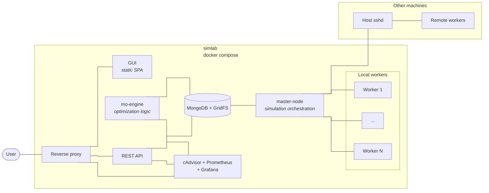
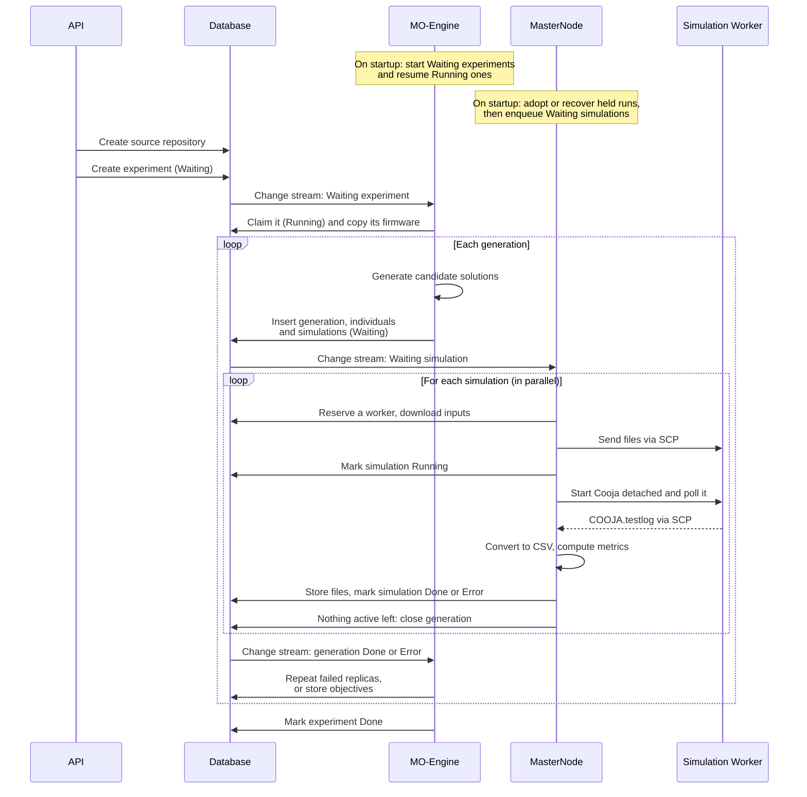

# simlab

🌍 *[**English**](README.md) ∙ [Português](README_pt.md)*

This repository hosts a scalable multi-objective optimization simulation system for sensor networks, built on **Cooja/Contiki-NG**, **Docker** and **MongoDB/GridFS**.
It orchestrates the end-to-end experiment lifecycle: solution generation (mo-engine), parallel simulation in containers (master-node), and traceable result collection/storage, driven by MongoDB **Change Streams**. It is operated through a **web GUI** and a **REST API** (Swagger UI).

---

## System Architecture

SimLab has six main components, plus a reverse proxy and a monitoring stack.

1. **REST API** ([rest-api/](rest-api/README.md))
   - Creates and manages experiments, campaigns, saved problems and source repositories.
   - Reads generations, individuals and simulations, and serves their files from GridFS.
   - Computes quality indicators and serves the infrastructure inventory.

2. **Database (MongoDB + GridFS)**
   - Stores experiments, generations, individuals, simulations and the host/worker inventory.
   - Uses GridFS for files (logs, CSVs, generated Cooja `.csc` and `.dat` inputs, firmware).
   - Provides the Change Streams that trigger the other services, which is why it runs as a replica set.

3. **mo-engine** ([mo-engine/](mo-engine/README.md))
   - Runs the strategies: NSGA-II and NSGA-III (native, DEAP and pymoo selection), random search, batch evaluation and the scalability benchmark.
   - Writes candidate solutions and their simulations to MongoDB.
   - Reacts to finished generations to select, vary and enqueue the next one.

4. **master-node** ([master-node/](master-node/README.md))
   - Observes the **simulations** collection and places each waiting simulation on a worker.
   - Keeps the inventory of hosts and Cooja containers and measures their health. It does not create or destroy containers.
   - Sends inputs via **SCP**, starts Cooja detached via **SSH**, and follows it.
   - Converts the log to metrics and stores the results in MongoDB/GridFS.

5. **Cooja simulation containers**
   - Each container runs one simulation at a time.
   - Builds the Contiki-NG firmware from its sources, runs it, and produces the `COOJA.testlog` that the metrics come from.

6. **GUI** ([gui/simlab/](gui/simlab/README.md))
   - Designs problems, launches and follows experiments, compares results and manages the infrastructure.
   - Talks only to the REST API.

### System Topology



The GUI is served as static files: its API calls are made by the browser, through the proxy.

### SimLab Work Sequence

A simplified view of an experiment that runs in Cooja:



---

## Features

- **Distributed processing:** parallel simulations on one or several machines.
- **Event-driven coordination:** MongoDB Change Streams, with periodic fallbacks for missed events.
- **Automation:** end-to-end execution, from evolution to result collection.
- **Evidence kept with results:** replica completeness, a firmware snapshot per experiment and the host/container of each simulation.
- **Benchmarks without Cooja:** DTLZ2, ZDT1 and SCH1, evaluated by the mo-engine (by the master-node for a batch).
- **Infrastructure measurement:** a Universal Scalability Law benchmark and per-experiment CPU/memory telemetry.

---

## Repository Organization

### Directories and Files

| Path | Content |
| --- | --- |
| [`rest-api/`](rest-api/README.md) | FastAPI REST service |
| [`mo-engine/`](mo-engine/README.md) | Optimization engine: [strategies](mo-engine/lib/strategy/README.md) and [problems](mo-engine/lib/problem/README.md) |
| [`master-node/`](master-node/README.md) | Simulation orchestrator |
| [`pylib/`](pylib/README.md) | Python library shared by the services |
| [`gui/simlab/`](gui/simlab/README.md) | Vue web application |
| [`firmware/`](firmware/README.md) | Contiki-NG applications that run in the motes |
| [`pareto-analysis/`](pareto-analysis/README.md) | Offline Pareto and indicator CLIs, also used by the API |
| [`util/`](util/README.md) | Operator and maintenance scripts |
| [`nginx/`](nginx/README.md) | TLS reverse proxy |
| `monitoring/`, `grafana-provisioning/` | Prometheus configuration and Grafana dashboards |
| [`baseline/`](baseline/README.md) | Script-based orchestrator used for comparison |
| `experiments/` | Standalone studies and dated reports: [NSGA-III benchmark](experiments/external-nsga3-benchmark/README.md), [metrics audit](experiments/nsga-metrics-audit/README.md), [chart performance](experiments/chart-performance/README.md) |
| [`debug/`](debug/README.md) | Development compose files, request examples and fault-validation scripts |
| `docs/` | Guides (below), diagrams and images |
| `docker-compose.yaml`, `Dockerfile.*`, `.env.example` | Build and deployment |

### Documentation

| Guide | Subject | Kind |
| --- | --- | --- |
| [Firmware metrics](docs/markdown/FIRMWARE_METRICS.md) | How every network metric is obtained and what it can support | Reference |
| [Firmware traceability](docs/markdown/FIRMWARE_TRACEABILITY.md) | The per-experiment copy of the firmware | Reference |
| [Runtime metrics](docs/markdown/RUNTIME_METRICS.md) | CPU/memory telemetry per experiment | Reference |
| [Synthetic mode](docs/markdown/SYNTHETIC_MODE.md) | Benchmarks and convergence indicators | Reference |
| [GridFS storage](docs/markdown/GRIDFS_STORAGE.md) | Compression, and the measurements behind it | Reference and dated analysis |
| [Provenance guide](docs/markdown/PROVENANCE_GUIDE.md) | Recording code and images, releasing with a DOI | Plan, not implemented |
| [Campaign v2](docs/markdown/CAMPAIGN_V2.md) | The experiments planned for the thesis and the papers | Plan |
| [Changelog](CHANGELOG.md) | What changed, and why | History |

---

## Installation

### Prerequisites

- Docker with Docker Compose v2 (`docker compose`)
- [Docker Image Cooja (Contiki-NG environment)](https://github.com/JunioCesarFerreira/Cooja-Docker-VM-Setup) (`juniocesarferreira/simulation-cooja:v1.1`)
- Only to run components or scripts outside Docker: Python 3.12+ and Node.js 20.19+ or 22.12+

MongoDB does not need to be installed: the compose file provides it.

### Setup Instructions

Follow these steps to get SimLab up and running locally using Docker.

#### 1. Clone the repository

```bash
git clone https://github.com/JunioCesarFerreira/simlab.git
```

#### 2. Enter the project directory

```bash
cd simlab
```

#### 3. Adjust the deployment settings

Only the nginx reverse proxy publishes ports off the machine (`80` and `443`);
every other service is either internal or bound to `127.0.0.1`. Copy the
example settings and edit them:

```bash
cp .env.example .env
```

| Variable | Default | Purpose |
| --- | --- | --- |
| `SIMLAB_PUBLIC_URL` | `https://localhost` | Base URL users type in. **Must include the port** when HTTPS is not on 443. |
| `SIMLAB_HTTP_PORT` / `SIMLAB_HTTPS_PORT` | `80` / `443` | Host ports for the proxy. Change these if 80/443 are taken. |
| `SIMLAB_TLS_CN` / `SIMLAB_TLS_SAN` / `SIMLAB_TLS_DAYS` | `localhost` / `DNS:localhost,IP:127.0.0.1` / `825` | Name and validity of the self-signed certificate generated on first start. |
| `SIMLAB_API_KEY` | `simlab-api-key42` | API key. It is also built into the GUI, so a change needs `docker compose up -d --build`. |
| `GRAFANA_ADMIN_USER` / `GRAFANA_ADMIN_PASSWORD` | `simlab` / `simlab123` | Grafana login. Change it, and the API key, before exposing SimLab beyond localhost. |
| `SIM_TIMEOUT_SEC` | `10800` | Wall-clock limit of one simulation. |

Every variable has a working default, so the stack also comes up without a
`.env` file. See [nginx/README.md](nginx/README.md) for the full proxy setup,
including how to install a CA-issued certificate.

In `docker-compose.yaml` itself you set the **number of Cooja simulators on
this machine** (8 by default): add or remove `cooja*` services and keep the
master-node's `NUMBER_OF_CONTAINERS` in sync. Each simulation is also given a
4 GB JVM heap (`COOJA_JVM_XMS` / `COOJA_JVM_XMX`), so size both to the
machine.

`NUMBER_OF_CONTAINERS` **seeds** the local host's workers rather than sizing a
pool: every start adds the ones that are missing and never overwrites an
existing one. Capacity comes from an inventory of hosts and workers in the
database, maintained by Docker discovery and the health cycle, and more
machines are added from the **Infrastructure** page without touching the
compose file. See [Distributed Cooja Resources](#distributed-cooja-resources).

#### 4. Launch the full stack with Docker Compose

Run:

```bash
docker compose up --build -d
```

This command will build (if needed) and start all containers in detached mode.

If you want to see logs in real time, you can omit `-d`:

```bash
docker compose up --build
```

#### 5. Verify that all containers are running as expected

Use:

```bash
docker compose ps -a
```

Confirm that:

* **simlab_proxy** is running and publishing `80` and `443`: it is the only way into the stack
* **simlab_gui** and **rest_api** are running (no published port: they are reached through the proxy)
* **mo_engine** and **master_node** are running
* **mongodb**, **prometheus**, **cadvisor**, **grafana** and the `cooja*` containers are running
* **simlab_proxy_certs** has exited with code 0: it only generates the certificate

If any other container is not up, inspect its logs. The argument is the service
name, which is not always the container name (`moengine`, `masternode`,
`restapi`, `proxy`, `gui`):

```bash
docker compose logs <service-name>
```

---

## Usage

### 1. Access SimLab

Everything is served over HTTPS by the nginx reverse proxy; no other container
is reachable from outside the machine. With the default settings:

| Interface | URL |
| --- | --- |
| Web GUI | `https://localhost/` |
| Swagger UI | `https://localhost/docs` |
| REST API | `https://localhost/api/v1/` |
| Grafana | `https://localhost/grafana/` |

The certificate generated on first start is self-signed, so the browser warns
on the first visit: accept it, or install a CA-issued certificate as described
in [nginx/README.md](nginx/README.md).

Every API route needs the `X-API-Key` header (in Swagger, use *Authorize*).
Collection routes end in a slash:

```bash
curl --cacert nginx/certs/simlab.crt \
     -H "X-API-Key: simlab-api-key42" \
     https://localhost/api/v1/experiments/
```

### 2. Register the Firmware

A **source repository** holds the files that are copied into the Cooja
container and built there: `root.c`, `node.c`, their headers and the
`Makefile`. The `.csc` and position files are generated by the mo-engine and
are not uploaded.

Use the **Sources** page, `POST /api/v1/sources/`, or the script that registers
the repositories shipped here (it needs `requests`):

```bash
python firmware/upload-firmware.py rpl-udp-csma-v2 rpl-udp-tsch-v2
```

### 3. Create and Launch an Experiment

From the GUI:

* **Problems**: draw the problem, then use 🚀 to open the five-step launch wizard. Afterwards the experiment can be added to a campaign.
* **Synthetic**: define a DTLZ2, ZDT1 or SCH1 instance and launch it. No Cooja is needed.
* **Scalability**: launch a benchmark of the infrastructure.

Or use `POST /api/v1/experiments/`. An experiment specifies:

* The strategy: `nsga3`, `nsga3_deap`, `nsga3_pymoo`, `nsga2`, `nsga2_deap`, `nsga2_pymoo`, `random_search`, or `batch` with its chromosomes ([strategies](mo-engine/lib/strategy/README.md#batch)). A scalability benchmark is created from the Scalability page or `POST /api/v1/scalability/`
* The problem, and the objectives with their direction and seed aggregator
* The simulation seeds and the simulated duration
* The source repository of each MAC protocol and the data conversion

> **`simulation.duration` is in simulated minutes:** `180` simulates three hours.

Once created, the **mo-engine** and **master-node** detect the experiment through MongoDB Change Streams and begin execution.

### 4. Monitor

* **GUI:** the experiment page updates while it runs. *Topology* shows what each worker is doing.
* **Grafana:** container dashboards at `/grafana/`.
* **Swagger:** `/api/v1/experiments/`, `/api/v1/generations/by-experiment/{id}`, `/api/v1/simulations/by-status/{status}`.
* **MongoDB shell or Compass:** the `simlab` database, on `mongodb://localhost:27017/?directConnection=true`.
* **Docker CLI:**

  ```bash
  docker ps
  docker logs <container-name>
  docker exec -it <container-name> bash
  ```

> **Connecting from the machine that hosts the stack.** The replica set
> advertises `mongodb:27017`, a name that only resolves inside Docker. Scripts
> run on the host need
> `MONGO_URI='mongodb://localhost:27017/?directConnection=true'`.

### 5. Retrieve Results

* From the experiment page: charts, individual details, analysis and topology ZIPs, and the firmware that ran.
* From the API: `GET /api/v1/simulations/{id}/file/{field_name}` (for example `log_cooja_id`, `csv_log_id`) or `GET /api/v1/files/{file_id}/as/{extension}`.
* Offline: [pareto-analysis/](pareto-analysis/README.md).

Read [Firmware metrics](docs/markdown/FIRMWARE_METRICS.md) before quoting a network metric.

---

## Distributed Cooja Resources

Simulations can run on Cooja containers hosted on other machines. The
master-node keeps an inventory of **hosts** (machines) and their **workers**
(Cooja containers), measures each one before giving it work, and places every
simulation according to a [placement policy](master-node/README.md#placement-policies).
A container on another machine is reached through that host's own SSH session,
so no container port has to be published on the network. A single-machine
deployment needs nothing new: its local containers are seeded automatically.

Each simulation records the host and container it ran on, and the experiment
page shows how a run was spread across them (*Work distribution*). The
**Topology** page draws the pool as a graph, live: which hosts the
master-node reaches, which workers are free or running, and which experiment
each one is running. The **Scalability** page measures how the pool and each
physical machine scale.

### Adding a machine

From the GUI, **Infrastructure → Register host**:

1. **Host access**: address, port and SSH user of the machine.
2. **Credential**: a private key (recommended) or a password. It is sealed in
   the browser before it leaves the page, and only the master-node can open it.
3. **Container access**: default user and port of the containers, and how
   each container's address is obtained.
4. **Workers**: *Ask Docker on the host*, or *Configure each one by hand* when
   the SSH user cannot reach the Docker daemon. A hand-configured worker's
   address is the one its sshd answers on **from inside the host**: usually
   `127.0.0.1` with the published port, or the container IP with port 22.

The same can be scripted with [`util/register_host.py`](util/README.md):

```bash
export MONGO_URI='mongodb://localhost:27017/?directConnection=true'
python util/register_host.py add lab-01 \
    --address 192.168.0.42 --user simlab --key ~/.ssh/simlab_lab01
python util/register_host.py list
```

> **Back up the `infra_keys` volume.** It holds the master-node's private key.
> Losing it makes every stored credential unreadable, and every host has to be
> registered again.

### Configuration

The master-node variables most often changed. The "compose" column is what
`docker-compose.yaml` sets; the full list is in
[master-node/README.md](master-node/README.md#configuration-environment-variables).

| Variable | Code default | Compose | Role |
|---|---|---|---|
| `SCHED_POLICY` | `least_loaded_host` | `earliest_completion` | Placement policy: `least_loaded_host`, `fastest_then_least_loaded` or `earliest_completion` |
| `NUMBER_OF_CONTAINERS` | `8` | `8` | Local workers to seed |
| `SIM_TIMEOUT_SEC` | `10800` | from `.env` | Wall-clock limit of one simulation |
| `COOJA_JVM_XMS` / `COOJA_JVM_XMX` | `1g` / `2g` | `4g` / `4g` | JVM heap of each simulation |
| `INFRA_CHECK_INTERVAL_SEC` | `30` | not set | Interval of the health cycle that measures hosts and workers |
| `INFRA_FAILURE_THRESHOLD` | `3` | not set | Consecutive failures before a host is marked `offline` |
| `RESERVATION_TTL_SEC` | `600` | not set | After this, a reservation nobody renews is reclaimed |
| `RUN_POLL_INTERVAL_SEC` | `5` | not set | How often a running simulation is followed |
| `INFRA_KEY_PATH` | `/run/secrets/simlab-infra/x25519.json` | same | The private key, inside the `infra_keys` volume |

A variable in `.env` reaches a service only if that service's `environment:`
block passes it through.

### Behaviour changes worth knowing

These alter results compared with earlier versions, and are listed in
[`CHANGELOG.md`](CHANGELOG.md):

- **An incomplete evaluation is not used as a complete one.** A failed
  replica is run again once with its own seed; if it is still missing, the
  individual gets the worst objective. Set `incomplete_objective: accept` in
  the experiment's simulation configuration for the previous behaviour, with
  the completeness recorded next to the objective.
- **A non-finite metric is treated as missing**, and a front with no valid
  solution is reported as such (`pareto_front_validity`).
- **With a single firmware, the MAC gene is pinned** to the protocol that runs.
- **A generation's status counts seeds, not simulation documents**, so one
  whose failed replica was repeated closes `Done`. Generations created before
  the replica plan was recorded keep the previous rule.
- **Timestamps are timezone-aware UTC.** Stored values without a timezone are
  read as UTC; no data was migrated.
- **The default data conversion reads firmware v2.** Running v1 needs the
  changes in [Firmware metrics §9](docs/markdown/FIRMWARE_METRICS.md#9-using-results-across-versions).
- **Each mobile mote repeats its own path for the whole simulation**, and a
  closed path returns to its start, in the simulation and in the coverage of P1
  and P2. Runs from before are not comparable on mobility.
- **P3 penalises an infeasible individual** instead of simulating it, and
  repairs the degree `g`; **P4 runs**, with its data constraints enforced
  ([problems](mo-engine/lib/problem/README.md)).
- **A run in which no report reached the root is a result** (`Done`, counts
  at 0), no longer a collection failure.

### Limitations

- **One master-node.** There is no leader election and no atomic claim of a
  simulation itself; reservations are atomic per container, which is not the
  same guarantee.
- **The API key is in the GUI bundle.** Anyone who loads the application can
  read it, and `docker-compose.yaml` falls back to a known default when
  `SIMLAB_API_KEY` is unset. HTTPS and credential sealing do not replace user
  authentication.
- **Container SSH uses the image's default login** unless a credential is
  stored, and container host keys are not pinned. Only the host's key is.
- **Runtime telemetry covers local containers only.** cAdvisor scrapes this
  machine, so CPU and memory of remote hosts are not measured.
- **No end-to-end *exactly once*.** What is guaranteed is that one container
  runs one attempt at a time and that a stale attempt cannot publish. A crash
  between storing a result's files and recording them leaves GridFS blobs that
  nothing references, and nothing collects them.
- **A result that could not be collected is recovered by hand.** If the bytes
  could be copied aside on the container, the worker returns to the pool; if
  not, it is held. [`util/recover_result.py`](util/README.md) handles both.
- **Duplicate registrations are detected by address, not by machine.** One
  container registered twice under the same address is refused; the same
  machine reached through a DNS alias, a tunnel or a different published port
  is not recognised as the same.
- **Cancelling an experiment takes effect at the next generation boundary.**
  Simulations already queued still run.

### Next steps

- **Telemetry on remote hosts** (for instance a node-exporter on each machine),
  to explain why remote workers slow down when a host runs more than one
  container, before tuning the placement policies any further.
- **Compare the placement policies** with that telemetry, with repeated runs
  per configuration and against a local-only baseline.
- **Automatic recovery of preserved results** and a **sweep of unreferenced
  GridFS blobs**, both currently manual.
- **More than one master-node**, which needs an atomic claim of the simulation
  and not only of the container.

---

## Known Issues

Defects in the current code that affect what can be run or how a result is
read, each described in its module's README. None are known at present; the
architectural limits are under [Limitations](#limitations).

---

## Future Enhancements

- Extended examples of experiment submission and monitoring
- Benchmark dataset publication and performance validation
- Code and image provenance per experiment, and citable releases ([guide](docs/markdown/PROVENANCE_GUIDE.md))

---

## Releases

`main` is ahead of the last release. See the *Unreleased* sections of the [changelog](CHANGELOG.md).

* [`v1.1.0`](https://github.com/JunioCesarFerreira/simlab/releases/tag/v1.1.0) (*2026-02-13*):
  Introduces the first consolidated layer of **problem adapters and abstraction interfaces** for multiple Wireless Sensor Network (WSN) optimization formulations. At this stage, problems **P1, P2, and P3** are fully integrated into the experimental pipeline and can be instantiated, evaluated, and benchmarked through the **NSGA-III optimization loop**. This release enables the generation of the first reproducible and analytically viable multi-objective results within the SimLab environment.

* [`v1.0.0`](https://github.com/JunioCesarFerreira/simlab/releases/tag/v1.0.0) (*2025-10-12*):
  Initial stable release establishing the **foundational execution workflow** of the platform, including the integration between the **MO-Engine**, **Master-Node orchestration layer**, and **MongoDB persistence infrastructure**. This version marks the architectural baseline of SimLab, consolidating the core services required for distributed simulation management and optimization experiment lifecycle control.

---

## License

This project is licensed under the [MIT License](./LICENSE).

---

## Contributing

Contributions are welcome!
SimLab is an open research and development project designed to support distributed multi-objective simulation workflows.
If you want to contribute with code, documentation, bug reports, or experiments, please read the following guidelines.

The modules are listed in [Repository Organization](#repository-organization). Please keep changes consistent with that modular architecture.

### How to contribute

1. **Fork** the repository on GitHub

2. **Create a branch** for your feature or fix

   ```bash
   git checkout -b feature/my-new-feature
   ```

3. **Implement your changes**
   * Follow the existing code style and structure
   * Add comments or docstrings where relevant
   * For new modules, include minimal working examples or usage notes

4. **Test locally** (see [Testing and debugging](#testing-and-debugging))

5. **Commit using clear messages**

   ```bash
   git commit -m "Add feature: synthetic benchmark support in master-node"
   ```

6. **Push your branch** and open a Pull Request (PR)
   * Describe the purpose of your changes
   * Include relevant logs, screenshots, or results if applicable
   * If fixing an issue, reference it (e.g., “Fixes #42”)

### Code quality and style

* **Python:** follow the conventions of the surrounding module
* **TypeScript/Vue:** `npm run lint` and `npm run type-check` must pass
* **C (firmware):** prefer clarity, small functions, and no external dependencies; follow the [firmware rules](firmware/README.md#rules-for-changes)
* **Docker:** build images reproducibly; keep images small and self-contained
* Use consistent **logging** (as already done with `logging` in master-node)
* Always handle exceptions gracefully and mark MongoDB simulation states properly

### Testing and debugging

The CI ([ci.yml](.github/workflows/ci.yml)) runs each suite from its own
directory, with the dependencies of that module. The unit suites need neither
MongoDB nor Cooja:

```bash
(cd mo-engine       && pytest -q)   # also needs moocore==0.3.1
(cd pylib           && pytest -q)   # pylib/requirements-test.txt
(cd master-node     && pytest -q)
(cd rest-api        && pytest -q)   # rest-api/requirements-test.txt
(cd pareto-analysis && pytest -q)
(cd gui/simlab      && npm ci && npm run type-check && npm run lint && npm test && npm run build)
```

* For local runs, use one of the setups under [`debug/docker/`](debug/docker/README.md):

  ```bash
  cd debug/docker/minimal-infra
  docker compose up --build
  ```

* To validate the pipeline without Cooja, launch an experiment from the GUI's
  *Synthetic Instances* page. The mo-engine evaluates it in-process. The
  master-node also has a [synthetic fallback](docs/markdown/SYNTHETIC_MODE.md#global-fallback-environment-variables),
  which has to be set in the service's `environment:` block.

### Pull request checklist

Before submitting a PR:

- [ ] The affected test suites pass
- [ ] No breaking changes introduced to API or DTOs
- [ ] All modified files follow the style conventions
- [ ] Documentation updated (module README, and both main READMEs if affected)
- [ ] Changelog entry added if relevant (`CHANGELOG.md`)
- [ ] Commit messages are clear and descriptive

### Reporting issues

If you find a bug or inconsistency:

1. Check if the issue already exists in the [Issues](https://github.com/JunioCesarFerreira/simlab/issues) tab.
2. If not, open a new issue and include:

   * Steps to reproduce
   * Expected vs. actual behavior
   * Relevant logs or stack traces
   * Environment details (OS, Docker version, etc.)

---

## Citing or referencing SimLab

> If you use SimLab in academic work, please cite the corresponding publication once available.
> Until then, you may reference the project as follows (metadata in [CITATION.cff](CITATION.cff)):
>
> Junio Cesar Ferreira.
> SimLab: A Distributed Framework for Large-Scale Multi-Objective WSN Simulation and Optimization.
> Institute of Mathematical and Computer Sciences (ICMC), University of São Paulo (USP).
> GitHub: https://github.com/JunioCesarFerreira/simlab
