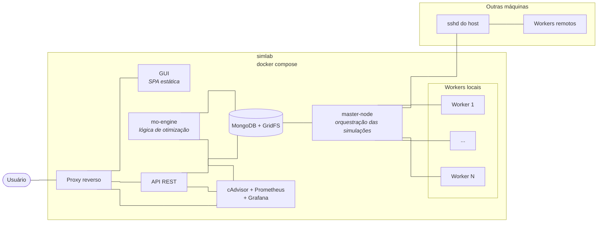
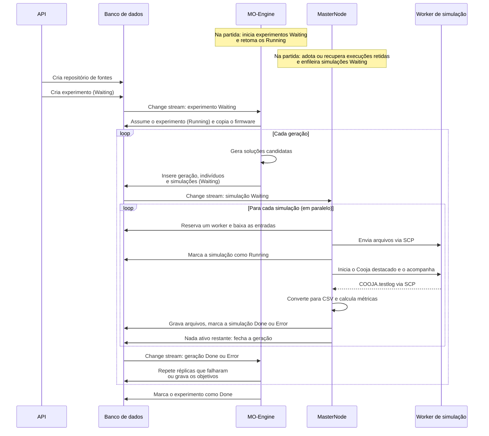

# simlab

🌍 *[English](README.md) ∙ [**Português**](README_pt.md)*

Este repositório hospeda um sistema escalável de simulação e otimização multiobjetivo para redes de sensores, desenvolvido sobre **Cooja/Contiki-NG**, **Docker** e **MongoDB/GridFS**.
Ele orquestra, de ponta a ponta, o ciclo de experimentos: geração de soluções (mo-engine), execução paralela de simulações em containers (master-node) e coleta/armazenamento rastreável de resultados, dirigidos por **Change Streams** do MongoDB. A operação é feita por uma **interface web (GUI)** e por uma **API REST** (Swagger UI).

> A documentação dos módulos e os guias em `docs/markdown/` estão em inglês.

---

## Arquitetura do Sistema

O SimLab tem seis componentes principais, além de um proxy reverso e de uma pilha de monitoramento.

1. **API REST** ([rest-api/](rest-api/README.md))
   - Cria e gerencia experimentos, campanhas, problemas salvos e repositórios de fontes.
   - Lê gerações, indivíduos e simulações, e entrega seus arquivos do GridFS.
   - Calcula indicadores de qualidade e expõe o inventário de infraestrutura.

2. **Banco de dados (MongoDB + GridFS)**
   - Armazena experimentos, gerações, indivíduos, simulações e o inventário de hosts e workers.
   - Usa o GridFS para arquivos (logs, CSVs, entradas `.csc` e `.dat` geradas para o Cooja, firmware).
   - Fornece os Change Streams que acionam os demais serviços, motivo pelo qual roda como replica set.

3. **mo-engine** ([mo-engine/](mo-engine/README.md))
   - Executa as estratégias: NSGA-II e NSGA-III (seleção nativa, DEAP e pymoo), busca aleatória, avaliação em lote e o benchmark de escalabilidade.
   - Grava soluções candidatas e suas simulações no MongoDB.
   - Reage às gerações concluídas para selecionar, variar e enfileirar a seguinte.

4. **master-node** ([master-node/](master-node/README.md))
   - Observa a coleção de **simulações** e aloca cada simulação pendente em um worker.
   - Mantém o inventário de hosts e containers Cooja e mede sua saúde. Não cria nem destrói containers.
   - Envia as entradas via **SCP**, inicia o Cooja destacado via **SSH** e o acompanha.
   - Converte o log em métricas e grava os resultados no MongoDB/GridFS.

5. **Containers de simulação Cooja**
   - Cada container executa uma simulação por vez.
   - Compila o firmware Contiki-NG a partir das fontes, executa-o e produz o `COOJA.testlog` de onde vêm as métricas.

6. **GUI** ([gui/simlab/](gui/simlab/README.md))
   - Desenha problemas, lança e acompanha experimentos, compara resultados e gerencia a infraestrutura.
   - Comunica-se apenas com a API REST.

### Topologia do Sistema



A GUI é servida como arquivos estáticos: suas chamadas à API partem do navegador, através do proxy.

### Sequência de Trabalho do SimLab

Visão simplificada de um experimento executado no Cooja:



---

## Funcionalidades

- **Processamento distribuído:** simulações paralelas em uma ou várias máquinas.
- **Coordenação orientada a eventos:** Change Streams do MongoDB, com verificações periódicas para eventos perdidos.
- **Automação:** execução de ponta a ponta, da evolução à coleta dos resultados.
- **Evidência junto do resultado:** completude das réplicas, cópia do firmware por experimento e host/container de cada simulação.
- **Benchmarks sem Cooja:** DTLZ2, ZDT1 e SCH1, avaliados no próprio processo.
- **Medição da infraestrutura:** benchmark pela Lei Universal de Escalabilidade e telemetria de CPU/memória por experimento.

---

## Organização do Repositório

### Diretórios e Arquivos

| Caminho | Conteúdo |
| --- | --- |
| [`rest-api/`](rest-api/README.md) | Serviço REST em FastAPI |
| [`mo-engine/`](mo-engine/README.md) | Motor de otimização: [estratégias](mo-engine/lib/strategy/README.md) e [problemas](mo-engine/lib/problem/README.md) |
| [`master-node/`](master-node/README.md) | Orquestrador de simulações |
| [`pylib/`](pylib/README.md) | Biblioteca Python compartilhada pelos serviços |
| [`gui/simlab/`](gui/simlab/README.md) | Aplicação web em Vue |
| [`firmware/`](firmware/README.md) | Aplicações Contiki-NG executadas nos motes |
| [`pareto-analysis/`](pareto-analysis/README.md) | CLIs de Pareto e indicadores, também usadas pela API |
| [`util/`](util/README.md) | Scripts de operação e manutenção |
| [`nginx/`](nginx/README.md) | Proxy reverso com TLS |
| `monitoring/`, `grafana-provisioning/` | Configuração do Prometheus e dashboards do Grafana |
| [`baseline/`](baseline/README.md) | Orquestrador por scripts usado para comparação |
| `experiments/` | Estudos independentes e relatórios datados: [benchmark NSGA-III](experiments/external-nsga3-benchmark/README.md), [auditoria de métricas](experiments/nsga-metrics-audit/README.md), [desempenho dos gráficos](experiments/chart-performance/README.md) |
| [`debug/`](debug/README.md) | Composes de desenvolvimento, exemplos de requisição e scripts de validação de falhas |
| `docs/` | Guias (abaixo), diagramas e imagens |
| `docker-compose.yaml`, `Dockerfile.*`, `.env.example` | Build e implantação |

### Documentação

| Guia | Assunto | Tipo |
| --- | --- | --- |
| [Métricas do firmware](docs/markdown/FIRMWARE_METRICS.md) | Como cada métrica de rede é obtida e o que ela sustenta | Referência |
| [Rastreabilidade de firmware](docs/markdown/FIRMWARE_TRACEABILITY.md) | A cópia do firmware por experimento | Referência |
| [Métricas de execução](docs/markdown/RUNTIME_METRICS.md) | Telemetria de CPU/memória por experimento | Referência |
| [Modo sintético](docs/markdown/SYNTHETIC_MODE.md) | Benchmarks e indicadores de convergência | Referência |
| [Armazenamento no GridFS](docs/markdown/GRIDFS_STORAGE.md) | Compressão e as medições que a motivaram | Referência e análise datada |
| [Guia de proveniência](docs/markdown/PROVENANCE_GUIDE.md) | Registro de código e imagens, releases com DOI | Plano, não implementado |
| [Campanha v2](docs/markdown/CAMPAIGN_V2.md) | Os experimentos planejados para a tese e os artigos | Plano |
| [Changelog](CHANGELOG.md) | O que mudou e por quê | Histórico |

---

## Instalação

### Pré-requisitos

- Docker com Docker Compose v2 (`docker compose`)
- [Imagem Docker do Cooja (ambiente Contiki-NG)](https://github.com/JunioCesarFerreira/Cooja-Docker-VM-Setup) (`juniocesarferreira/simulation-cooja:v1.1`)
- Apenas para rodar componentes ou scripts fora do Docker: Python 3.12+ e Node.js 20.19+ ou 22.12+

Não é preciso instalar o MongoDB: o compose já o fornece.

### Instruções de Configuração

Siga os passos abaixo para executar o SimLab localmente usando o Docker.

#### 1. Clonar o repositório

```bash
git clone https://github.com/JunioCesarFerreira/simlab.git
```

#### 2. Entrar no diretório do projeto

```bash
cd simlab
```

#### 3. Ajustar as configurações do ambiente

Apenas o proxy reverso nginx publica portas para fora da máquina (`80` e
`443`); todos os demais serviços são internos ou estão presos a `127.0.0.1`.
Copie o arquivo de exemplo e edite:

```bash
cp .env.example .env
```

| Variável | Padrão | Finalidade |
| --- | --- | --- |
| `SIMLAB_PUBLIC_URL` | `https://localhost` | URL base que os usuários digitam. **Precisa incluir a porta** quando o HTTPS não estiver na 443. |
| `SIMLAB_HTTP_PORT` / `SIMLAB_HTTPS_PORT` | `80` / `443` | Portas do host usadas pelo proxy. Altere se 80/443 já estiverem ocupadas. |
| `SIMLAB_TLS_CN` / `SIMLAB_TLS_SAN` / `SIMLAB_TLS_DAYS` | `localhost` / `DNS:localhost,IP:127.0.0.1` / `825` | Nome e validade do certificado autoassinado gerado na primeira execução. |
| `SIMLAB_API_KEY` | `simlab-api-key42` | Chave da API. Também é embutida na GUI, então alterá-la exige `docker compose up -d --build`. |
| `GRAFANA_ADMIN_USER` / `GRAFANA_ADMIN_PASSWORD` | `simlab` / `simlab123` | Login do Grafana. Troque-o, assim como a chave da API, antes de expor o SimLab fora do localhost. |
| `SIM_TIMEOUT_SEC` | `10800` | Limite de tempo de relógio de uma simulação. |

Todas as variáveis têm um valor padrão funcional, então a pilha também sobe sem
o arquivo `.env`. Veja [nginx/README.md](nginx/README.md) para a configuração
completa do proxy, incluindo como instalar um certificado emitido por uma CA.

No próprio `docker-compose.yaml` define-se o **número de simuladores Cooja
desta máquina** (8 por padrão): adicione ou remova serviços `cooja*` e mantenha
a variável `NUMBER_OF_CONTAINERS` do master-node sincronizada. Cada simulação
também recebe um heap de JVM de 4 GB (`COOJA_JVM_XMS` / `COOJA_JVM_XMX`),
então dimensione ambos para a máquina.

`NUMBER_OF_CONTAINERS` **semeia** os workers do host local em vez de
dimensionar um pool: cada partida acrescenta os que faltam e nunca sobrescreve
um existente. A capacidade vem de um inventário de hosts e workers no banco,
mantido pela descoberta Docker e pelo ciclo de saúde, e outras máquinas são
acrescentadas pela página **Infrastructure** sem tocar no compose. Veja
[Recursos Cooja Distribuídos](#recursos-cooja-distribuídos).

#### 4. Inicializar a pilha completa com Docker Compose

Execute:

```bash
docker compose up --build -d
```

Esse comando compilará (se necessário) e iniciará todos os containers em modo *detached*.

Para ver os logs em tempo real, omita o parâmetro `-d`:

```bash
docker compose up --build
```

#### 5. Verificar se todos os containers estão em execução

Use:

```bash
docker compose ps -a
```

Verifique que:

* **simlab_proxy** está ativo publicando `80` e `443`: é a única entrada da pilha
* **simlab_gui** e **rest_api** estão ativos (sem porta publicada: o acesso é via proxy)
* **mo_engine** e **master_node** estão ativos
* **mongodb**, **prometheus**, **cadvisor**, **grafana** e os containers `cooja*` estão ativos
* **simlab_proxy_certs** terminou com código 0: ele apenas gera o certificado

Se algum outro container não subir, inspecione os logs. O argumento é o nome do
serviço, que nem sempre é o do container (`moengine`, `masternode`, `restapi`,
`proxy`, `gui`):

```bash
docker compose logs <service-name>
```

---

## Uso

### 1. Acessar o SimLab

Tudo é servido sobre HTTPS pelo proxy reverso nginx; nenhum outro container é
alcançável de fora da máquina. Com as configurações padrão:

| Interface | URL |
| --- | --- |
| GUI Web | `https://localhost/` |
| Swagger UI | `https://localhost/docs` |
| API REST | `https://localhost/api/v1/` |
| Grafana | `https://localhost/grafana/` |

O certificado gerado na primeira execução é autoassinado, então o navegador
exibe um aviso no primeiro acesso: aceite-o, ou instale um certificado emitido
por uma CA conforme descrito em [nginx/README.md](nginx/README.md).

Toda rota da API exige o cabeçalho `X-API-Key` (no Swagger, use *Authorize*).
As rotas de coleção terminam em barra:

```bash
curl --cacert nginx/certs/simlab.crt \
     -H "X-API-Key: simlab-api-key42" \
     https://localhost/api/v1/experiments/
```

### 2. Registrar o Firmware

Um **repositório de fontes** guarda os arquivos que são copiados para o
container Cooja e compilados lá: `root.c`, `node.c`, seus cabeçalhos e o
`Makefile`. Os arquivos `.csc` e de posições são gerados pelo mo-engine e não
são enviados.

Use a página **Sources**, `POST /api/v1/sources/`, ou o script que registra os
repositórios deste projeto (requer `requests`):

```bash
python firmware/upload-firmware.py rpl-udp-csma-v2 rpl-udp-tsch-v2
```

### 3. Criar e Iniciar um Experimento

Pela GUI:

* **Problems**: desenhe o problema e use 🚀 para abrir o assistente de lançamento em cinco passos. Ao final, o experimento pode ser incluído em uma campanha.
* **Synthetic**: defina uma instância DTLZ2, ZDT1 ou SCH1 e lance-a. Não requer Cooja.
* **Scalability**: lance um benchmark da infraestrutura.

Ou use `POST /api/v1/experiments/`. Um experimento especifica:

* A estratégia: `nsga3`, `nsga3_deap`, `nsga3_pymoo`, `nsga2`, `nsga2_deap`, `nsga2_pymoo` ou `random_search`
* O problema, e os objetivos com sentido e agregador entre sementes
* As sementes e a duração simulada
* O repositório de fontes de cada protocolo MAC e a conversão de dados

> **`simulation.duration` está em minutos simulados.** O assistente, a página
> de comparação e o formulário de benchmark rotulam o campo como segundos, mas
> o valor é usado como minutos: `180` simula três horas.

Após criado, o **mo-engine** e o **master-node** detectam o experimento via Change Streams do MongoDB e iniciam a execução.

### 4. Monitorar

* **GUI:** a página do experimento se atualiza durante a execução. *Topology* mostra o que cada worker está fazendo.
* **Grafana:** dashboards dos containers em `/grafana/`.
* **Swagger:** `/api/v1/experiments/`, `/api/v1/generations/by-experiment/{id}`, `/api/v1/simulations/by-status/{status}`.
* **MongoDB (shell ou Compass):** banco `simlab`, em `mongodb://localhost:27017/?directConnection=true`.
* **Docker CLI:**

  ```bash
  docker ps
  docker logs <container-name>
  docker exec -it <container-name> bash
  ```

> **Conexão a partir da máquina que hospeda a pilha.** O replica set anuncia
> `mongodb:27017`, nome que só resolve dentro do Docker. Scripts executados no
> host precisam de
> `MONGO_URI='mongodb://localhost:27017/?directConnection=true'`.

### 5. Obter os Resultados

* Pela página do experimento: gráficos, detalhes dos indivíduos, ZIPs de análises e topologias, e o firmware executado.
* Pela API: `GET /api/v1/simulations/{id}/file/{field_name}` (por exemplo `log_cooja_id`, `csv_log_id`) ou `GET /api/v1/files/{file_id}/as/{extension}`.
* Fora da plataforma: [pareto-analysis/](pareto-analysis/README.md).

Leia [Métricas do firmware](docs/markdown/FIRMWARE_METRICS.md) antes de citar uma métrica de rede.

---

## Recursos Cooja Distribuídos

As simulações podem rodar em containers Cooja hospedados em outras máquinas. O
master-node mantém um inventário de **hosts** (máquinas) e seus **workers**
(containers Cooja), mede cada um antes de lhe dar trabalho e aloca cada
simulação segundo uma [política de alocação](master-node/README.md#placement-policies).
Um container em outra máquina é alcançado pela própria sessão SSH daquele host,
então nenhuma porta de container precisa ser publicada na rede. Uma implantação
de máquina única não precisa de nada novo: os containers locais são semeados
automaticamente.

Cada simulação registra o host e o container em que rodou, e a página do
experimento mostra como a execução se distribuiu entre eles (*Work
distribution*). A página **Topology** desenha o pool como um grafo, ao vivo:
quais hosts o master-node alcança, quais workers estão livres ou ocupados e
qual experimento cada um executa. A página **Scalability** mede como o pool e
cada máquina física escalam.

### Adicionando uma máquina

Pela GUI, **Infrastructure → Register host**:

1. **Host access**: endereço, porta e usuário SSH da máquina.
2. **Credential**: chave privada (recomendado) ou senha. É selada no navegador
   antes de sair da página, e só o master-node consegue abri-la.
3. **Container access**: usuário e porta padrão dos containers, e como o
   endereço de cada container é obtido.
4. **Workers**: *Ask Docker on the host*, ou *Configure each one by hand*
   quando o usuário SSH não acessa o daemon Docker. O endereço de um worker
   configurado à mão é aquele em que seu sshd responde **de dentro do host**:
   em geral `127.0.0.1` com a porta publicada, ou o IP do container com a
   porta 22.

O mesmo pode ser feito por script com [`util/register_host.py`](util/README.md):

```bash
export MONGO_URI='mongodb://localhost:27017/?directConnection=true'
python util/register_host.py add lab-01 \
    --address 192.168.0.42 --user simlab --key ~/.ssh/simlab_lab01
python util/register_host.py list
```

> **Faça backup do volume `infra_keys`.** Ele guarda a chave privada do
> master-node. Perdê-lo torna ilegíveis todas as credenciais armazenadas, e
> todos os hosts precisam ser registrados de novo.

### Configuração

As variáveis do master-node mais alteradas. A coluna "compose" é o que o
`docker-compose.yaml` define; a lista completa está em
[master-node/README.md](master-node/README.md#configuration-environment-variables).

| Variável | Padrão no código | Compose | Papel |
|---|---|---|---|
| `SCHED_POLICY` | `least_loaded_host` | `earliest_completion` | Política de alocação: `least_loaded_host`, `fastest_then_least_loaded` ou `earliest_completion` |
| `NUMBER_OF_CONTAINERS` | `8` | `8` | Workers locais a semear |
| `SIM_TIMEOUT_SEC` | `10800` | do `.env` | Limite de tempo de relógio de uma simulação |
| `COOJA_JVM_XMS` / `COOJA_JVM_XMX` | `1g` / `2g` | `4g` / `4g` | Heap da JVM de cada simulação |
| `INFRA_CHECK_INTERVAL_SEC` | `30` | não definida | Intervalo do ciclo de saúde que mede hosts e workers |
| `INFRA_FAILURE_THRESHOLD` | `3` | não definida | Falhas consecutivas até um host ser marcado `offline` |
| `RESERVATION_TTL_SEC` | `600` | não definida | Depois disso, uma reserva que ninguém renova é retomada |
| `RUN_POLL_INTERVAL_SEC` | `5` | não definida | Frequência de acompanhamento de uma simulação em execução |
| `INFRA_KEY_PATH` | `/run/secrets/simlab-infra/x25519.json` | igual | A chave privada, dentro do volume `infra_keys` |

Uma variável do `.env` só chega a um serviço se o bloco `environment:` desse
serviço a repassar.

### Mudanças de comportamento importantes

Alteram resultados em relação a versões anteriores e estão listadas no
[`CHANGELOG.md`](CHANGELOG.md):

- **Uma avaliação incompleta não é usada como completa.** Uma réplica que
  falhou é repetida uma vez com a própria semente; se continuar faltando, o
  indivíduo recebe o pior objetivo. Use `incomplete_objective: accept` na
  configuração de simulação do experimento para o comportamento anterior, com
  a completude registrada ao lado do objetivo.
- **Uma métrica não finita é tratada como ausente**, e uma frente sem solução
  válida é reportada como tal (`pareto_front_validity`).
- **Com um único firmware, o gene MAC é fixado** no protocolo que roda.
- **O status de uma geração conta sementes, não documentos de simulação**,
  então uma geração cuja réplica falha foi repetida fecha como `Done`. Gerações
  criadas antes do registro do plano de réplicas mantêm a regra anterior.
- **Os timestamps são UTC com fuso.** Valores armazenados sem fuso são lidos
  como UTC; nenhum dado foi migrado.
- **A conversão de dados padrão lê o firmware v2.** Rodar o v1 exige os ajustes
  de [Métricas do firmware §9](docs/markdown/FIRMWARE_METRICS.md#9-using-results-across-versions).

### Limitações

- **Um único master-node.** Não há eleição de líder nem posse atômica da
  simulação em si; as reservas são atômicas por container, o que não é a mesma
  garantia.
- **A chave da API está no bundle da GUI.** Quem carrega a aplicação consegue
  lê-la, e o `docker-compose.yaml` usa um padrão conhecido quando
  `SIMLAB_API_KEY` não está definida. HTTPS e selagem de credenciais não
  substituem autenticação de usuários.
- **O SSH dos containers usa o login padrão da imagem**, salvo se houver uma
  credencial armazenada, e a chave de host dos containers não é fixada. Só a
  do host é.
- **A telemetria de execução cobre apenas containers locais.** O cAdvisor mede
  esta máquina, então CPU e memória de hosts remotos não são medidas.
- **Não há *exactly once* de ponta a ponta.** O garantido é que um container
  executa uma tentativa por vez e que uma tentativa obsoleta não publica. Uma
  queda entre gravar os arquivos de um resultado e registrá-los deixa blobs no
  GridFS sem referência, e nada os recolhe.
- **Um resultado que não pôde ser coletado é recuperado manualmente.** Se os
  bytes puderam ser copiados à parte no container, o worker volta ao pool;
  senão, fica retido. O [`util/recover_result.py`](util/README.md) trata os
  dois casos.
- **Registros duplicados são detectados por endereço, não por máquina.** Um
  container registrado duas vezes com o mesmo endereço é recusado; a mesma
  máquina alcançada por um alias de DNS, um túnel ou outra porta publicada não
  é reconhecida como a mesma.
- **Cancelar um experimento só tem efeito na próxima fronteira de geração.**
  Simulações já enfileiradas ainda rodam.

### Próximos passos

- **Telemetria nos hosts remotos** (por exemplo, um node-exporter em cada
  máquina), para explicar por que workers remotos desaceleram quando o host
  roda mais de um container, antes de ajustar mais as políticas de alocação.
- **Comparar as políticas de alocação** com essa telemetria, com execuções
  repetidas por configuração e contra uma referência somente local.
- **Recuperação automática de resultados preservados** e **varredura de blobs
  sem referência no GridFS**, hoje manuais.
- **Mais de um master-node**, o que requer posse atômica da simulação e não
  apenas do container.

---

## Problemas Conhecidos

Defeitos do código atual que afetam o que pode ser executado ou como um
resultado deve ser lido. Cada um está descrito no documento indicado.

| Área | Problema | Detalhes |
| --- | --- | --- |
| Indicadores | As CLIs medem descendentes; a GUI mede sobreviventes por padrão | [pareto-analysis](pareto-analysis/README.md#known-issues) |

---

## Melhorias Futuras

- Exemplos ampliados de submissão e monitoramento de experimentos
- Publicação de *benchmarks* e validação de desempenho
- Proveniência de código e imagens por experimento, e releases citáveis ([guia](docs/markdown/PROVENANCE_GUIDE.md))

---

## Releases

A `main` está à frente da última release. Veja as seções *Unreleased* do [changelog](CHANGELOG.md).

* [`v1.1.0`](https://github.com/JunioCesarFerreira/simlab/releases/tag/v1.1.0) (*2026-02-13*):
  Introduz a primeira camada consolidada de **adaptadores de problema e interfaces de abstração** para múltiplas formulações de otimização de Redes de Sensores Sem Fio (RSSF). Neste estágio, os problemas **P1, P2 e P3** estão integrados ao pipeline experimental e podem ser instanciados, avaliados e comparados pelo **laço de otimização NSGA-III**. Esta release viabiliza os primeiros resultados multiobjetivo reprodutíveis e analiticamente viáveis no ambiente SimLab.

* [`v1.0.0`](https://github.com/JunioCesarFerreira/simlab/releases/tag/v1.0.0) (*2025-10-12*):
  Primeira release estável, que estabelece o **fluxo fundamental de execução** da plataforma, incluindo a integração entre o **MO-Engine**, a **camada de orquestração Master-Node** e a **persistência em MongoDB**. Esta versão marca a linha de base arquitetural do SimLab, consolidando os serviços essenciais para gerenciar simulações distribuídas e controlar o ciclo de vida dos experimentos.

---

## Licença

Este projeto é licenciado sob a [Licença MIT](./LICENSE).

---

## Contribuindo

Contribuições são bem-vindas!
O SimLab é um projeto aberto de pesquisa e desenvolvimento voltado ao suporte de fluxos distribuídos de simulação multiobjetivo.
Se desejar contribuir com código, documentação, relatórios de bugs ou experimentos, siga as orientações abaixo.

Os módulos estão listados em [Organização do Repositório](#organização-do-repositório). Mantenha as alterações consistentes com essa arquitetura modular.

### Como Contribuir

1. **Faça um fork** do repositório no GitHub

2. **Crie uma branch** para sua contribuição

   ```bash
   git checkout -b feature/nova-funcionalidade
   ```

3. **Implemente suas modificações**
   * Siga o estilo e a estrutura existentes
   * Adicione comentários e docstrings quando apropriado
   * Para novos módulos, inclua exemplos mínimos ou notas de uso

4. **Teste localmente** (veja [Testes e Depuração](#testes-e-depuração))

5. **Comite com mensagens claras**

   ```bash
   git commit -m "Adiciona suporte a benchmark sintético no master-node"
   ```

6. **Envie sua branch** e abra um Pull Request (PR)
   * Descreva o propósito da mudança
   * Inclua logs, capturas de tela ou resultados, se aplicável
   * Caso resolva um problema existente, referencie-o (ex.: “Fixes #42”)

### Qualidade e Estilo de Código

* **Python:** siga as convenções do módulo em questão
* **TypeScript/Vue:** `npm run lint` e `npm run type-check` devem passar
* **C (firmware):** priorize clareza, funções curtas e nenhuma dependência externa; siga as [regras do firmware](firmware/README.md#rules-for-changes)
* **Docker:** mantenha imagens pequenas, autocontidas e reprodutíveis
* Use **logging** consistente (como no master-node)
* Trate exceções adequadamente e atualize corretamente os estados no MongoDB

### Testes e Depuração

A CI ([ci.yml](.github/workflows/ci.yml)) roda cada suíte a partir do seu
diretório, com as dependências daquele módulo. As suítes unitárias não precisam
de MongoDB nem de Cooja:

```bash
(cd mo-engine       && pytest -q)   # também requer moocore==0.3.1
(cd pylib           && pytest -q)   # pylib/requirements-test.txt
(cd master-node     && pytest -q)
(cd rest-api        && pytest -q)   # rest-api/requirements-test.txt
(cd pareto-analysis && pytest -q)
(cd gui/simlab      && npm ci && npm run type-check && npm run lint && npm test && npm run build)
```

* Para execuções locais, use um dos ambientes em [`debug/docker/`](debug/docker/README.md):

  ```bash
  cd debug/docker/minimal-infra
  docker compose up --build
  ```

* Para validar o pipeline sem Cooja, lance um experimento pela página
  *Synthetic Instances* da GUI. O mo-engine o avalia no próprio processo. O
  master-node também tem um [fallback sintético](docs/markdown/SYNTHETIC_MODE.md#global-fallback-environment-variables),
  que precisa ser definido no bloco `environment:` do serviço.

### Checklist de Pull Requests

Antes de enviar um PR:

- [ ] As suítes de teste afetadas passam
- [ ] Nenhuma alteração quebra compatibilidade com a API ou DTOs
- [ ] Os arquivos modificados seguem o estilo do projeto
- [ ] Documentação atualizada (README do módulo e os dois READMEs principais, se afetados)
- [ ] Entrada adicionada no `CHANGELOG.md`, se aplicável
- [ ] Mensagens de commit claras e descritivas

### Relato de Problemas

Caso encontre um bug ou inconsistência:

1. Verifique se o problema já existe na aba [Issues](https://github.com/JunioCesarFerreira/simlab/issues).
2. Caso não exista, abra uma nova issue e inclua:

   * Passos para reproduzir
   * Comportamento esperado vs. observado
   * Logs ou *stack traces* relevantes
   * Detalhes do ambiente (SO, versão do Docker, etc.)

---

## Citação e Referência

> Se utilizar o SimLab em trabalhos acadêmicos, cite a publicação correspondente assim que estiver disponível.
> Enquanto isso, utilize a seguinte referência (metadados em [CITATION.cff](CITATION.cff)):
>
> **Junio Cesar Ferreira.**
> *SimLab: A Distributed Framework for Large-Scale Multi-Objective WSN Simulation and Optimization.*
> Instituto de Ciências Matemáticas e de Computação (ICMC), Universidade de São Paulo (USP).
> GitHub: [https://github.com/JunioCesarFerreira/simlab](https://github.com/JunioCesarFerreira/simlab)
