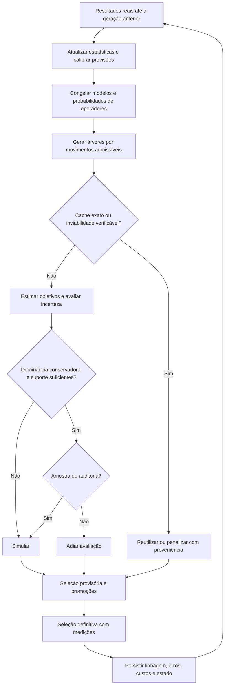

# Árvores, aprendizado entre gerações e economia de simulações

Análise para revisão — 20–21/10/2026. Escopo: P2, variantes de representação e
`nsga3_adaptive_simulation`. Alterações locais, sem commit.

## 1. Parecer

**A ideia é promissora, desde que a representação viável e a decisão de simular
sejam tratadas como mecanismos distintos.** Recomendo manter a árvore enraizada
no sink como genótipo, aprender a preferência por variações com resultados reais
das gerações anteriores e usar previsão com auditoria para alocar simulações.
Uma MST pode fornecer sementes e uma referência estrutural; sua minimalidade
não deve ser uma restrição obrigatória de todos os cromossomos.

O ganho de representação vem de operadores que preservam conectividade. O ganho
de aprendizado vem de escolher melhor quais variações produzir e avaliar. Nenhum
dos dois exige que a árvore minimize a soma dos pesos das arestas. Também não é
possível garantir, apenas por semelhança estatística, que um indivíduo ainda não
simulado jamais superará os atuais.

O projeto já implementa boa parte da infraestrutura. O trabalho indicado é
consolidá-la, medir suas limitações e acrescentar aprendizado de variações de
forma incremental. Não há evidência nesta análise de economia ou melhoria de
Pareto em Cooja: os experimentos locais usam um avaliador determinístico auxiliar.

Leituras e limites das fontes estão em
[REFERENCIAS_MST_APRENDIZADO.md](REFERENCIAS_MST_APRENDIZADO.md).

## 2. Três árvores diferentes

| Estrutura | O que representa/minimiza | Papel possível |
|---|---|---|
| Árvore geradora mínima, MST | Soma de pesos de arestas de um grafo não dirigido, para um conjunto fixo de vértices | Semente, comparação e prior estrutural |
| Árvore de caminhos mínimos, SPT | Distância acumulada do sink até cada vértice | Esqueleto canônico atual, construído por Dijkstra |
| Árvore de dependências, Chow–Liu | Aproximação de uma distribuição conjunta de genes; usa árvore de peso **máximo** com informação mútua | Modelo estatístico para gerar combinações de genes |

Chow–Liu pode ser escrito como MST sobre pesos negativos, mas suas arestas
representam dependência entre variáveis, não enlaces de rádio. Amostrar sua
distribuição não garante conectividade física. A distinção é essencial se a
intenção de “MST” também incluir aprender relações entre genes.
Fonte: [Chow e Liu, 1968](https://research.ibm.com/publications/approximating-discrete-probability-distributions-with-dependence-trees).

Para P2, definimos `G_Q=(Q ∪ {sink}, E)`, com enlaces admissíveis segundo o raio
de comunicação. Cada indivíduo escolhe `A ⊆ Q` e um MAC. A árvore `T_A` conecta
`A ∪ {sink}`. Uma MST de **todos** os candidatos ativaria um conjunto fixo e
eliminaria a decisão de quantos/onde instalar relays. Mesmo uma MST sobre `A`
não escolhe `A` e não resolve cobertura. Escolher relays de apoio para conectar
terminais se aproxima de problemas de Steiner/projeto de rede, com restrições
adicionais de cobertura e mobilidade.

### Contraexemplo simples

Considere sink `(0,0)`, relay `a=(3,0)` e relay `b=(2,3)`, todos ao alcance, com
custo igual à distância ao quadrado:

| Aresta | Custo |
|---|---:|
| sink–a | 9 |
| sink–b | 13 |
| a–b | 10 |

A SPT usa as duas arestas do sink: custo total 22, caminho até `b` com custo 13.
A MST usa sink–a e a–b: custo total 19, caminho até `b` com custo 19 e dois saltos.
Normalizar todas as distâncias pelo mesmo fator não altera essa conclusão.
O caso está reproduzido em `test_topology_mst.py`.

Logo, “menor custo da árvore” não significa “menor latência”, nem “menor energia
simulada”. Fluxo agregado, contenção, MAC, retransmissões e mobilidade podem
alterar os objetivos. No SimLab atual, trocar somente `tree_parents` nem sequer
troca a implantação simulada: o firmware escolhe o roteamento. No RPL, a função
objetivo do protocolo governa seleção de pais e formação do DODAG.
Fonte: [RFC 6550, §§3.2 e 14](https://datatracker.ietf.org/doc/html/rfc6550#section-3.2).

## 3. O que já existe e o que falta

| Componente examinado | Situação encontrada | Consequência |
|---|---|---|
| `ChromosomeP2Tree` | Máscara, MAC e vetor de pais; hash ignora os pais | Árvores diferentes podem representar a mesma avaliação |
| `Problem2TreeEncodedAdapter` / `TreeOperators` | Crescimento, poda, PAO, CAO e transplante com enlaces admissíveis | Conectividade pode ser preservada sem reparo posterior |
| `build_sink_rooted_tree` | Dijkstra; não é MST | Corrigida a descrição ambígua de “minimum-cost tree” |
| Cobertura | Crescimento guloso restrito à fronteira; penalidade se insuficiente | “Sem reparo de conectividade” não significa “todas as restrições satisfeitas” |
| `RoutingKnowledge` | Frequência de arestas, normalmente de árvores **estruturais** de indivíduos simulados | Frequência não mede sucesso, ETX, utilidade causal ou confiabilidade |
| `observe_simulated` | Recebe cromossomo e chave, não diferenças de objetivos entre pai e filho | Ainda não aprende quais mutações foram úteis |
| `observation_from_dodag` | Conversor disponível, mas não chamado pelo fluxo adaptativo examinado | Não presumir que o modelo está aprendendo o DODAG real |
| Base de avaliações | Objetivos realmente avaliados; exclui penalidades grandes do treinamento | Boa separação entre previsão e rótulo |
| k-NN | Prediz objetivos usando descritores e dispersão de vizinhos | Dispersão é heurística; não é intervalo calibrado |
| Triagem e promoção | Descarta provisoriamente previsões dominadas e simula estimados relevantes para seleção | Protege a origem dos resultados, mas não recupera todo falso descarte |
| Orçamento máximo | Pode rebaixar decisões de exploração/auditoria | Descarte por orçamento precisa ser analisado separadamente |

A identidade de avaliação é `(contexto de simulação, máscara, MAC)`. A identidade
do genótipo inclui também a árvore. Não aumentar a chave do cache com a árvore
enquanto ela não for enviada ao simulador. Se futuramente o firmware receber
rotas impostas, revisar hash, contexto, cache e equivalência entre variantes.
O armazenamento atual do cache é consultado por experimento; hash compatível
entre variantes **não implica compartilhamento automático entre experimentos**.

PAO/CAO frequentemente alteram apenas a árvore, sem trocar máscara/MAC. São
movimentos neutros no fenótipo que podem facilitar futuras podas/transplantes.
Devem ser contados como tal: mais acertos de cache podem indicar tanto boa
localidade quanto estagnação. Deduplicação por fenótipo também pode eliminar
árvores alternativas úteis; medir diversidade de genótipos e fenótipos
separadamente antes de introduzir um arquivo de múltiplas árvores por máscara.

### Problemas confirmados e corrigidos nesta análise

1. **Descritores móveis:** com peso histórico não nulo na árvore de reparo,
   um mesmo cromossomo mudava seus descritores após observar outra simulação.
   No teste, a profundidade máxima mudou de 2 para 25 sem alterar implantação.
   A regressão agora usa sempre a SPT geométrica canônica; o reparo pode manter
   sua árvore influenciada pelo histórico.
2. **MAC ausente da previsão:** máscaras iguais com MACs diferentes tinham
   entradas idênticas no k-NN. Acrescentado `mac_protocol` como atributo fixo.
   Isso diferencia as configurações, mas ainda não equivale a modelos separados
   por MAC ou a uma garantia de bom aprendizado de categorias pouco amostradas.
3. **Colisões truncadas:** quando mais de `k` indivíduos tinham os mesmos
   descritores, apenas os primeiros `k` entravam na média/desvio. O resultado
   podia depender da ordem de inserção e esconder divergência conhecida.
   Agora todos os empates exatos entram na estatística. Igualdade de descritores
   continua sem autorizar reutilização exata da avaliação.

Os cinco casos de regressão falharam antes das correções. O vetor passa de 20
para 21 atributos. A base adaptativa recompõe descritores a partir do cache de
cromossomos; consumidores externos de vetores persistidos precisam recomputá-los.
Não misturar vetores das duas versões. Uma retomada atravessando esta atualização
pode tomar novas decisões diferentes; iniciar campanhas comparativas novas e
registrar versão de código/esquema.

## 4. Representação recomendada

Manter `x=(MAC,A,T_A)` e árvores admissíveis enraizadas no sink, sem exigir que
`T_A` continue sendo mínima após cada movimento. Os operadores podem ser os
existentes, enriquecidos com escolha estatística de candidatos.

O argumento de conectividade é indutivo: a árvore inicial é conectada; crescer
adiciona um nó a um pai já conectado; podar remove uma subárvore inteira;
transplantar/reconectar exige um pai fora do fragmento, já conectado e dentro do
raio. Assim, a componente ativa permanece conectada e acíclica. Essa propriedade
depende das condições dos operadores, não da minimalidade da MST. Representações
node-depth e operadores de rearranjo oferecem precedentes para essa abordagem;
os vieses de inicialização também precisam ser avaliados.
Fonte: [Lima, Rothlauf e Delbem, 2008](https://gpbib.pmacs.upenn.edu/gecco2008/docs/p969.pdf).

Persistem quatro limites: cobertura pode falhar; a conectividade é a do modelo
geométrico, não a entrega efetiva de pacotes; uma árvore não representa toda a
redundância do grafo de rádio; limites de grau, tráfego ou relays exigem condições
próprias. `max_relays` hoje limita a árvore inicial, não é garantia global após
cobertura, crossover e mutação.

Usos experimentais adequados da MST:

- construir algumas árvores iniciais sobre conjuntos ativos previamente viáveis;
- comparar profundidade, custo e distribuição de graus com SPT e árvores aleatórias;
- propor enxertos/arestas preferenciais, preservando uma fração de escolhas aleatórias;
- usar pesos aprendidos somente quando houver evidência e denominadores corretos.

Reconstruir uma única MST determinística a cada geração apagaria rearranjos
neutros e parte da diversidade. Restringir todos os indivíduos a subárvores de
uma MST global também exclui implantações conectáveis por outras arestas de
`G_Q`. A representação deve continuar usando o grafo admissível completo.

## 5. Aprender somente com informações das simulações

Interpretação adotada: os rótulos de qualidade vêm exclusivamente das simulações
do próprio estudo. Geometria, máscara, MAC e operações realizadas são entradas
conhecidas do problema, não estimativas externas de desempenho. Não é necessário
treinar em bases externas nem inventar uma função física de energia/latência.
Uma restrição literal que proibisse até a geometria impediria certificar a
viabilidade de enlaces ainda não observados; essa não é a interpretação usada.

### 5.1 Registro mínimo e proveniência

Por avaliação: hash de fenótipo, genótipo, geração, máscara, MAC, objetivos por
semente e agregados, status/completude das réplicas, versão de firmware/Cooja,
configuração do rádio, duração, tráfego/mobilidade e transformações de métricas.
Por variação: pai(s), operador, parâmetros, conjunto adicionado/removido,
arestas alteradas, contexto/modelo usado, probabilidade de escolha e destino
do filho (`cache`, simulado, estimado, penalizado).

Há infraestrutura de completude e cache, mas a linhagem de variações e as
estatísticas abaixo são **propostas**, não recursos novos já integrados.
Erros de infraestrutura não são amostras de baixo desempenho. Timeout sem
informação suficiente é observação censurada/falha, não energia zero.

### 5.2 Crédito a operadores, antes de crédito a cada aresta

Começar com estatísticas de `grow`, `prune`, PAO, CAO e transplante por contexto
simples: MAC, faixa de tamanho, cobertura e região de Pareto. Usar todos os
resultados válidos, inclusive ruins; só sobreviventes produzem viés de seleção.

Para uma mutação de pai `p` para filho `x`, ambos medidos nas mesmas sementes:

`Δ_j(x,p,s) = f_j(x,s) − f_j(p,s)` em espaço de minimização.

Guardar contagem, média e variância das diferenças, taxa de mudança efetiva de
fenótipo, viabilidade/cobertura, contribuição ao arquivo e custo de avaliação.
Sementes comuns permitem uma comparação pareada, mas a redução de variância
depende da correlação observada; não é automática.

Para crossover, registrar ambos os pais e comparar o filho com o conjunto
parental/arquivo, sem atribuir causalidade a uma aresta isolada. Um escore inicial
pode ser “contribuiu com solução não dominada ou nicho relevante por avaliação
nova”, acompanhado dos `Δ_j`; empates/duplicatas não contam como melhoria.
Qualidade multiobjetivo não deve ser reduzida permanentemente a uma soma fixa.

Atualizar as probabilidades apenas ao fechar a geração, com suavização e uma
probabilidade mínima de exploração:

`P_t(o | contexto) = ε/|O| + (1−ε) softmax(score_t(o)/τ)`.

`ε`, `τ`, janelas e contexto são hiperparâmetros a validar. Com pouco histórico,
usar a política original. Congelar os escores durante a geração evita que a
ordem de término dos workers altere o experimento. Persistir estado ou reconstruí-lo
em ordem determinística. Movimentos neutros merecem crédito retardado apenas
com linhagem identificável, para não contar o mesmo resultado várias vezes.

### 5.3 Crédito a enlaces e subárvores

Se houver métricas reais por enlace: guardar exposição (tentativas, tempo ou
pacotes elegíveis), sucessos, retransmissões, duração como pai, carga encaminhada
e contexto. Um exemplo de suavização para probabilidade de sucesso é
`p_e=(sucessos_e+α)/(tentativas_e+α+β)`, com prior explícito. Sem tentativas, a
qualidade é **desconhecida**, não zero. Diferenciar direções quando o rádio for
assimétrico; uma MST não dirigida exige uma regra de simetrização declarada.

Se houver somente objetivos globais, calcular associações entre presença de
genes/blocos e resultados, condicionadas ao contexto. Não chamar isso de
“qualidade do enlace”: presença depende de seleção anterior, densidade, posições
e outros genes. Um enlace raro pode ser excelente e pouco explorado; um enlace
frequente pode ser apenas inevitável.

No código atual, a árvore estrutural registrada por `observe_tree` é uma
construção do algoritmo. Reforçá-la como se fosse observação do rádio cria uma
realimentação da própria hipótese. Ela pode servir como estatística de busca,
desde que rotulada `structural`, separada de `rpl_dodag` e de medidas de entrega.
Os logs antigos podem oferecer só profundidades/primeiro contato; a árvore exata
depende dos eventos de troca de pai descritos em `pylib/rpl_dodag.py`.

Uma árvore Chow–Liu sobre genes binários seria uma extensão de estimação de
distribuições: aprender dependências com suavização, preservar diversidade entre
nichos e traduzir propostas em operações admissíveis. Reamostrar máscaras livres
e depois repará-las reintroduziria o problema original. Priorizar aprendizado de
operadores é uma escolha de engenharia desta análise: exige menos dados e se
encaixa melhor no código existente, não é uma superioridade demonstrada.

## 6. Quando deixar de simular

Há três níveis de evidência:

| Decisão | Evidência | Limite |
|---|---|---|
| Reutilizar avaliação | Fenótipo e contexto idênticos, réplicas completas | Reutiliza o resultado daquele conjunto de sementes; não elimina incerteza sobre a média populacional |
| Não simular inviável | Violação verificável de restrição do modelo | Raio/cobertura são o modelo assumido, não prova de desempenho físico |
| Adiar indivíduo previsto como ruim | Modelo treinado com medições anteriores | Pode perder um indivíduo bom; precisa de auditoria e exploração |

“Superar os atuais” deve significar potencial de contribuir para o arquivo
multiobjetivo ou para a seleção/diversidade. Um candidato sem dominar nenhum
atual pode ocupar uma região valiosa de Pareto. Mesmo dominados podem preencher
populações pequenas; conferir o conjunto de sobreviventes, como faz a promoção.

### 6.1 Comparação com incerteza

Para minimizar todos os objetivos, sejam `[L_j(x),U_j(x)]` os limites preditivos
do candidato e `[L_j(y),U_j(y)]` os limites da média de um incumbente medido.
Uma regra conservadora proposta é adiar `x` apenas quando existe **o mesmo** `y`
tal que `U_j(y) + δ_j ≤ L_j(x)` para todo `j`, com melhora estrita em pelo menos
um objetivo, baixo afastamento do domínio treinado e evidência suficiente.
Margens `δ_j ≥ 0` devem ter unidades/normalização explícitas.

Se o alvo for estritamente o agregado de um conjunto fixo de sementes já
completo, `f_j(y)` pode substituir `U_j(y)`. Se o alvo científico for desempenho
esperado sob novas sementes, comparar apenas médias ignora ruído dos incumbentes.
Nenhuma regra garante ausência de falso descarte se os limites não forem válidos.

O código usa `f̂ ± κ σ_vizinhos`. **`κ=1,96` não cria um intervalo de 95%.**
Desvio entre vizinhos não mede sozinho erro de aproximação, variância entre
sementes ou extrapolação. `confidence=1/(1+distância)` é apenas um escore de
proximidade. Mesmo após corrigir colisões, um único vizinho pode produzir desvio
zero sem justificar certeza. O k-NN continua sendo referência simples para
comparação, não um teste estatístico de dominância.

### 6.2 Calibração, auditoria e promoção

Treinar em gerações anteriores e avaliar nas seguintes, mantendo todos os
registros de um mesmo fenótipo no mesmo bloco. Congelar previsões antes de ver
os resultados; nunca calcular erro de generalização na própria amostra usada
para ajustar o modelo. Medir resíduos por objetivo, MAC e região, cobertura
conjunta dos limites e erro perto da fronteira.

Calibração conformal é candidata, mas a busca evolutiva muda a distribuição e
seleciona o que será medido. As garantias usuais de permutabilidade não podem ser
assumidas automaticamente. Há métodos para covariate shift e não permutabilidade
com condições adicionais; nesta proposta, cobertura deve ser verificada
empiricamente antes de alegar controle formal de erro.
Fontes: [Tibshirani et al., 2019](https://arxiv.org/abs/1904.06019) e
[Barber et al., 2023](https://arxiv.org/abs/2202.13415).

Reservar auditoria aleatória entre os candidatos que seriam descartados, com
probabilidade registrada, orçamento protegido e RNG separado. Avaliar o falso
descarte em relação ao arquivo **congelado na decisão**, além da relevância ao
fim da geração. Não misturar promoções selecionadas com auditorias aleatórias
na estimativa de frequência de erro. Com probabilidades diferentes por estrato,
usar ponderação adequada ou reportar os estratos separadamente.

Zero erros observados não basta: sob amostragem Bernoulli independente de uma
população estável, zero erros em `n` auditorias dá limite superior unilateral de
95% `1−0,05^(1/n)` (aproximadamente `3/n`). Com 30 auditorias, ainda é cerca de
9,5%; são necessárias aproximadamente 299 sem erro para ficar abaixo de 1%.
Em uma busca adaptativa, essas premissas precisam ser examinadas; usar janelas e
controle sequencial quando pertinente, não reinterpretar a conta como garantia.

Promoção mede candidatos relevantes **sob as previsões disponíveis**. Um filho
excelente previsto como péssimo pode não ser promovido. Exigir sobreviventes
medidos protege a validade das avaliações publicadas, não limita por si só a
perda de hipervolume. Existe ainda fallback atual que admite estimados se faltarem
indivíduos medidos: não usar essa opção/ocorrência como evidência de garantia
estrita; registrar e tratar explicitamente em uma futura política de orçamento.

### 6.3 Menos sementes antes de zero simulações

Uma extensão útil é simular um pequeno lote inicial de sementes e alocar mais
réplicas aos candidatos cuja dominância permanece ambígua. Isso permite obter
evidência direta onde o modelo está pouco informado. Não encurtar duração e
tratar a métrica como equivalente: aquecimento, formação do DODAG e mobilidade
mudam o alvo.

Para parada adaptativa, intervalos pontuais comuns não são automaticamente
válidos após repetidas consultas. Sequências de confiança e identificação de
conjuntos de Pareto fornecem referências, sob hipóteses sobre ruído e amostragem.
Elas não resolvem gratuitamente a previsão de um cromossomo nunca simulado.
Fontes: [Howard et al., 2021](https://arxiv.org/abs/1810.08240) e
[Kone, Kaufmann e Richert, 2024](https://proceedings.mlr.press/v238/kone24a.html).

O enum `SIMULATE_REDUCED` existe, mas não é emitido. Implementar essa fase exige
rever completude, agregação, chave das réplicas e retomada: um indivíduo parcial
não pode entrar como avaliação completa no cache.

## 7. Fluxo proposto por geração

O diagrama é um desenho-alvo. O fluxo atual já cobre cache, penalidade, triagem
e promoção; ainda faltam o aprendizado de operadores, limites calibrados,
auditoria protegida e tratamento estrito de falta de sobreviventes medidos.

## 8. Experimento que pode sustentar a hipótese

Separar representação, política de geração e política de avaliação:

| Braço | Representação | Aprendizado de operadores | Avaliação |
|---|---|---|---|
| A | Máscara + reparo histórico | Não | Completa |
| B | Máscara + reparo estrutural | Não | Completa |
| C | Árvore admissível atual | Não | Completa |
| D | Árvore admissível, algumas sementes MST | Não | Completa |
| E | Árvore admissível | Sim | Completa |
| F | Árvore admissível | Não | Triagem calibrada + auditoria |
| G | Árvore admissível | Sim | Triagem calibrada + auditoria |
| H | Melhor configuração validada | Opcional | Réplicas sequenciais |

C−B mede representação; D−C testa MST; E−C mede geração aprendida; F−C mede
triagem; G testa interação. Hoje os harnesses cobrem A/B/C e uma triagem k-NN
heurística. A comparação MST acrescentada nesta revisão é **retrospectiva sobre
as mesmas máscaras**, não executa o braço D nem demonstra ganho da busca.

Primeiro rodar modo de observação: registrar decisões hipotéticas de descarte,
mas simular todos. Isso produz rótulos inclusive para os descartáveis e permite
medir erros sem comprometer a trajetória dessa fase. Depois, habilitar descarte
em campanhas independentes, com auditoria contínua. Prever tamanho de amostra
para auditoria, não apenas uma probabilidade como 5%.

Usar instâncias com diferentes densidades, gargalos, níveis de cobertura e
mobilidade; repetir sementes de evolução e de simulação. Uma partida razoável
é 20–30 sementes evolutivas por cenário, ajustada após piloto de variância/custo;
não tratar isso como cálculo de poder. Manter firmware, tráfego, duração,
objetivos, agregador e política de réplicas comparáveis. Mesma semente de GA não
produz a mesma sequência de indivíduos quando operadores consomem RNG distinto.

Reportar duas curvas: qualidade por número de simulações/réplicas e qualidade
por tempo/custo total. Uma comparação só por número de gerações favorece métodos
com quantidades diferentes de trabalho. Contabilizar warm-up, auditorias,
promoções e ajuste do modelo. Separar custo incremental de custo amortizado caso
se reutilize histórico compatível; o histórico não é gratuito.

Métricas necessárias:

- chamadas e tempo de reparo; relays adicionados/removidos pelo reparo;
  conectividade, cobertura e mudanças efetivas de fenótipo;
- fenótipos únicos, taxa de cache, diversidade, profundidade/grau e custo do
  esqueleto, sem confundir custo geométrico com energia;
- indivíduos efetivamente simulados, documentos por semente, CPU/tempo de
  parede, réplicas interrompidas/falhas e custo do treinamento;
- hipervolume com referência comum pré-definida, IGD+ contra referência
  independente, diversidade de nichos e qualidade reavaliada com sementes novas;
- erro por objetivo normalizado, cobertura dos limites, falsos descartes,
  tamanho da auditoria, intervalo de incerteza e ganho perdido em hipervolume.

O `false_skip_rate` atual mistura amostras relevantes à previsão e usa uma
fronteira que pode já conter resultados da mesma geração; serve como diagnóstico,
não como estimador isolado do risco de descarte. MAE agregada entre objetivos de
unidades diferentes também deve ser complementada por erros normalizados.

Definir antes do teste tolerância à perda de qualidade e ao falso descarte.
Exemplo de critério a discutir: redução de custo com limite inferior positivo,
perda relativa de HV até 2% e limite superior de falso descarte até 1%. São
metas propostas, não garantias obtidas nem valores prescritos pela literatura.

## 9. Implementação e validação desta revisão

Implementados: os três reparos do estimador/descritores; construtor geométrico
`build_sink_rooted_mst` por Prim; testes de minimalidade por enumeração exaustiva
em grafos pequenos, empates/custos zero e componentes desconectadas; extensão do
harness para exportar JSON por semente e comparar MST/SPT sobre a mesma máscara.
O harness agora verifica conectividade também no P2 clássico, que antes
reportava zero quando o adapter não oferecia o cache de topologia.

A MST não altera a configuração padrão, não impõe rotas ao Cooja e não ativa
relays para reparar componentes desconectadas. Quando não há caminho até o
sink, os nós permanecem destacados e inspecionáveis. Não foi implementado um
novo descarte mais agressivo, crédito causal por aresta, aprendizado de operadores
ou garantia estatística: faltam medições apropriadas para justificá-los.

Resultados reproduzíveis, comandos e ambiente estão em
[mst-review/README.md](../../experiments/adaptive-simulation/mst-review/README.md).
A suíte completa do motor passou: **566 testes**, incluindo os novos casos de
regressão e de MST. O frame de apresentação está em
[frame_mst_aprendizado.tex](../latex/frame_mst_aprendizado.tex).
No piloto, a representação em árvore teve menos avaliações novas, enquanto a
triagem k-NN apresentou perda de hipervolume mesmo com `κ=1,96`. São resultados
compatíveis com a recomendação de validar representação e triagem separadamente.
Os resultados locais servem para validar mecanismo e revelar limitações. Uma
campanha Cooja com observação integral e validação temporal é o próximo passo
experimental antes de recomendar economia de simulações em produção.
