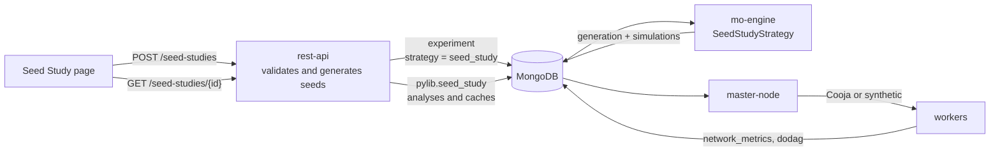

# Seed Study — feature proposal

**Status:** implemented as option B (section 12), manual at [SEED_STUDY.md](SEED_STUDY.md) · **Date:** 2026-10-30 · **Base:** `feature/dist-seed` (`0d3b53b`)

## 1. Summary

SimLab gets a **Seed Study**: the user picks a problem instance and a list of seeds (generated or
imported), the system runs one simulation per seed with everything else held fixed, and presents the
distribution of each metric and how many seeds each objective requires.

The feature reuses the path of the other runs: it is an experiment with its own strategy, goes through
the master-node, the replica gate and recovery, and has its own endpoint and page, modelled on the
scalability benchmark.

Four results, measured on data that already exists, shape the design (section 4):

1. **The seed is the only source of variation.** 1,734 runs of the same chromosome with the same seed,
   on up to 10 hosts, gave identical values in all 17 metrics. The premise of the study holds.
2. **"How many seeds" is two questions, with very different answers.** Estimating the latency of
   *one* solution with ±5% error takes about 244 seeds; ranking *solutions* with a reliability of 0.90
   takes 6. The system must show both and say what each one is for.
3. **A single chromosome does not represent the instance.** Among individuals of the same experiment,
   the coefficient of variation changes by up to 47×. The number obtained on one chromosome holds for
   that chromosome.
4. **Of the 17 default metrics, only 10 are informative.** Three are always zero, two are copies of
   others, and two are corrupted by underflow in the firmware. Without handling, the study would
   recommend 1,409 seeds because of a measurement defect.

## 2. Questions the study answers

| # | Question | Unit | Requires |
|---|---|---|---|
| Q1 | Does the seed change this metric? | 1 chromosome | n ≥ 3 |
| Q2 | How is the metric distributed across seeds? | 1 chromosome | n ≥ 30 to speak about shape |
| Q3 | How many seeds to **estimate** the value of one solution to the desired precision? | 1 chromosome | n ≥ 30 |
| Q4 | How many seeds to **rank** solutions reliably during optimisation? | panel of chromosomes | K ≥ 10, ideally 20 |

The original request covers Q1 to Q3. Q4 is the question that decides the configuration of an
optimisation experiment, and it has no answer with a single chromosome: it depends on the ratio between
the real difference among solutions and the noise of each one. Hence the decision in section 12.

## 3. What the seed is in this system

Verified in the code of the production image, `juniocesarferreira/simulation-cooja:v1.1`
(Contiki-NG `a044c3203`, Cooja `2b9b0bf9`, November 2024):

| Source | Mechanism | Reach of the seed |
|---|---|---|
| Boot delay | `Clock.added()` draws up to `motedelay_us` (1 s) per mote with the simulation's Java PRNG | Whole seed |
| Firmware PRNG | `simRandomSeed = (int)(seed + moteID)`, then `random_init(unsigned short)` → libc `srand`; `random_rand()` uses `rand()` | **Only 16 bits** of `seed + moteID` |
| Radio | UDGM with `success_ratio_tx/rx = 1.0` in the [template](../../mo-engine/simulation_template.xml): no random loss | **None** |

Three consequences for the validity of the study:

- **The measured distribution is one of internal variability, not of the channel.** The draw affects
  boot instants, jitter and backoff; collisions follow from that, but there is no stochastic per-link
  loss. A low CV means the result is stable *in this radio model*, not that the real network would be.
- **The seed space is not flat.** Two seeds with the same low 16 bits give the firmware the same set of
  seeds; `s` and `s+1` share almost all of them, shifted by one mote. The presets `1,2,3` and `1..5` of
  the [wizard](../../gui/simlab/src/components/problem-editor/launch/steps/Step3Simulation.vue) fall in
  this case. The practical effect has not been measured yet (section 9, Phase 0): since `rand()` lives
  in libc, the state may be global across motes, which I did not verify.
- **The semantics depend on the version.** The local `contiki-ng` (`6a35472a3`, May 2026) derives the
  seed by HKDF-SHA-256 and has no such truncation. Changing the image changes the meaning of a seed, so
  a study only holds for the image it ran on.

## 4. Evidence in the existing data

All queries were read-only. Sources: local database (38 experiments, 22,468 simulations) and
`simlab-results/raw/18_p1-43-seeds_*.json.gz`, with **156 individuals × 43 seeds = 6,708 simulations
with no failure** (P1, 180 simulated minutes, NSGA-III, 7 generations).

> **Limit of this evidence.** It is one instance, one problem, and individuals coming from an
> optimisation. The numbers below justify the design of the tool. They are not the answer for other
> instances, and producing that answer is precisely the tool's job.

### 4.1 Determinism and failures

- 5 USL benchmarks, 1,734 runs, up to 10 hosts: **none of the 17 metrics had more than one value**
  within the same chromosome/seed pair. All on P1; P2 to P4 do not have this check yet.
- 28 failures in 22,468 simulations (0.12%): 27 with an infrastructure or recovery cause and 1 with no
  message. None points to the seed.

### 4.2 Distributions per metric

CV across seeds per individual and `n*` from section 6.4, treating the 43 seeds as a pilot. Rejection
is the fraction of individuals for which Shapiro–Wilk rejects normality at 5%.

| Metric | CV p10 | CV p50 | CV p90 | Rejection | n*(±10%) p50 / p90 / max | n*(±5%) p50 / p90 / max |
|---|---:|---:|---:|---:|---:|---:|
| `latency` | 0.162 | 0.377 | 0.579 | 65% | 69 / 158 / 561 | 244 / 570 / 2,035 |
| `radio_tx_energy_mj` | 0.132 | 0.320 | 0.483 | 81% | 50 / 112 / 225 | 176 / 398 / 812 |
| `total_received` | 0.085 | 0.234 | 0.389 | 85% | 28 / 73 / 212 | 96 / 260 / 766 |
| `bytes_rx` | 0.129 | 0.209 | 0.302 | 82% | 23 / 45 / 124 | 76 / 158 / 443 |
| `throughput` | 0.037 | 0.070 | 0.125 | 72% | 5 / 10 / 39 | 11 / 29 / 136 |
| `hops` | 0.015 | 0.035 | 0.083 | 83% | 3 / 6 / 25 | 5 / 15 / 82 |
| `total_sent` | 0.010 | 0.036 | 0.141 | 70% | 3 / 12 / 56 | 5 / 36 / 196 |
| `energy` | 0.007 | 0.013 | 0.077 | 60% | 3 / 6 / 33 | 3 / 13 / 111 |

`cpu_energy_mj` and `radio_rx_energy_mj` behave like `energy`. Reading: there is no single number of
seeds for the system, and normality cannot be assumed. The dispersion also varies a lot per solution:
the CV of `energy` goes from 0.007 to 0.077 between p10 and p90 (ratio 10.7; 3.6 for `latency` and 3.4
for `throughput`), with max/min ratios of 47, 29 and 18, and Brown–Forsythe rejects equal variances
with p ≪ 0.001 on the three objectives.

### 4.3 Variance decomposition and reliability

Crossed individual × seed model (section 6.6). `Eρ²(m)` is the reliability of the ranking using `m`
seeds and `m*` the smallest `m` that reaches the target.

| Objective | SS individual | SS seed | SS interaction | Eρ²(1) | Eρ²(2) | Eρ²(3) | Eρ²(5) | Eρ²(8) | m*(0.90) | m*(0.95) |
|---|---:|---:|---:|---:|---:|---:|---:|---:|---:|---:|
| `latency` | 64.4% | 0.50% | 35.1% | 0.64 | 0.78 | 0.84 | 0.90 | 0.93 | **6** | 11 |
| `energy` | 54.8% | 0.37% | 44.8% | 0.54 | 0.70 | 0.78 | 0.85 | 0.90 | **8** | 17 |
| `throughput` | 70.8% | 0.46% | 28.7% | 0.70 | 0.83 | 0.88 | 0.92 | 0.95 | **4** | 8 |

- **There is no "good seed".** The main effect of the seed accounts for at most 0.5% of the sum of
  squares; the variation depends on the seed × solution combination. A list of seeds is therefore not
  a reusable asset: what transfers is the *quantity*.
- **Reusing the same seeds across individuals does not reduce the noise of the comparison.** The ratio
  between the variance of the paired difference and the independent one is 0.99 to 1.00. It remains
  correct for reproducibility, but it is not variance reduction.
- **On this instance, 8 seeds reach 0.90 on all three objectives.** With 2 seeds, the configuration of
  25 of the 38 experiments in the database, reliability sits between 0.70 and 0.83. Those experiments
  validated infrastructure, so this invalidates nothing, but it is a limit to declare if they are used
  as optimisation results.

Check without ANOVA assumptions, comparing two **disjoint** sets of `k` seeds:

| k | 1 | 2 | 5 | 8 | 15 | 21 |
|---|---:|---:|---:|---:|---:|---:|
| Spearman `latency` | 0.57 | 0.74 | 0.87 | 0.92 | 0.95 | 0.96 |
| Spearman `energy` | 0.54 | 0.68 | 0.83 | 0.88 | 0.93 | 0.95 |
| Spearman `throughput` | 0.55 | 0.71 | 0.86 | 0.90 | 0.95 | 0.96 |
| Jaccard of the Pareto front | 0.32 | 0.36 | 0.45 | 0.49 | 0.55 | 0.57 |

The ranks confirm `Eρ²`, slightly below it. In contrast, **exact front membership does not
stabilise**: 71 of the 156 individuals are on the front, many nearly tied, and small noise swaps the
membership even with 21 seeds. This Jaccard stays as a diagnostic and does not serve as a stopping
criterion.

**MAC gene in this data.** The experiment only had `csma` firmware, but 61 of the 156 individuals
record `mac_protocol = 1`, a defect described in section 11. All of them ran with CSMA. No pair of
individuals differs only in that gene, so there are no hidden duplicates and the `m*` values above
remain valid.

### 4.4 Size of the pilot and of the panel

Error of the standard deviation and of `n*` (with `γ = 10%`) in pilots of `n₀` seeds, p10–p90 range
against the reference of 43. These ranges are optimistic, because the pilot is a subset of the
reference.

| n₀ | S/S₄₃ `latency` | S/S₄₃ `energy` | n̂*/n*₄₃ `latency` |
|---:|---:|---:|---:|
| 5 | 0.50–1.34 | 0.36–1.48 | 0.32–1.95 |
| 10 | 0.72–1.22 | 0.53–1.36 | 0.55–1.56 |
| 20 | 0.85–1.13 | 0.69–1.23 | 0.73–1.30 |
| 30 | 0.91–1.08 | 0.83–1.13 | 0.82–1.18 |

`m*(0.90)` estimated with 30 seeds and random panels of `K` chromosomes, p10 / p50 / p90. The value
with all 156 is 6, 8 and 4:

| K | `latency` | `energy` | `throughput` |
|---:|---:|---:|---:|
| 5 | 2 / 7 / 24 | 5 / 17 / 52 | 2 / 8 / 31 |
| 10 | 3 / 6 / 14 | 5 / 14 / 35 | 2 / 7 / 16 |
| 20 | 4 / 6 / 10 | 4 / 12 / 26 | 2 / 5 / 12 |
| 40 | 4 / 6 / 8 | 5 / 10 / 19 | 3 / 5 / 8 |

Hence the proposed defaults: `n = 30`, `K = 20`, minimum `K = 10`. For a single generation (19 to 28
individuals), `m*(0.90)` ranged between 3 and 34 with no visible trend, a range compatible with the
noise of a panel that size. I found no sign that the requirement grows with convergence, but 7
generations are not enough to rule it out.

Cost at the throughput of that experiment (247.6 simulations/h, pool-dependent): `K=1, n=30` takes
about 7 min; `K=20, n=30` (600 simulations) takes about 2.4 h.

### 4.5 Validation of the t interval on the real distributions

Coverage of the nominal 95% CI by resampling each individual, median (p10) across individuals:

| Size | `latency` | `energy` | `throughput` | `hops` |
|---:|---:|---:|---:|---:|
| 5 | 0.931 (0.881) | 0.933 (0.834) | 0.929 (0.888) | 0.919 (0.842) |
| 10 | 0.943 (0.917) | 0.936 (0.845) | 0.944 (0.924) | 0.927 (0.859) |
| 30 | 0.947 (0.939) | 0.942 (0.895) | 0.947 (0.939) | 0.939 (0.908) |

The t interval works in the typical case from `n ≈ 10`, but under-covers on heavy-tailed individuals,
especially for `energy`. That is why the system shows t and BCa bootstrap side by side.

## 5. Experimental design

### 5.1 Definition

An **instance** is the fixed set `I = (problem, chromosome, firmware, duration, image,
data_conversion_config)`. For seeds `ω` in the list, each metric `m` yields `Y_m(ω) = g_m(Sim(I, ω))`.
Since the simulation has a fixed horizon, each seed is an independent replication of a terminating
simulation: there is no warm-up removal, and every conclusion holds for that duration.

The **estimand** is not always the mean. The optimisation uses `Ψa(Y(ω₁), …, Y(ω_m))` with the
aggregator of each objective, so the right question is about the sampling distribution of that
aggregator. The study evaluates the same aggregator the experiment would use (section 6.5).

The design is **crossed**: all `n` seeds on all `K` chromosomes. `K = 1` is the simple case of the
original request.

### 5.2 Seeds

| Mode | Behaviour |
|---|---|
| **Generated** | User gives `count` and `master_seed`; the server generates the list and stores the list and its provenance |
| **Imported** | Same format as the wizard, `{ "seeds": [...] }` or a plain list, with a shared parser |

In both modes, the experiment stores the explicit list, and it is the list that defines the order of
the study.

Generator rules:

- **No repetition.** `resolve_simulation_seeds` draws with replacement from `1..999999`: the chance of
  a repeat is 0.5% with 100 seeds and 39% with 1,000. A duplicate would be silently collapsed by the
  per-seed count.
- **Prefix-stable.** The first `n` values of a list of `n + k` are the list of `n`. `random.sample`
  does not guarantee this; the generator walks a single stream and discards rejected values.
- **Minimum distance in the low 16 bits**, `guard = 64` in circular distance, which also prevents
  collision (7.3% with 100 seeds, 50% with 300). With this, the maximum is 500 seeds. Phase 0 decides
  whether the distance is necessary or whether requiring distinct low 16 bits is enough.
- **Range** `1 ≤ seed < 2³¹ − 2¹⁶`, so that `seed + moteID` does not overflow Cooja's `int`.

On import, a duplicate or out-of-range value results in 422. A collision in the low 16 bits and
consecutive seeds raise a warning, because the list may come from a previous experiment one wants to
reproduce.

### 5.3 Sizes and limits

`n` between 3 and 500, `K` between 1 and 100, `K·n ≤ 5,000`. What each `n` allows one to claim:

| n | Output |
|---:|---|
| < 10 | Individual values, mean, S. `n*` marked as indicative. |
| ≥ 10 | Confidence intervals. |
| ≥ 30 | Distribution shape and `n*` as an estimate (default). Error of S ≈ 13%. |
| ≥ 29 / 59 / 299 | Distribution-free CI for p90 / p95 / p99. Below that, the bound is not shown. |

### 5.4 Controls

- **Determinism.** Per chromosome, the first seed is repeated `r = 2` times. A divergence in any metric
  means there is a source of noise besides the seed, and the analysis shows this alert above everything
  else.
- **Seed structure** (Phase 0, once per image): pairs `(s, s+1)` and `(s, s+65536)` against random
  pairs.

The control replicates live in a **generation of their own**, marked with
`seed_study: {role: "control"}`, like the USL `benchmark`s. In the main generation they would be
collapsed: the read keeps one result per individual/seed pair, a rule that exists so a repetition does
not weigh twice. The control generation does not store `expected_seeds`, as in the USL, and the
comparison reads the raw documents.

### 5.5 Failures

The study keeps the `ReplicaGate`: a replica that failed is repeated with the same seed, and
determinism guarantees this does not change the measured value. With `incomplete_objective: "accept"`,
the study finishes with what it got and reports what was missing:

- planned `n`, observed per metric, missing seeds and reason;
- failure rate with a Clopper–Pearson CI;
- separation between infrastructure and execution. A failure that persists after the repetition is
  potentially informative censoring: the distribution becomes conditional on the seeds that finished,
  and the report says so instead of just reducing `n`.

### 5.6 Provenance

Each study records: exported problem, resolved chromosomes and hash, firmware snapshot
(`capture_firmware_snapshot`, already existing), `data_conversion_config`, list and origin of the
seeds, targets, `analysis_version`, and the image of each worker that took part
(`ContainerInfo.image`). Today the simulation document does not store the image. This field is a
*tag*, not a digest, a limitation recorded in section 10. The stored chromosome is the one already
resolved by `get_source_by_mac_protocol`, so that what is recorded and what was executed coincide.

### 5.7 Panel

- **One firmware per study.** A mixed panel counts the difference between protocols as a difference
  between solutions. In the `csma+tsch` experiment of the database (641 viable individuals, one seed
  each), the protocol explains 82% to 95% of the sum of squares of the objectives, and the variance
  between individuals is 5.6 to 20 times larger than within each protocol. With one seed this value
  includes noise and serves as an order of magnitude. Since `m*` is proportional to `σ²_e/σ²_a`, the
  mixed panel would recommend few seeds precisely where ranking is hard. Whoever optimises the MAC gene
  runs one study per protocol and uses the largest `m*`.
- **Distinct chromosomes after resolution.** With one firmware, resolution rewrites the MAC gene, and
  two draws may become the same chromosome. `BatchStrategy` skips duplicates without error, which would
  silently reduce `K`. So the draw resolves first, compares `genome_hash` and continues until `K`
  distinct ones are obtained. If the attempts run out, the study does not start and reports how many
  it got.
- **Recorded panel.** As in the USL, the chromosomes are stored in the experiment, and resuming reads
  that record instead of drawing again. `panel.random_seed` is also stored. If the user does not
  provide one, the server draws a value, because a fixed default `random_seed` would make two studies
  repeat the panel.
- **Origin.** `generated` represents the start of the search. `provided` accepts an explicit list via
  the API. Choosing a Pareto front from the interface is in Phase 5.

## 6. Statistical analysis

The analysis is a pure function of the per-seed data: same input, same `analysis_version`, same
numbers. The bootstrap uses a seed derived from the content of the seed list.

### 6.1 Descriptive, per metric and chromosome

`n`, minimum, maximum, mean, S, CV, median, IQR, p5, p95, corrected skewness and excess kurtosis.
Quantiles by linear interpolation (Hyndman–Fan type 7), the same as `pylib/statistics.py`.

### 6.2 Inference

- **Mean:** t CI and BCa bootstrap CI with 9,999 resamples, always side by side. A relevant difference
  between the two is a sign of skewness.
- **Median and quantiles:** distribution-free CI by order statistics.
- **Standard deviation:** BCa CI. The chi-square interval is sensitive to non-normality and is left
  out.
- **Failure rate:** Clopper–Pearson, including when there are no failures (0 in 30 → upper bound of
  11.6%).

### 6.3 Shape and diagnostics

Histogram with Freedman–Diaconis bins (unit-width for discrete metrics), ECDF, boxplot, QQ-plot and
plot by run order. Shapiro–Wilk appears as a diagnostic with Holm correction across metrics and
**does not select the method**: with small `n` it lacks power, with large `n` it rejects irrelevant
deviations. Outliers are flagged (Tukey and robust z by MAD), link to the simulation and to the log,
and are **never removed**.

### 6.4 Seeds to estimate (precision)

For absolute half-width `h`, or relative error `γ`:

$$
n^*(h)=\min\left\{i\ge 2:\ t_{i-1,\,1-\alpha/2}\,\frac{S}{\sqrt{i}}\le h\right\},
\qquad h=\gamma'\,|\bar y|,\quad \gamma'=\frac{\gamma}{1+\gamma}.
$$

The adjustment comes from requiring the relative error with respect to the true value. If
`|ȳ−μ| ≤ γ'|ȳ|`, then `|ȳ−μ| ≤ γ'(|μ|+|ȳ−μ|)`, hence `|ȳ−μ|/|μ| ≤ γ'/(1−γ') = γ`.

Complements:

- **Uncertainty of `n*`.** `n*` inherits the error of `S`. The system shows the range obtained with the
  CI of `S` and Stein's two-stage form, `max(n₀, ⌈(t_{n₀−1,1−α/2}·S/h)²⌉)`.
- **Extrapolation.** `n* > n` is marked as extrapolated, and `n* > 3n` as merely indicative.
- **Non-parametric second opinion.** Precision curve by resampling with replacement of size `k`:

$$
\hat P(k)=\frac1B\sum_{b=1}^{B}\mathbf 1\left\{\,|\Psi(y^{*b}_1,\dots,y^{*b}_k)-\Psi(y)|\le\gamma'\,|\Psi(y)|\,\right\},
\qquad n_{\text{emp}}=\min\{k:\hat P(k)\ge 1-\alpha\}.
$$

Limited to `k ≤ n`. It uses the same `γ'` as `n*`: with `γ`, the two would differ by construction, and
the disagreement would mean nothing. A divergence above 25% and above 2 seeds between `n*` and
`n_emp`, measured where `n* ≤ n`, raises a warning.

- **Mean close to zero.** When the CI of the mean contains zero, the relative criterion loses meaning
  and the system requires an absolute target.
- **Several objectives.** For `J` objectives with joint coverage, `α/J` is used (Bonferroni), and the
  recommendation is the maximum among them. Metrics that are not objectives are shown without a
  recommendation.

### 6.5 Aggregators

| Aggregator | Criterion |
|---|---|
| `mean` | Section 6.4 |
| `median`, `trimmed_mean` | Only `n_emp`, with the real estimator. `trimmed_mean` uses `⌊trim·k⌋`: with small `k` it equals the mean, and the curve shows this |
| `min`, `max` | **No `n*`.** The target changes with `k`, because the expected extreme shifts the more seeds are used. The system shows `E[Ψ_k]` against `k` and states that the precision criterion does not apply |

The vectorised implementation of the analysis is validated against `AGGREGATOR_DISPATCH` by a parity
test, so that the study evaluates exactly what the engine computes.

### 6.6 Seeds to rank (reliability, `K ≥ 2`)

Crossed random-effects model, one per metric:

$$
y_{is}=\mu+a_i+b_s+e_{is},\qquad
\hat\sigma_a^2=\max\!\left(0,\frac{MS_a-MS_e}{n}\right),\quad
\hat\sigma_b^2=\max\!\left(0,\frac{MS_b-MS_e}{K}\right),\quad
\hat\sigma_e^2=MS_e.
$$

In generalizability-theory terminology, the projection for `m` seeds (D study) is:

$$
E\rho^2(m)=\frac{\sigma_a^2}{\sigma_a^2+\sigma_e^2/m},\qquad
\Phi(m)=\frac{\sigma_a^2}{\sigma_a^2+(\sigma_b^2+\sigma_e^2)/m},\qquad
m^*(\rho)=\left\lceil\frac{\rho}{1-\rho}\cdot\frac{\sigma_e^2}{\sigma_a^2}\right\rceil.
$$

`Eρ²` is for ranking solutions evaluated with the same seeds, which is how the strategies operate.
`Φ` is for comparing against an absolute threshold. The intervals use a crossed bootstrap
(*pigeonhole*, resampling rows and columns), appropriate for this design.

Caveats handled by the system:

- The model assumes homogeneous variance, and the data show the opposite (section 4.2). `Eρ²` is then
  an **average** reliability of the panel. That is why the analysis also shows the rank correlation
  between disjoint sets of seeds, which does not depend on this assumption.
- `Eρ²` depends on the spread of the panel. A very similar panel asks for more seeds than a diverse
  one, so the origin of the panel is part of the result: random represents the start of the search, and
  solutions from a front represent the end. The extreme case is mixing protocols, which the study does
  not allow (section 5.7).
- If `σ̂²_a = 0`, the panel does not distinguish solutions and `m*` is not reported.

The final recommendation keeps the two answers separate, without merging them into a single number:

- **To report the value of a solution:** `n*` per objective.
- **To optimise:** `m*` per objective, with default target 0.90, and the maximum among them.

### 6.7 Automatic handling of metrics

| Code | Condition | Effect |
|---|---|---|
| `constant` | `S = 0` in all seeds | No inference; if the value is zero, marked as carrying no information |
| `alias` | Vector identical to that of another metric | Grouped and counted once |
| `overflow_suspect` | `|y| ≥ 2⁵⁰` | No recommendation; indicates a measurement defect. Below 2⁶⁴ because the mean of a run dilutes the row that overflowed: `r2n_latency` gave 1e18 with four seeds |
| `non_deterministic` | Control diverged | Top-level alert; the premise of the study does not hold |
| `incomplete` | Missing seeds | Top-level alert, with failure rate |
| `seed_structure` | 16-bit collision or consecutive seeds | Warning |
| `near_zero_mean` | CI of the mean contains zero | Requires an absolute target |

### 6.8 What the system refuses to do

- **Pick seeds by outcome.** The interface never offers "best seeds". Reducing from `n` to `m` means
  using the first `m` values of the list, whose order was fixed before any result. Selecting seeds by
  performance biases the evaluation, and section 4.3 shows there is no gain to chase anyway.
- **Remove outliers** from the computation.
- **Stop by looking.** Extending a study until the interval is narrow enough, without a prior rule,
  reduces the real coverage. The extension (Phase 5) is computed exactly once, by the two-stage rule.
- **Treat a study as universal.** Every recommendation appears with the instance, duration, image and
  aggregator it refers to.

### 6.9 Validation of the method itself

Two layers, before trusting the analysis:

1. **Monte Carlo with known truth.** Normal, lognormal, uniform and bimodal data: empirical coverage
   of the intervals within the binomial tolerance, `n*` reaching the requested precision. Simulated
   variance components must be recovered by the model of section 6.6.
2. **End to end without Cooja.** Synthetic mode adds Gaussian noise of known standard deviation, drawn
   per `(seed, individual)`. A study on `problem0` must return `S ≈ noise_std`, `σ̂_b ≈ 0` and
   `σ̂_e ≈ noise_std`, going through the whole system. Note: the noise is truncated at zero on
   non-negative objectives, so test points must stay away from zero.

## 7. Architecture



### 7.1 Architecture decisions

- **The strategy inherits from `BatchStrategy`.** The batch already does "one generation, fixed
  chromosomes, several seeds", with replica gate, resume and observers, and `NSGA3DeapStrategy` already
  follows this inheritance pattern. The subclass adds panel selection, resolved chromosome and control
  generation.
- **Objectives live in `parameters.objectives`.** This way, aggregator validation and the batch flow
  are reused, and the individuals come out with normal objectives, visible on the experiment screen.
- **Dedicated endpoint**, for the reason already written in `scalability.py`: the generic experiment
  body is typed, and an undeclared block could be dropped without error.
- **On-demand analysis, with cache.** As in the USL, the partial result appears during execution and
  the targets can change without re-simulating. `MetricsCache.get_or_compute` avoids recomputation.
- **`scipy` enters `rest-api`.** t quantiles, Shapiro–Wilk and BCa should not be reimplemented by hand
  in a feature whose value is statistical reliability. `usl.py` avoids a scientific stack the service
  does not use; here it starts being used. The `rest_api` container has no `scipy` today, and
  `mo_engine` has it transitively, so the API image (709 MB) grows. Pinned version, like the others.
- **Extra metrics.** `dodag.convergence.total_parent_switches` enters the analysis.
  `convergence_time_ms` stays out for now (section 11).

### 7.2 Changes per component

| Component | File | Change |
|---|---|---|
| pylib | `pylib/seed_study.py` (new) | `generate_seeds`, `diagnose_seeds`, per-metric analysis, D study. Only `numpy` and `scipy`, pure and testable |
| pylib | `pylib/db/repositories/generation.py` | Extracts the "most recent result per seed" deduplication from `get_simulations_metrics_by_individual` and exposes it as `per_seed_metrics`, without duplicating the rule |
| pylib | `pylib/db/models/generation.py` | Optional `seed_study` marker |
| mo-engine | `lib/strategy/seed_study.py` (new) | `SeedStudyStrategy(BatchStrategy)`, with panel via `choose_workload`, distinct chromosomes after resolution and refusal of infeasible chromosomes |
| mo-engine | `lib/strategy/batch.py` | Extension point to load chromosomes, currently mandatory in `__init__` |
| mo-engine | `engine.py` | Registration, outside `Step2Experiment.vue`, like the USL |
| rest-api | `api/endpoints/seed_study.py` (new), `api/router.py`, `requirements.txt` | Routes, validation and `scipy` |
| GUI | `pages/SeedStudy.vue`, `components/seed-study/*`, `api/seedStudy.ts`, `types/seedStudy.ts`, `services/seedStudy.ts` (new) | Form, list, result, charts with ECharts and `ChartExportButton` |
| GUI | `lib/seedFile.ts` (new) | Seed file parser extracted from `Step3Simulation.vue`, used in both places |
| GUI | `app/router/index.ts`, `components/layout/Sidebar.vue` | `/seed-study` route and menu item |
| docs | `docs/markdown/SEED_STUDY.md`, `CHANGELOG.md`, READMEs | Manual and methodology |

### 7.3 API contract

`POST /seed-studies/`

```json
{
  "name": "P1 ind1 · 30 seeds",
  "problem": { "name": "problem1", "...": "exported as in the wizard" },
  "source_repository_options": { "csma": "<id>" },
  "duration": 180,
  "seeds": { "mode": "generated", "count": 30, "master_seed": 20261030 },
  "panel": { "source": "generated", "size": 20, "random_seed": 7741 },
  "chromosomes": null,
  "objectives": [
    { "metric_name": "latency", "goal": "min", "aggregator": "mean" },
    { "metric_name": "energy", "goal": "min", "aggregator": "mean" },
    { "metric_name": "throughput", "goal": "max", "aggregator": "mean" }
  ],
  "targets": { "confidence": 0.95, "relative_error": 0.05, "reliability": 0.90 },
  "control_replicates": 2,
  "data_conversion_config": { "...": "..." }
}
```

Import: `"seeds": { "mode": "imported", "values": [...], "file_name": "seeds.json" }`. Unknown fields
result in 422, as in the benchmark. `source_repository_options` with more than one firmware also
results in 422 (section 5.7).

`GET /seed-studies/` lists the studies with progress.
`GET /seed-studies/{id}?confidence=&relative_error=&reliability=` returns the study and the analysis:

```json
{
  "id": "...", "status": "Done", "analysis_version": 1,
  "completeness": { "planned": 30, "observed": 30, "failed_seeds": [] },
  "determinism": { "checked": true, "identical": true, "replicates": 2 },
  "seed_diagnostics": { "low16_collisions": 0, "consecutive_pairs": 0 },
  "warnings": [{ "code": "extrapolated", "metric": "latency", "message": "..." }],
  "metrics": [{
    "name": "latency", "status": "ok", "aliases": ["rtt_latency"],
    "by_chromosome": [{
      "genome_hash": "...", "n": 30, "mean": 213.4, "sd": 80.1, "cv": 0.375,
      "ci_mean_t": [183.5, 243.3], "ci_mean_bca": [186.0, 245.1],
      "median": 208.2, "ci_median": [178.0, 240.3],
      "skewness": 0.09, "excess_kurtosis": -0.57, "shapiro_p": 0.04,
      "n_star": { "value": 244, "range": [190, 320], "stein": 251, "empirical": 262 },
      "values": [{ "seed": 336157, "order": 0, "value": 201.2, "simulation_id": "...", "flag": null }]
    }],
    "panel": {
      "components": { "individual": 11903.0, "seed": 52.9, "residual": 6737.0 },
      "reliability": [{ "m": 1, "e_rho2": 0.64, "phi": 0.64 }, { "m": 2, "e_rho2": 0.78, "phi": 0.77 }],
      "m_star": { "value": 6, "ci": [5, 8] }, "rank_stability": [{ "k": 8, "spearman": 0.92 }]
    }
  }],
  "recommendation": {
    "report": { "by_objective": { "latency": 244 } },
    "optimise": { "by_objective": { "latency": 6, "energy": 8, "throughput": 4 }, "max": 8 }
  }
}
```

The numbers above illustrate the format. `GET /seed-studies/{id}/values.csv` exports in long format:
`chromosome, seed, order, metric, value, status, simulation_id`.

**In the implementation**, the per-seed values, the BCa and the chart data moved out of the main read
into `GET /seed-studies/{id}/metrics/{metric}?chromosome=`: BCa is what costs, and the page opens few
of these at a time, not one per metric and chromosome. Study-level alerts come in `top_warnings`,
separate from `analysis.warnings`. `GET /seed-studies/estimate?duration=` provides the time shown
before starting.

## 8. Interface

**Seed Study** page, in English like the rest of the GUI, with the same organisation as Scalability:

```text
Seed Study                                             [Refresh] [New study]

New study
  Problem instance [p1-ind1 ▾]        Firmware  [rpl-udp-csma ▾]
  Solutions        ( ) This solution   (•) Panel of [20] random solutions
  Duration (min)   [180]               Metrics   [default ▾]
  Seeds            (•) Generate [30] with master seed [20261030]
                   ( ) Import  [seeds.json]  ✓ 30 valid, 0 warnings
  Objectives       latency min [Mean ▾] · energy min [Mean ▾] · throughput max [Mean ▾]
  Targets          Confidence [95%]  Relative error [5%]  Reliability [0.90]
  → 640 simulations (600 + 40 control), about 2.6 h on the current pool  [Start study]

Result · P1 ind1                    Done · 640/640 · identical on control · v1.1
┌ How many seeds? ──────────────────────────────────────────────────────────┐
│ To rank solutions (optimisation)    To report a value (±5%, 95%)          │
│ latency 6   energy 8   throughput 4  latency 244  energy 3  throughput 11 │
│ Use 8 seeds to optimise. Valid for this instance, 180 min, image v1.1.    │
└───────────────────────────────────────────────────────────────────────────┘
Metrics   name       n   mean   CV    95% CI     normal?   n*   status
          latency   30   213   0.38  [183,243]   doubtful  244  extrapolated
          energy    30   5.6M  0.01  [...]       no          3  ok
          lpm_energy —    0    —     —           —           —  constant, no information
          n2r_latency —   —    —     —           —           —  suspected overflow
Details: latency
  [Histogram] [ECDF] [Box] [Q-Q] [By run order]
  [Running mean and CI by seed order]  [P(within ±5%) by number of seeds]
  [Reliability by number of seeds]
Export: CSV · JSON · seeds.json · charts
```

Presentation rules:

- The recommendation block carries the two answers and their scope. Determinism and completeness
  alerts come above it.
- Clicking a point opens the simulation, with seed, log and host.
- Changing the targets recomputes the analysis, without simulating again.
- Charts follow the persistent height of the others.
- The cost estimate shows the exact count of simulations. The time is an estimate based on recent runs
  of the same duration.

## 9. Delivery plan

**Result of Phase 0 (run on 2026-10-30).** Decision: `guard = 64` stays, because it costs nothing up to
500 seeds and the sample does not exclude a weak effect. The structure warning went from alert to
caution.

- **Seed structure.** P1, one chromosome, 20 triplets `s, s+1, s+65536`. Spearman correlation between
  the pairs: no signal in 21 of 22 tests; `total_sent` had ρ ≈ 0.45 on both pair types (p ≈ 0.02
  uncorrected), which does not survive the correction for 22 tests. With 20 pairs, only a strong
  similarity would be detected.
- **Determinism.** Identical on P1, P2 and P3 (18 comparisons in each study). P4 has no instance in the
  database.
- **`rand()`.** Cooja saves per mote only `data`, `bss` and `common` of the mote library, so the libc
  state is left out and shared. This explains why the same low 16 bits do not repeat the result.

| Phase | Content | Exit criterion |
|---|---|---|
| **0. Checks** | Seed structure (pairs `s, s+1` and `s, s+65536`, about 60 simulations); determinism on P2 and P3; `rand()` state across motes. P4 has no instance in the database, and each study's control covers that case | Decision on `guard` recorded |
| **1. Statistical core** | `pylib/seed_study.py`, seed generator and the validation of section 6.9 | Coverage within tolerance; `n*` of one case computed by hand |
| **2. Execution** | Strategy, control generation, `per_seed_metrics`, API and `scipy` | Synthetic end to end recovers `noise_std`; resume tested |
| **3. Interface** | Page, import, charts and export | `build`, `lint` and `vitest`; a complete real study |
| **4. Panel** | `K > 1`, D study, crossed bootstrap, rank stability | Reproduces the tables of section 4.3 with the 43-seed data |
| **5. Extensions** | Extend a study by two stages; take the recommendation to the wizard (uses the first `m` values); panel from a Pareto front; revalidate a front with new seeds | On demand |

Per the decision in section 12, Phases 1 to 4 form one delivery. Phase 4 uses the same data structure
as the earlier ones, because `K` is already a list since Phase 2. Phase 0 does not block the others:
`guard = 64` already avoids the suspected case, and its result only decides whether that limit can be
relaxed.

**Tests.** `pylib/tests/test_seed_study.py` (generator, estimators, aggregator parity),
`mo-engine/tests/test_seed_study_strategy.py` (panel, infeasible, control, resume, repetition),
`rest-api/tests/test_seed_study.py` (validation, contract, numerical reproducibility), `vitest` specs
for the parser and the cost computation.

## 10. Risks and limitations

| Risk | Handling |
|---|---|
| Reading a low CV as robustness of the real network | Fixed text on the page: the radio is deterministic in this model (section 3) |
| Generalising from one instance to the problem | Recommendation always scoped; the report includes instance, duration and image |
| Unrepresentative panel | Panel origin recorded and shown; front-based panel option in a later phase |
| Expensive study | Count visible before starting; `K=1` remains available and answers Q1 to Q3 in minutes |
| Image change | Image stored per study. The tag does not identify the content if republished; recording a digest requires extending the `ContainerInfo` collection |
| `scipy` stack in the service | Pinned version; only `pylib/seed_study.py` imports it, with deferred loading |
| Cost of the bootstrap in a request | Vectorisation, cache and limits on `n` and `K`; Phase 1 measures the worst case. If it exceeds 2 s, the analysis is persisted at the end of the study |

## 11. Out-of-scope findings

Found during the analysis. **None was fixed**, and the proposal does not depend on fixing them:
section 6.7 makes them visible.

| Finding | Evidence | Impact |
|---|---|---|
| `n2r_latency` and `r2n_latency` with underflow | [root.c:157](../../firmware/rpl-udp-csma/root.c) and [node.c:219](../../firmware/rpl-udp-csma/node.c) subtract, unsigned, times from unsynchronised clocks. Maximum of 1.82e19, near 2⁶⁴; 88% of the means above 10⁶ in `n2r` and 81% in `r2n`. `rpl-udp-tsch` has the equivalent line in `n2r` | Invalid metrics. The boot delay, which comes from the seed, decides when underflow occurs, which explains the `n*` of 1,409 and the −0.95 correlation between the two per seed |
| Three always-zero metrics | `bytes_tx`, `lpm_energy_mj`, `server_bytes_rx` in the 6,708 simulations | Carry no information |
| `server_sent` reads the wrong column | [defaultDataConversion.ts:23](../../gui/simlab/src/services/defaultDataConversion.ts) points to `server_received`, and the CSV has its own `server_sent` column. Result identical to `throughput` | Misleading name; `latency` and `rtt_latency` are also the same column |
| `convergence_time_ms` does not measure convergence in P1 | Median of 179.6 min in 180-min runs | With mobile nodes, it reflects the last parent change |
| Wrong unit label | `duration` is in minutes (`replace_xml.py`), but `BenchmarkForm.vue` says "(s)" | Benchmark may have been configured with the wrong unit |
| Draw with replacement | [simulation_seeds.py:18](../../mo-engine/lib/strategy/simulation_seeds.py) | Silent duplicates in large lists |
| `random_seeds_count` ignored | `nsga2.py` and `nsga3.py` do not call `resolve_simulation_seeds` | Experiment receives `[123456]` without warning |
| Presets with consecutive seeds | `Step3Simulation.vue`, presets `1,2,3` and `1..5` | See section 3 |
| Strategies discard the resolved chromosome | [batch.py:614](../../mo-engine/lib/strategy/batch.py), [nsga2.py:1263](../../mo-engine/lib/strategy/nsga2.py), [nsga3.py:1276](../../mo-engine/lib/strategy/nsga3.py) and [random_search.py:821](../../mo-engine/lib/strategy/random_search.py). Only the USL fixed it for itself. In the database, 30 single-firmware experiments have 3,490 of 7,606 individuals (46%) with a MAC gene different from the firmware executed | Anyone analysing the MAC gene in those experiments reads a protocol that did not run. The metrics are not affected |

## 12. Decisions

**Made (informational):** `SeedStudyStrategy` inherits from `BatchStrategy`; on-demand analysis with
cache; `scipy` in `rest-api`; seeds generated on the server, prefix-stable and without repetition;
determinism control in its own generation, on by default; defaults of 95%, ±5%, reliability 0.90 and
`n = 30`; defective metrics remain visible, without recommendation; no selection of seeds by outcome;
one firmware per study and a panel of distinct chromosomes, recorded in the experiment (section 5.7).

**Approved on 2026-10-30:** option B. Phases 1 to 4 form one delivery, with default `K = 20`. Besides
questions Q1 to Q3, it answers Q4, which defines the configuration of an optimisation. The discarded
alternative was to deliver only a single chromosome and leave Phase 4 for later.

## 13. References

Checked online in this write-up: Arcuri and Briand; Pawlikowski et al.; Matsumoto et al.; Stein; Chow
and Robbins; Brennan and Cronbach (as foundations of the theory). The others are canonical references
cited from memory, and volume and page should be checked before use in a manuscript, as should the
chapter by Law.

- Arcuri, A.; Briand, L. (2014). A Hitchhiker's guide to statistical tests for assessing randomized
  algorithms in software engineering. *Software Testing, Verification and Reliability*, 24(3), 219–250.
  doi:10.1002/stvr.1486.
- Brennan, R. L. (2001). *Generalizability Theory*. Springer.
- Chow, Y. S.; Robbins, H. (1965). On the asymptotic theory of fixed-width sequential confidence intervals
  for the mean. *Annals of Mathematical Statistics*, 36, 457–462.
- Clopper, C. J.; Pearson, E. S. (1934). The use of confidence or fiducial limits illustrated in the case
  of the binomial. *Biometrika*, 26(4), 404–413.
- Cronbach, L. J. et al. (1972). *The Dependability of Behavioral Measurements*. Wiley.
- Efron, B. (1987). Better bootstrap confidence intervals. *JASA*, 82(397), 171–185.
- Freedman, D.; Diaconis, P. (1981). On the histogram as a density estimator: L2 theory. *Zeitschrift für
  Wahrscheinlichkeitstheorie und Verwandte Gebiete*, 57, 453–476.
- Holm, S. (1979). A simple sequentially rejective multiple test procedure. *Scandinavian Journal of
  Statistics*, 6(2), 65–70.
- Hyndman, R. J.; Fan, Y. (1996). Sample quantiles in statistical packages. *The American Statistician*,
  50(4), 361–365.
- Iglewicz, B.; Hoaglin, D. (1993). *How to Detect and Handle Outliers*. ASQC.
- Jin, Y.; Branke, J. (2005). Evolutionary optimization in uncertain environments: a survey. *IEEE
  Transactions on Evolutionary Computation*, 9(3), 303–317.
- Law, A. M. (2015). *Simulation Modeling and Analysis*, 5th ed. McGraw-Hill. Output analysis of a
  single system and number of replications.
- Matsumoto, M.; Wada, I.; Kuramoto, A.; Ashihara, H. (2007). Common defects in initialization of
  pseudorandom number generators. *ACM TOMACS*. doi:10.1145/1276927.1276928.
- Owen, A. B. (2007). The pigeonhole bootstrap. *Annals of Applied Statistics*, 1(2), 386–411.
- Pawlikowski, K.; Jeong, H.-D. J.; Lee, J.-S. R. (2002). On credibility of simulation studies of
  telecommunication networks. *IEEE Communications Magazine*, 40(1), 132–139. doi:10.1109/35.978060.
- Shapiro, S. S.; Wilk, M. B. (1965). An analysis of variance test for normality. *Biometrika*, 52(3–4),
  591–611.
- Stein, C. (1945). A two-sample test for a linear hypothesis whose power is independent of the variance.
  *Annals of Mathematical Statistics*, 16, 243–258.

## Appendix — how to reproduce section 4

Data: `simulations` from the file `raw/18_p1-43-seeds_*.json.gz` of `simlab-results`, individual × seed
matrix per metric, with `network_metrics` and objectives `latency`, `energy` and `throughput`
(maximised). Fronts by dominance under minimisation, with `throughput` negated. Resampling: subsets of
seeds without replacement (B = 400 to 2,000) in sections 4.3 and 4.4, with replacement (B = 4,000) in
section 4.5. Determinism: grouping by `(individual_id, random_seed)` in the `usl_benchmark` experiments.
MAC gene and protocol: grouping by `chromosome.mac_protocol`, compared with `source_repository_options`;
in section 5.7, experiment `P1-ind1 mac-gene 1 seed, 68 pop, 10 gen`, without the 9 penalised
individuals. Phase 4 reimplements these computations in `pylib/seed_study.py` and has reproducing them
as its criterion.
