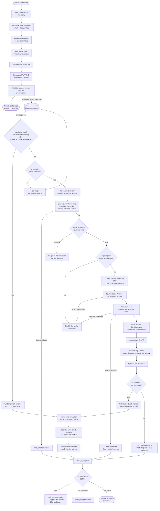
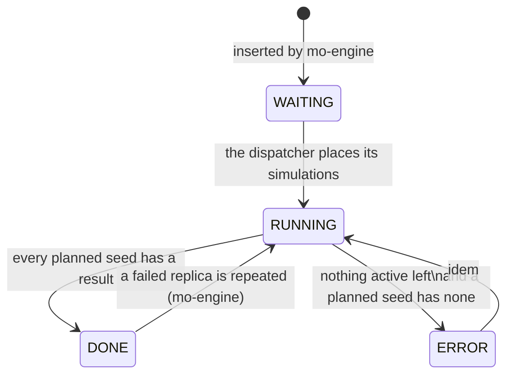

# master-node

The **master-node** is the simulation execution orchestrator in SimLab. It
bridges MongoDB (where experiments and generations are defined) and a pool of
[Cooja](https://github.com/contiki-ng/cooja) simulator containers — on this
machine and on other hosts — managing the full lifecycle of every simulation
job: placement, file transfer, execution, log collection, metric extraction and
status reporting.

Containers are **not** a fixed list of worker threads any more. The master-node
keeps an inventory of *hosts*, each with its own Cooja *workers*, measures
them, and places each simulation on the host carrying the fewest active
simulations. Setup, configuration and limitations are in the main README's
[Distributed Cooja Resources](../README.md#distributed-cooja-resources)
section; this file is about the design and the process.

---

## Architecture Overview

```
┌──────────────────────────────────────────────────────────────────────┐
│                             master-node                              │
│                                                                      │
│  change stream ─▶ ┌────────────┐   decides where   ┌──────────────┐  │
│  (WAITING sims)   │ dispatcher │──────────────────▶│ runner × N   │  │
│                   │ (1 thread) │   reserves a      │ (one thread  │  │
│                   └────────────┘   container       │  per run)    │  │
│                         ▲                          └──────┬───────┘  │
│                         │ capacity                        │          │
│                   ┌─────┴──────┐                          │ transport│
│                   │   health   │ measures hosts and       │ (1 or 2  │
│                   │  monitor   │ workers, frees stale     │  SSH     │
│                   └────────────┘ reservations, reconciles │  hops)   │
│                                  unwatched runs           ▼          │
└──────────────────────────────────────────────────────────────────────┘
                                   │                  Cooja container
                                   ▼                  (local or remote)
                    MongoDB: simulations, generations,
                    hosts, cooja_resources, GridFS
```

Three roles. The dispatcher and the health monitor are one thread each; a
*runner* is one thread **per run**, so the live thread count is three plus the
number of simulations in flight, plus the change-stream watchers.

| Role | Responsibility |
|---|---|
| **dispatcher** (1 thread) | Serialised placement. One decision at a time, which is what makes the load balance correct. |
| **runner** (1 thread per run) | Executes one simulation on one reserved container and gives it back — or takes it out of the pool when it cannot say the run is over. |
| **health monitor** (1 thread) | Measures hosts and workers, frees reservations that never started, reconciles runs nobody is following, re-closes generations left open, and resolves workers held for something unresolved. |
| **lease** (1 thread per preparation) | Renews the reservation of a simulation whose inputs are still being assembled and sent. |
| **watchers** (3 threads) | Change streams on simulations, resources and hosts. |

---

## Startup Sequence

When `master-node.py` starts:

1. **Load settings** from environment variables.
2. **Load the keystore** and publish its public key, so the GUI can seal
   credentials that only this process can open.
3. **Bootstrap the local host** — its containers are seeded from
   `NUMBER_OF_CONTAINERS` on first start, insert-only, so nothing an operator
   changed is undone. Discovery takes over afterwards.
4. **Reconcile occupied containers** — anything still held from a previous
   process is probed: a run still going is *adopted* and followed, one that
   finished has its result collected, and only one that left nothing behind is
   failed. This is why killing the master-node does not destroy running work.
5. **Recover abandoned simulations** — those marked `RUNNING` that no
   container holds. After the reconciliation, and only for what it did not
   cover.
6. **Run the first health cycle, synchronously** — forced, so the pool the
   dispatcher starts from was measured by *this* process rather than inherited
   from the one that ended.
7. **Start the health and dispatcher threads.**
8. **Drain the pending queue** — every simulation already `WAITING`.
9. **Start the change-stream watcher** for simulations entering `WAITING`.
10. **Block** on the main thread (keyboard interrupt exits cleanly).

---

## Components

### `master-node.py`

The entry point. Holds the `Settings` dataclass, all core functions, and `main()`.

| Function | Responsibility |
|---|---|
| `Settings.from_env()` | Reads all configuration from environment variables |
| `recover_abandoned_simulations()` | Fails the `RUNNING` simulations that **no container holds**. Runs *after* the reconciliation, which is what keeps the clock from overruling a probe |
| `prepare_simulation_files()` | Downloads `.csc`, `.dat` and source files from GridFS to a temp dir |
| `run_cooja_simulation()` | Launches Cooja, follows it, collects its artifacts, and **reports**: it writes no simulation state — the runner decides what the outcome means |
| `build_liveness_probe()` | Asks a container what became of a recorded run: alive, finished with an exit code, gone, or no answer |
| `load_initial_waiting_jobs()` | Enqueues all `WAITING` simulations present at startup |
| `_check_and_close_generation()` | After each simulation completes, checks if the whole generation is DONE or ERROR |
| `main()` | Orchestrates startup, watcher, and main loop |

### `lib/scheduler/`

`policy` is the placement decision as a pure function over the inventory;
`inventory` is the snapshot it reads; `dispatcher` is the single-threaded loop
that applies it; `runner` executes one placed simulation and owns every
decision about its outcome.

### `lib/transport/`

How a container is reached: `plan` resolves where to go, `ssh` is the only
implementation (one hop for a local container, two for one on another host),
`hostkey` is the trust policy, `pool` keeps the first hop from being opened
once per worker, and `factory` composes a transport from the stored records.

`resolve` turns a host's name into an address before paramiko sees it, so a
failed lookup is bounded (5 s) and classified: `NameResolutionFailed` says
whether the master-node's resolver did not answer (`resolver_fault`) or the
name does not exist. It also remembers the last address each name connected
on — in memory, and on the host as `resolved_address` — and uses it when the
lookup fails, **only** for a host whose key is pinned: an address that now
belongs to another machine fails the pin instead of being trusted.

### `lib/health.py`

The measuring cycle: Docker says whether a container exists, an SSH probe says
whether it can actually run a simulation, and both must agree before a worker
enters the pool. The cycle also does the housekeeping nothing else owns —
freeing reservations that never started, reconciling runs nobody is following,
and re-closing generations left open with nothing running in them.

A probe carries the host's `config_version`, and a worker whose host's access
settings changed is measured again before it is schedulable. Both halves
matter: clearing the stored measurement does not stop a probe that was
*already running* from writing a positive result for a path that no longer
exists.

Hosts are checked **concurrently** (`INFRA_CHECK_PARALLEL`), each with a
shorter handshake timeout than a simulation's (`INFRA_CONNECT_TIMEOUT_SEC`).
Checked one at a time, a pool with eight hosts down took almost four minutes
per cycle, and the housekeeping after the hosts waited with it.

A remote host that keeps failing is **backed off**: from the cycle that takes
it offline, it waits one interval, then two, four, … up to
`INFRA_BACKOFF_MAX_SEC`, written on the host as `backoff_until`. Its workers
are already out of the pool, so checking every interval only bought another
connect timeout. An operator's check, an edit of the host's access settings
and re-enabling it all skip the wait; a local host never backs off.

The cycle also watches the master-node's own resolver (`lib/dns_watch.py`)
and writes a heartbeat to `master_status` with what it found; the Topology
page reads both. While the resolver answers for **none** of the hosts' names,
a host reached by name is recorded as *not measured*: its status, failure
count and backoff are left alone instead of every host going offline at once
for a fault on the master-node. Its workers still leave the pool, because this
master-node cannot use them, unless the host is reached at its last known
address. See *The master-node cannot resolve host names* below.

### `lib/detached.py`

Launching Cooja in its own session so the JVM outlives a dropped connection,
and following it by polling. This is what lets a simulation survive a
master-node restart.

### `lib/recovery.py`

Deciding what to do with containers still held from a previous process, and
with runs nobody is following. Five answers, kept apart — alive, finished with
a collectable result, gone, unreachable, and *still being prepared*.

The last one is a grace rather than a probe: a container `reserved` moments ago
has had nothing started on it, so there is no process to ask about, and the
stale-reservation sweep is the component that owns that timeout. Concluding
anything from it freed a seconds-old reservation and failed its simulation
while the thread that owned it was still assembling inputs.

### `lib/synthetic_data.py`

Fallback execution mode that replaces actual Cooja runs with benchmark functions
(**DTLZ2** — default, **ZDT1**, **SCH1**), useful for testing the pipeline
without launching the simulator.

> **Note — most synthetic experiments never reach this module.** Experiments
> encoded as `problem0` (the current GUI *Synthetic Instances* flow) are
> evaluated **in-process by the mo-engine** (analytical fast-path in
> `mo-engine/lib/strategy/analytical.py`): no `Simulation` documents are
> created, so the master-node stays idle. This module is only exercised by:
>
> 1. **`batch` strategy** experiments — `BatchStrategy` has no analytical
>    fast-path and always enqueues simulations;
> 2. **Legacy P1-encoded synthetic experiments** — benchmark variables encoded
>    as relay coordinates of a `problem1` instance;
> 3. **The global env-var override** (`ENABLE_DATA_SYNTHETIC=true`), which
>    turns any incoming simulation into a synthetic one.
>
> Keep this module in place while any of these paths is supported.

Two ways to enable it, with the per-experiment config taking precedence over the
environment variables:

- **Per-experiment** — `parameters.simulation.synthetic = { enabled, bench, noise_std }`,
  set through the GUI *Synthetic Instances* editor.
- **Global fallback** — `ENABLE_DATA_SYNTHETIC=true` (+ `BENCH`, `NOISE_STD`).

Both chromosome encodings are supported: the P0 decision vector is read verbatim
from `simulationElements.decisionVector`, while the legacy P1 genome (relay
coordinates, excluding the fixed sink) is normalized to `[0,1]ⁿ` via
`parameters.problem.region`. Objectives are written keyed by
`parameters.objectives[].metric_name`. See
[docs/markdown/SYNTHETIC_MODE.md](../docs/markdown/SYNTHETIC_MODE.md) for the full guide.

---

## Simulation Execution Flow



---

## Attempt State Machine

One *attempt* is one placement of one simulation on one worker, identified by
`attempt_id`. Every transition below is a **single** conditional write, and the
condition is the attempt — which is what makes "two simulations never share a
worker" a property of the database rather than of the code around it.

```mermaid
stateDiagram-v2
    [*] --> preparing : reserve() granted, attempt registered
    preparing --> running : mark_busy(), pid recorded
    preparing --> lost : lease refused, or sweep expired it
    preparing --> unknown : something alive in the run directory
    running --> contact_lost : the link dropped
    contact_lost --> running : reconnected; the run was unaffected
    running --> collecting : exit code recorded
    running --> unknown : had to be stopped and the stop was not confirmed
    collecting --> done : mark_done()
    collecting --> pending_collection : both fetch attempts failed
    collecting --> failed : nothing usable came back
    running --> failed : the run produced nothing
    lost --> [*] : the simulation returns to the queue
    unknown --> [*] : the worker is disabled; a person decides
    done --> [*]
    failed --> [*]
    pending_collection --> [*] : artifacts kept, location recorded
```



Two of these states exist because of what review reproduced:

* **`unknown`** — a run that may still be executing. The worker is taken out of
  the pool by one write that both disables it and lets go of the attempt. It
  used to be two writes, and when the first failed the second still ran.
* **`pending_collection`** — a finished run whose result could not be fetched
  twice. The artifacts are copied to a name the next run's cleanup does not
  know, and `simulation.unfetched_result` records the worker, directory and
  pid. Nothing comes back for them automatically.

### How the hold outlives this process

Being disabled keeps the **dispatcher** off a worker. It does not keep the
*reconciliation* off it: that pass decides from the simulation's state, and a
terminal simulation is not evidence that a remote process ended. So a
quarantine whose write had failed was undone by the next health cycle —
exactly when the database came back.

The decision therefore lives in the document. A held worker carries:

```
held_for: { kind, simulation_id, attempt_id, remote_pid, remote_dir, reason, at }
```

and every write that could make it usable again refuses while it is set:

| Operation | With `held_for` |
|---|---|
| `release`, `force_release` | refuse |
| `reserve` | refuses |
| any status write (`mark_available`, `mark_offline`, …) | refuses |
| `clear_held_for` | the only way out |

`HealthMonitor.resolve_held_workers()` is that way out, and it runs every
cycle. One rule, deliberately conservative: the hold is cleared only when the
container **answers**, has **nothing alive** and has left **nothing behind**.
Still running, still holding bytes, or unreachable — it stays held.

That pass is what lets the quarantine be strict. A worker leaves the pool
whenever something about it is unaccounted for, and most of those causes are
transient; without a pass that asks the container, every network blip around a
launch would need a person.

`contact_lost` is deliberately not an outcome: losing the connection says
nothing about the process on the other end, which is the whole reason the run
is detached.

---

## Generation State Machine



The decision is **by seed, not by document**, and that distinction only
appeared once a failed replica could be repeated. The repeat is a second
document for the same seed and the failed one stays on the record with its
message, so counting documents reported `ERROR` for a generation whose every
planned seed had a result — and whose every individual read `complete`. The
status and the completeness record now use the same unit and cannot disagree.

Two consequences:

- A planned seed with **no simulation at all** closes the generation in
  `ERROR`. Counting documents reported `DONE`, because the one document that
  existed had finished.
- A generation that recorded **no plan** — every one created before
  `expected_seeds` existed — keeps the old document rule exactly. Changing how
  a historical generation reads is a different decision from fixing this one.

Closing a generation is **idempotent and recoverable**: `close_if_finished`
re-reads its simulations every time, and the health cycle repeats it for any
generation left open with nothing running in it. That matters because
publishing a result and closing its generation are two writes over two
documents — and a failure of the second used to propagate back and mark the
*finished* simulation in error.

---

## Configuration (Environment Variables)

| Variable | Default | Description |
|---|---|---|
| `MONGO_URI` | `mongodb://localhost:27017/?replicaSet=rs0` | MongoDB connection string (replica set required for Change Streams) |
| `DB_NAME` | `simlab` | Database name |
| `IS_DOCKER` | `false` | If `true`, seeded hostnames are `cooja1..coojaN` on port 22; otherwise `localhost` on ports `2231+i` |
| `NUMBER_OF_CONTAINERS` | `8` | How many local containers to **seed** on first start. Not a thread count any more: the pool comes from the inventory, and discovery maintains it |
| `SIM_TIMEOUT_SEC` | `3600` | How long one simulation may run, and the cutoff for recovering one left `RUNNING` with no container holding it. `0` disables both |
| `SCHED_POLICY` | `least_loaded_host` | Placement policy — see *Placement policies* below. `least_loaded_host` or `fastest_then_least_loaded` |
| `RUN_POLL_INTERVAL_SEC` | `5` | How often a running simulation is checked on. One cheap round trip each time |
| `INFRA_CHECK_INTERVAL_SEC` | `30` | Health cycle interval |
| `INFRA_FAILURE_THRESHOLD` | `3` | Consecutive failures before a host leaves the pool. Capacity is slow to lose and quick to regain |
| `INFRA_CONNECT_TIMEOUT_SEC` | `8` | Hop-1 handshake timeout (TCP connect and SSH banner) for a **health check**. A simulation's connection keeps 20 s |
| `INFRA_CHECK_PARALLEL` | `8` | Hosts checked at the same time in one cycle |
| `INFRA_BACKOFF_MAX_SEC` | `600` | Longest wait between checks of a host that keeps failing. `0` disables the backoff |
| `DNS_SELF_RESTART` | `true` in Docker | Exit (status 75) so the restart policy starts a new container when the resolver has answered for none of the hosts' names for `DNS_RESTART_AFTER_SEC` and no worker is reserved or busy. See *The master-node cannot resolve host names* |
| `DNS_RESTART_AFTER_SEC` | `300` | How long the resolver must have failed before restarting over it |
| `DNS_RESTART_MIN_INTERVAL_SEC` | `3600` | At most one such restart per interval — the guard against a loop when the machine itself has no DNS. The last restart is stored in `master_status`, so the guard survives the restart |
| `RESERVATION_TTL_SEC` | `600` | How long a container may stay reserved without its simulation starting. Covers only that window — a run that got as far as `busy` is governed by `SIM_TIMEOUT_SEC` |
| `INFRA_KEY_PATH` | `/run/secrets/simlab-infra/x25519.json` | The keystore that opens sealed credentials. The private half never leaves this process |
| `COOJA_JVM_XMS` / `COOJA_JVM_XMX` | `1g` / `2g` | JVM heap for Cooja |
| `ENABLE_DATA_SYNTHETIC` | `false` | Replace Cooja execution with a benchmark function for experiments without a per-experiment `synthetic` block (only affects simulations that reach the master-node — P0 experiments are evaluated in-process by the mo-engine) |
| `BENCH` | `DTLZ2` | Benchmark to use in synthetic mode: `DTLZ2`, `ZDT1`, or `SCH1` |
| `NOISE_STD` | `0.0` | Standard deviation of Gaussian noise added to synthetic objectives |

> These are read by the Python process. Adding one to `.env` does **not** reach
> the service unless it is also listed in the `environment:` block of the
> master-node service in `docker-compose.yaml`.

Two more timeouts are constants rather than variables, because they are
properties of the mechanism rather than of a deployment:
`DEFAULT_PROBE_TTL_SEC` (300s — how long a *ready* probe speaks for its
worker) and `DEFAULT_GENERATION_GRACE_SEC` (300s — how long a generation may
stay open with nothing running before the cycle closes it; it has to outlast
the enqueue of a whole generation, which inserts its simulations one at a
time).

### What the recovery does and does not guarantee

Worth stating precisely, because an earlier version of this file was broader
than the code:

* A run that outlives the master-node is **adopted**, and one that finished
  while the process was down has its result collected. The deadline is applied
  only after the container has been asked.
* **Every lost confirmation around the launch** is treated as a possibly-active
  run: the send failing, the shell answering without a pid, and the pid read
  losing contact all say the same thing about the JVM. A stop that *is*
  confirmed makes it an ordinary failure again.
* **The reservation is held for the whole of the preparation**, by a heartbeat
  rather than by renewals at its two ends. The interval is at most a quarter
  of `RESERVATION_TTL_SEC` (capped at 60 seconds). After three TTLs without a
  launch, the preparation budget closes the SSH transport to interrupt SCP.
  Renewal continues until the upload actually unwinds; an expired timer alone
  never authorizes releasing a worker that is still being written to. Failed
  ownership reads/renewals also stop preparation. A local preparation function
  stuck outside SSH cannot be forcibly interrupted by Python; its worker stays
  held until it returns or the master is restarted. A zero TTL disables both
  expiry and this budget.
* A result that cannot be fetched is retried over a new session. If that also
  fails, the artifacts are **preserved** and their location recorded — nothing
  goes back for them automatically. When the copy *cannot* be made, because
  the second session never opened, the worker is **held** rather than released:
  the original is still under the name the next run deletes.
* **Nothing remote is cleaned until the result is accounted for.** Storing the
  artifacts of an unconfirmed run and then failing to record them on the
  simulation used to be handled as a successful return — the caller cleared
  the container and released the worker, orphaning the blobs *and* deleting
  the evidence.
* A run whose termination could not be confirmed leaves its worker **out of
  the pool**, not released.
* Losing contact is never treated as a failed run.
* There is **no** end-to-end *exactly once*. At most one publication per
  attempt and at most one blob per artefact per attempt; a crash between the
  GridFS upload and the state write leaves blobs nothing references.
* Docker is **not** a requirement for a worker. A hand-registered one needs
  only SSH; Docker's view of it is ignored where an operator stated its
  address.

The thread counts in the overview are per role; the live total is higher,
because each placed simulation gets a follower of its own and each adopted run
another.

---

## Placement Policies

`SCHED_POLICY` chooses one. Both balance by **host**, and the primary rule is
the same in both: the host with the fewest **active placements** — an absolute
count, not a utilisation ratio. The difference matters in the specification's
own example: 8, 4 and 2 free containers and six simulations give 2/2/2 by
count and 3/2/1 by ratio, and the second lets the biggest machine quietly
absorb most of every run.

Worth knowing before choosing: **the absolute count is already speed-aware.**
Counting outstanding work is a closed loop — a slower host holds its
containers longer, so its count stays high, so it stops being selected.
Measured on a three-host pool (8+2+2 containers, 111/139/141 s per
simulation), the resulting split was 71.7/14.6/13.7% against a prediction
from measured throughput of 71.5/14.4/14.1%. No ranking produced that; the
queue did.

### `least_loaded_host` (default)

Ties broken by rotation, so a pool of idle hosts does not queue behind
whichever id sorts first.

### `fastest_then_least_loaded`

The candidate set is first restricted to the hosts that are **not
meaningfully slower** — within `SPEED_TOLERANCE` (10%) of the best measured
free container — and the rule above then decides inside that set, unchanged.

It exists for the one thing the count cannot do: leave a slow host *unused*
while a fast one is free. That is the tail of every generation, and a
generation closes only when its last simulation does, so the batch pays it
once per generation. Measured over 111 generations, the last simulation to
finish ran 12% longer than the median of its own generation on average — but
p90 was +40 s and the worst +1022 s, and the remote hosts were last in 52% of
generations while holding 33% of the capacity.

Breaking the *tie* by speed — the obvious design — does nothing, and the
test that asserts so is kept: after one placement the fast host is strictly
more loaded, so the count sends the next job to a slow host before any tie
can occur. Four jobs on 8+2+2 free containers go 2/1/1 either way.

| | `least_loaded_host` | `fastest_then_least_loaded` |
|---|---|---|
| Pool saturated | identical — the host that releases a container is the only candidate | identical |
| Uniform pool | 2/2/2 on the 8/4/2 example | identical: every host is inside the tolerance |
| No measurements yet | normal | identical — an unmeasured host is sampled first |
| Slack, mixed speeds | spreads one per host; the batch waits for the slowest | keeps the batch on the fast host |
| A genuinely slower host | always gets a share | **left idle while a faster host has room** |

That last row is the whole trade and the reason this is not the default: it
is right for finishing a batch soonest and wrong for spreading work across
machines. The *Work distribution* card on the experiment page shows which one
you got.

### Where the estimate comes from

Each successful run records how long the container was **held** — connection,
upload, run, collection — into `mean_duration_sec` on the worker, as an
exponentially weighted mean (`DURATION_ALPHA = 0.2`, roughly the last ten
runs). Three deliberate choices:

- **Held time, not the simulation's own `start_time`/`end_time`.** The two
  transfers are most of what makes a remote worker slower, and the simulation
  timestamps exclude them.
- **Successful runs only.** A failure that aborted in five seconds would make
  the worst worker look like the best.
- **Not `resume`.** Adopting a JVM that was already running measures the
  remainder of somebody else's run.

What the estimate cannot separate is a slow worker from a worker that happened
to receive harder simulations — duration varies more between individuals than
between machines. It converges anyway, because placement is uncorrelated with
difficulty and the differences worth acting on are large: on the same pool,
the same genome with the same seed took 1.22–1.25x longer on the remote hosts
(283 paired observations) against a few per cent of residual noise.

Writing it is advisory and isolated: a failure is logged and the simulation is
unaffected, because the number only chooses between equally loaded hosts.

---

## Operational Procedures

Six situations the system deliberately does **not** resolve on its own, because
each one needs a decision rather than a default.

### A worker is held and stays held

```
docker exec master_node python /tmp/recover_result.py list
```

`held_for.kind` says why, and there are two:

- **`termination_unknown`** — a launch, a stop or an ownership check that could
  not be confirmed, which all say the same thing about the remote JVM. Cleared
  by `resolve_held_workers()` as soon as the container answers with nothing
  alive and nothing left behind, usually within one health cycle. A hold that
  persists therefore means the container is still unreachable, still running
  something, or still holding bytes — and the resolver logs which.
- **`collection_pending`** — a result was produced and could not be brought
  back. This one is **never** cleared by the health cycle, even when the
  container is healthy and idle, because its bytes may be the only copy of a
  result. Follow the next procedure.

### A result was produced and never collected

`util/recover_result.py`, documented in [util/README.md](../util/README.md).
The short version: `list` to find it, `fetch` to look at the bytes without
touching the database, then `publish` or `discard`, and only then `release`.
The order is enforced — `release` refuses while the simulation still carries an
unresolved `unfetched_result`, because releasing the worker first lets the next
run delete the bytes.

`publish` does not compute metrics and does not change the simulation's status.
Whether a result collected by hand should feed the optimiser is a question
about the experiment.

### A host withdrawal was interrupted

A withdrawal marks the host with `withdrawn_at` first, so nothing can be
created on it or placed on it while the removal runs. Every failure path inside
the operation gives that marker back — a refusal, a write conflict, an
unexpected error — so finding it still set means the **process died** in that
window. The host is then unschedulable and refuses new workers, with nothing in
the interface explaining why.

Two ways out, and the first is usually right:

- repeat the `DELETE /api/v1/infra/hosts/{id}`. Withdrawing is idempotent, so
  it withdraws again and removes whatever is left;
- if the host should stay in service, clear the marker:
  `db.hosts.updateOne({_id: …}, {$unset: {withdrawn_at: ""}})`.

A 409 is not an interrupted withdrawal: it means a worker is holding a
simulation, or a registration committed against the host while the removal was
running, and **nothing was removed** — the transaction rolled back and the host
is back in service. Try again.

A worker with `held_for` also blocks both its own deletion and its host's
removal, even if quarantine cleared the active reservation. Resolve the run or
recover the retained result first. The transaction rolls back every deletion;
there is no partial-success `200/stranded` response.

### A host key has to be replaced

The pin is written on first contact and never overwritten — a second path
reaching the host with a different key has its session refused, not the pin
rewritten. So a legitimate key change (a rebuilt machine, a rotated key) is an
**administrative** act:

```
PUT /api/v1/infra/hosts/{id}   {"access": {"host_key_fingerprint": null}}
```

Clearing it puts the host back to first contact, and the next connection pins
what it sees. Until it is cleared, every session is refused with the stored and
the presented fingerprint in the message — which is the intended behaviour when
the change was *not* legitimate.

An operator who knows the new fingerprint out of band can send it as a string
instead of a null: that is a stronger position than trust-on-first-use, so it
is allowed. A document or a boolean is refused with a 422.

Either way the request touches `access`, so the host's configuration version is
bumped and its workers' probes are cleared — they leave the pool until the next
health cycle measures them against the new configuration. That is deliberate: a
key change is a reason to re-verify the path, not to keep trusting the last
measurement.

### Several hosts share one host key

The Infrastructure page warns when hosts on **different endpoints** present
the same SSH host key. That is what cloned VM images look like when the host
keys were not regenerated after cloning, and it defeats pinning: the pin is
what tells one host from another, so a port forward pointing at the wrong VM
is accepted without a word, and whoever holds one clone's private key can
impersonate all of them.

The fix is on the machines. On each one:

```
sudo rm /etc/ssh/ssh_host_*
sudo ssh-keygen -A                 # or: sudo dpkg-reconfigure openssh-server
sudo systemctl restart ssh         # `sshd` on RHEL-like systems
```

Then clear each host's pin, as in *A host key has to be replaced* above, so
the next check learns the new key:

```
PUT /api/v1/infra/hosts/{id}   {"access": {"host_key_fingerprint": null}}
```

Until the pin is cleared every session to that host is refused with both
fingerprints in the message — the intended response to a key that changed.
Clients that connect by hand (`ssh` from a terminal) will also report the
change, and need their `known_hosts` entry removed (`ssh-keygen -R`).

### The master-node cannot resolve host names

Symptom: every host registered **by name** goes unmeasured at once, the
Topology page flags the master-node with *DNS not answering*, and the log says
`DNS: the DNS resolver did not answer for any of N host name(s)`, while `ssh`
to the same names from a terminal on the same machine works.

Cause, as observed in deployment: Docker's embedded resolver (`127.0.0.11`)
copies the machine's upstream DNS servers when the container **starts** and
never reads them again. After the machine moves to another network — home to
lab, a VPN coming up or down — the container keeps asking servers it can no
longer reach. `docker exec master_node cat /etc/resolv.conf` shows the copied
list in its `ExtServers` comment.

What happens on its own:

- hosts with a pinned key are reached at their **last known address**, so
  work continues on them, with a note in the host's message;
- hosts reached by name are not counted as failing, so nothing is taken
  offline or backed off for it;
- once the resolver has failed for `DNS_RESTART_AFTER_SEC` and nothing is
  reserved or busy, the master-node **restarts itself** and Docker gives the
  new container the machine's current servers. A running simulation is never
  interrupted for this — the restart waits for an idle pool — and at most one
  such restart happens per `DNS_RESTART_MIN_INTERVAL_SEC`.

By hand, at any time: `docker restart master_node`.

If a restart does not help, the machine itself has no working DNS, and the
guard stops further restarts. Fix the machine's resolver, or register the
hosts by IP address. Pinning servers in `docker-compose.yaml`
(`dns: [1.1.1.1, 8.8.8.8]` on the master-node service) also works, **but** it
breaks on networks that block external DNS and cannot resolve names that only
a local DNS server knows — which is why it is not the default.

### A worker carries old port data

An older version of the worker form wrote the port into `connection.port` as
well as `endpoint.port`, and the override wins in the connection plan. Editing
such a worker through the current form removes the override, so the port the
page shows is the port `build_plan()` uses. To keep an override on purpose,
send it in the same body as the endpoint; to drop one explicitly, send
`connection.port: null`.

The effective precedence, in `build_plan()` and in the form, is the same:
`connection.port` → `endpoint.port` → the host's `container_access.port` → 22.

### A timestamp looks wrong

Everything is stored and read as **aware UTC** (`tz_aware=True`), and the API
serialises with an offset. A naive value already in the database is read as
UTC, which is correct for the data that exists: every process that wrote one
ran with its clock on UTC. **No data was migrated**, and importing timestamps
from another origin or timezone is a separate problem that needs its own
policy — do not assume this one covers it.

If a measurement appears to be in the future, the first thing to check is the
browser's clock against the server's: the GUI resolves offsets locally.

---

## File Layout

```
master-node/
├── master-node.py          # Entry point: settings, startup sequence, the
│                           #   execution of one simulation
└── lib/
    ├── scheduler/
    │   ├── policy.py       # Where a simulation goes, as a pure function
    │   ├── inventory.py    # The snapshot the policy reads
    │   ├── dispatcher.py   # The single-threaded loop that places work
    │   └── runner.py       # Runs one placed simulation; owns the outcome
    ├── transport/
    │   ├── plan.py         # Which address, one hop or two
    │   ├── ssh.py          # The transport itself, with the tunnel
    │   ├── hostkey.py      # Trust on first use, and refusing a change
    │   ├── pool.py         # One first hop per host per cycle
    │   ├── session.py      # A session on a host, with no container
    │   └── factory.py      # Composes a transport from the stored records
    ├── dockerctl/          # Asking Docker what containers exist
    ├── health.py           # The measuring cycle and the stale sweep
    ├── detached.py         # Launching Cooja so it outlives the connection
    ├── recovery.py         # What to do with containers still held
    ├── discovery.py        # Reconciling the inventory with Docker
    ├── credentials.py      # Opening sealed secrets; never logging them
    ├── bootstrap.py        # Seeding the local host, insert-only
    └── synthetic_data.py   # Benchmark-based simulation replacement
```

---

## Dependencies

- **paramiko** + **scp** — SSH client and file transfer
- **pandas** — CSV parsing for log conversion
- **pymongo** + **bson** — MongoDB driver
- **pylib** (internal) — shared repositories, models, metrics, and Cooja file utilities

---

## Interaction with Other Services

| Service | How it interacts |
|---|---|
| **mo-engine** | Inserts `Generation` documents with status `WAITING`, which triggers the Change Stream watcher |
| **MongoDB** | Persistence for simulations, generations, the host and worker inventory, and file storage (GridFS) |
| **Cooja containers** | Receive simulation files over SCP, run Cooja, return `COOJA.testlog`. Local ones are reached directly; those on another host through a `direct-tcpip` channel on the host's own SSH session, so no container port has to be published |
| **rest-api** | Reads what the master-node measures and writes. It records *requests* for a check or a discovery — it has neither a route to the container network nor the key that opens a credential, so the work happens here |
| **Docker** | Asked what containers exist: over the mounted socket for the local host, over the host's SSH session for a remote one |

---

## Credentials

A host's SSH credential is sealed in the browser against this process's public
key and stored sealed. The private half lives only here, in
`INFRA_KEY_PATH`, and the API has no way to open one — deliberately, and
there is a test that sabotages the crypto library in `sys.modules` to prove
the API does not depend on it.

A host key is pinned on first contact and a change afterwards refuses the
connection, with the message naming how to clear it if the host was
legitimately rebuilt.
