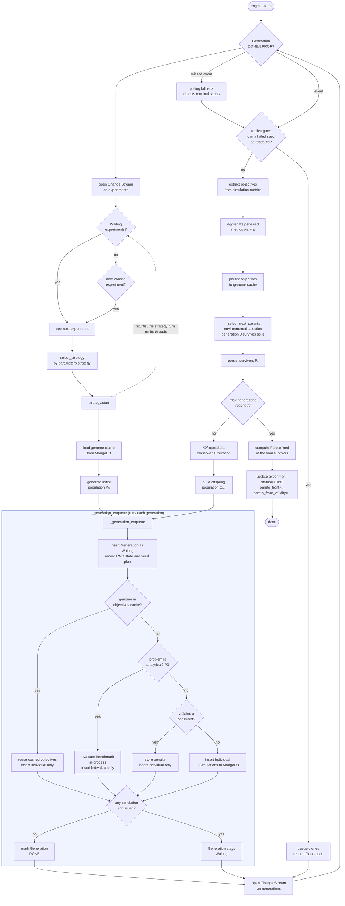

# mo-engine

The **mo-engine** is the multi-objective optimisation service of SimLab. It runs as an independent Docker container, watches MongoDB for new experiments, and drives the full evolutionary loop — from initial population generation to Pareto front extraction. It coordinates with the other services through MongoDB Change Streams, with a periodic poll as a fallback for missed events.

---

## Table of Contents

- [Overview](#overview)
- [Architecture](#architecture)
- [Available Strategies](#available-strategies)
- [Operation Flow](#operation-flow)
  - [Startup](#startup)
  - [Strategy Execution Flowchart](#strategy-execution-flowchart)
  - [Key Design Decisions](#key-design-decisions)
- [Components](#components)
- [Extending the Engine](#extending-the-engine)
  - [Adding a New Strategy from Scratch](#adding-a-new-strategy-from-scratch)
  - [Adding a New NSGA-III Variant (selection-only override)](#adding-a-new-nsga-iii-variant-selection-only-override)
  - [Adding a New Problem](#adding-a-new-problem)
- [Configuration Reference](#configuration-reference)

---

## Overview

The mo-engine implements the **Strategy** design pattern. An *experiment* document in MongoDB carries a `parameters.strategy` field that selects which algorithm runs. The engine picks up experiments in `Waiting` status (and, at startup, resumes those left `Running`), instantiates the appropriate strategy, and calls `start()`. From that point on, the strategy manages its own lifecycle through MongoDB Change Streams. Several experiments can be in progress at once.

The engine never directly communicates with the Cooja simulator. Instead, it writes simulation documents to MongoDB and waits for them to complete — the **master-node** handles all simulation scheduling and execution.

---

## Architecture

```
┌──────────────────────────────────────────────────────────────────────┐
│                             mo-engine                                │
│                                                                      │
│  engine.py                                                           │
│  ├── resume experiments left Running (at startup)                    │
│  ├── watch experiments (Change Stream: status=Waiting)               │
│  ├── capture_firmware_snapshot()     (pylib)                         │
│  ├── runtime-metrics watcher         (pylib/telemetry)               │
│  └── select_strategy() → EngineStrategy.start()                      │
│                                                                      │
│  lib/strategy/                                                       │
│  ├── base.py          EngineStrategy (ABC)                           │
│  ├── nsga3.py         NSGA3LoopStrategy  ──────┐  native NDS+niching │
│  ├── nsga3_deap.py    NSGA3DeapStrategy  ──────┤  DEAP selNSGA3      │
│  ├── nsga3_pymoo.py   NSGA3PymooStrategy ──────┘  pymoo survival     │
│  ├── nsga2.py         NSGA2LoopStrategy (+ deap/pymoo variants)      │
│  ├── batch.py         BatchStrategy                                  │
│  ├── random_search.py RandomSearchStrategy                           │
│  ├── usl_benchmark.py UslBenchmarkStrategy (scalability)             │
│  ├── completeness.py  ReplicaGate: replica evidence and repeats      │
│  └── analytical.py    in-process evaluation of P0 benchmarks         │
│                                                                      │
│  lib/problem/                                                        │
│  ├── adapter.py       ProblemAdapter (ABC)                           │
│  ├── p0_synthetic.py  analytical benchmarks (evaluated in-process)   │
│  ├── mac_gene.py      pins the MAC gene under a single firmware      │
│  └── p1..p4_*.py      problem-specific logic (chromosome, GA ops)    │
└──────────────────────────────┬───────────────────────────────────────┘
                               │ reads / writes
                        ┌──────▼──────┐
                        │   MongoDB   │
                        │             │
                        │ experiments │
                        │ generations │
                        │ individuals │
                        │ simulations │
                        │ genome_cache│
                        └──────┬──────┘
                               │ Change Stream
                        ┌──────▼──────┐
                        │ master-node │  (schedules and runs
                        └─────────────┘   Cooja simulations)
```

---

## Available Strategies

| `parameters.strategy` | Class | Selection mechanism | Analytical fast-path (P0) | External deps |
|---|---|---|---|---|
| `nsga3` | `NSGA3LoopStrategy` | Native NDS + NSGA-III niching | ✅ | — |
| `nsga3_deap` | `NSGA3DeapStrategy` | DEAP `tools.selNSGA3` | ✅ (inherited) | `deap >= 1.3` |
| `nsga3_pymoo` | `NSGA3PymooStrategy` | pymoo `ReferenceDirectionSurvival` | ✅ (inherited) | `pymoo >= 0.6` |
| `nsga2` | `NSGA2LoopStrategy` | Native NDS + crowding distance | ✅ | — |
| `nsga2_deap` | `NSGA2DeapStrategy` | DEAP `tools.selNSGA2` | ✅ (inherited) | `deap >= 1.3` |
| `nsga2_pymoo` | `NSGA2PymooStrategy` | pymoo `RankAndCrowdingSurvival` | ✅ (inherited) | `pymoo >= 0.6` |
| `batch` | `BatchStrategy` | No evolution — evaluates one generation ([not creatable through the API](lib/strategy/README.md#batch)) | ❌ (relies on master-node) | — |
| `random_search` | `RandomSearchStrategy` | None: each generation is drawn by the problem's random generator | ✅ | — |
| `usl_benchmark` | `UslBenchmarkStrategy` | None: measures the infrastructure; created by `POST /scalability/` | ❌ (P0 does not apply) | — |

`parameters.strategy` is required in practice: an absent or unknown value ends the experiment in `Error`.
DEAP and pymoo are pinned in `requirements.txt` and installed in the image; the imports are deferred only so that the native strategies also load without them.

The DEAP and pymoo variants share **all** SimLab infrastructure with their native base classes (Change Streams, Genome Cache, ProblemAdapter operators, resume capability) and differ only in the environmental-selection step (pymoo's NSGA-III also checkpoints its normalization). They exist to compare selection implementations inside the platform. The standalone scripts behind **Table 3** of the companion article are a separate benchmark, in [experiments/external-nsga3-benchmark](../experiments/external-nsga3-benchmark/README.md).

### Analytical fast-path (P0 synthetic benchmarks)

For analytical problems (`problem0` — DTLZ2/ZDT1/SCH1 benchmarks) the objectives
are a closed-form function of the decision vector, so the strategies evaluate
them **in-process** via [lib/strategy/analytical.py](lib/strategy/analytical.py)
instead of enqueuing `Simulation` documents. This skips the MongoDB round-trip
and the master-node hop entirely: the generation completes through the
"no simulations pending → mark DONE" path.

`BatchStrategy` is the exception — it has no analytical fast-path and always
enqueues simulations, which the **master-node** evaluates synthetically when
synthetic mode is enabled (`master-node/lib/synthetic_data.py`). See
[docs/markdown/SYNTHETIC_MODE.md](../docs/markdown/SYNTHETIC_MODE.md) for the
full picture of the two evaluation paths.

### Aggregator parameter (`Ψa`)

The optimization strategies, `batch` included, collapse the per-seed metrics of an individual into one value per objective with a seed aggregator. Each objective can name its own (`parameters.objectives[i].aggregator`); `parameters.simulation.aggregator` is the default for the objectives that do not, and mean the default of that:

| Value | Behaviour |
|---|---|
| `"mean"` (default) | arithmetic mean — backward-compatible with all existing experiments |
| `"median"` | robust to outlier seeds |
| `"trimmed_mean"` | requires dict form: `{"kind": "trimmed_mean", "trim": 0.1}` — drops ⌊trim·n⌋ seeds from each end |
| `"min"` / `"max"` | lower / upper bound across seeds — the worst case is `max` for a minimized metric and `min` for a maximized one |

```jsonc
"simulation": {
    "duration": 180,               // simulated minutes
    "random_seeds": [336157, 667370],
    "aggregator": "median"
},
"objectives": [
    {"metric_name": "latency",    "goal": "min", "aggregator": "max"},
    {"metric_name": "energy",     "goal": "min"},
    {"metric_name": "throughput", "goal": "max", "aggregator": "min"}
]
```

Here latency and throughput are judged by the worst seed and energy by the
median. It applies to analytical problems (P0) as well. A metric listed in two
objectives must use the same aggregator, since per-seed values are collected
per metric. `POST /experiments/` validates all of this
(`pylib/seed_aggregation.py`) and answers 422 naming the field, and the GUI
launch wizard sets it per objective in step 4 (*Objectives*).

---

## Operation Flow

### Startup

When the container starts, `engine.py`:

1. Starts the runtime-metrics watcher ([RUNTIME_METRICS.md](../docs/markdown/RUNTIME_METRICS.md)).
2. Resumes each experiment left `Running` by a previous process (`resumed_at` records it). This comes before anything new is started, so nothing this process starts is taken for a run to resume.
3. Opens a Change Stream on the `experiments` collection to handle future experiments.
4. With the stream listening, claims each experiment in `Waiting` (it becomes `Running`), copies its firmware ([FIRMWARE_TRACEABILITY.md](../docs/markdown/FIRMWARE_TRACEABILITY.md)) and starts its strategy. The scan repeats whenever the stream reopens. The claim is atomic, so an experiment seen by both the scan and the stream is started once.

What a resume restores depends on the strategy:

| Strategy | On resume |
|---|---|
| NSGA-II / NSGA-III and their variants | Population order, survivors, RNG state and the evidence behind each vector, so the run continues as it would have |
| `batch` | Its single generation, with the penalties written at enqueue and their evidence |
| `usl_benchmark` | The last wave and the recorded workload |
| `random_search` | The population, the archive and the RNG state, so the run continues as it would have ([details](lib/strategy/README.md#random-search)) |

### Known issues

- **A finished experiment does not release its threads.** Its change-stream
  watchers never return: in a test, each experiment left about 15 threads, 7
  MongoDB connections and 50–100 MB behind, and the engine ran out of 4 GB
  after some 70 of them. Restart the engine between batches, with nothing
  running.
- **Cancelling a scalability benchmark does not stop it.** `usl_benchmark` does
  not read the cancellation: it runs every wave and then overwrites `Cancelled`
  with `Done`.
- **An NSGA restart during an enqueue is not detected.** The generation is
  resumed as a fragment: it can wait for ever or be evaluated with individuals
  missing.
- **An empty `parameters.algorithm` fails at start** with
  `AttributeError: ... '_rng'`: the adapter receives the generator only with a
  non-empty configuration.

### Strategy Execution Flowchart

For NSGA-II and NSGA-III. The other strategies are described in
[lib/strategy/README.md](lib/strategy/README.md).



### Key Design Decisions

| Decision | Rationale |
|----------|-----------|
| **Change Streams instead of polling** | The engine reacts immediately when a generation finishes without holding a thread in a tight loop. |
| **Polling fallback** | If a Change Stream event is missed during a reconnection gap, a periodic poll (`BATCH_POLL_INTERVAL`, 30 s) catches the terminal status. |
| **Genome cache (`genome_cache` collection)** | Objectives computed for a chromosome are persisted per experiment, with the evidence behind them. If the same chromosome re-appears in a later generation, both are reused — no simulation is re-queued, including for a vector the policy refused. This also survives mo-engine restarts. Used by NSGA-II/III and random search. |
| **Analytical fast-path for P0** | When `ProblemAdapter.is_analytical` is true (P0 synthetic benchmarks), objectives are computed in-process (`lib/strategy/analytical.py`) and no `Simulation` document is ever enqueued — the master-node is bypassed entirely. Only `BatchStrategy` lacks this path and still relies on the master-node's synthetic evaluator. |
| **Nothing to simulate → DONE right after enqueue** | When every genome of a generation is cached, analytical or penalised, there is nothing for the master-node to execute. The generation is inserted `Waiting`, like any other, then marked `Done`, and its handler is also triggered directly in case the event is missed. |
| **`_gen_index` incremented before generation insert** | The Change Stream callback runs on a separate thread. Incrementing the index before inserting avoids a race where the callback fires and reads a stale index. |
| **Generation inserted before its simulations** | A fast worker can finish before the last simulation is inserted; the close has to land on a document that exists. |
| **Worst-objective fallback** | A failed replica is first repeated once (see [Replica completeness](lib/strategy/README.md#replica-completeness-completenesspy)). An evaluation that stays incomplete, or has a non-finite value, gets the finite sentinel `1e12` in every objective (minimisation space) and is recorded as not used. This keeps the loop running, though it biases the search against that chromosome. |
| **Constraint penalty** | An infeasible chromosome is not simulated: it gets `1e9 × (1 + deficit)` and the state `infeasible` (P1 and P2 only). |
| **MAC gene pinned under a single firmware** | With one source repository the gene cannot express anything; `lib/problem/mac_gene.py` pins it where chromosomes are made, so the stored gene is the one that ran. |
| **Cooperative cancellation** | A cancelled experiment stops at the next generation boundary; simulations already queued still run. |
| **`_select_next_parents()` hook** | Environmental selection is isolated in a single overridable method. DEAP and pymoo variants inherit all infrastructure and override only this one method, minimising code duplication and regression surface. |

---

## Components

```
mo-engine/
├── engine.py                    # Entry point: watches experiments, dispatches strategies
│
├── lib/
│   ├── strategy/
│   │   ├── base.py              # EngineStrategy ABC (start, stop, event_*)
│   │   ├── nsga3.py             # NSGA-III (native NDS + niching)
│   │   ├── nsga3_deap.py        # NSGA-III via DEAP selNSGA3 (optional dep)
│   │   ├── nsga3_pymoo.py       # NSGA-III via pymoo ReferenceDirectionSurvival (optional dep)
│   │   ├── nsga2.py             # NSGA-II (crowding distance)
│   │   ├── nsga2_deap.py        # NSGA-II via DEAP selNSGA2 (optional dep)
│   │   ├── nsga2_pymoo.py       # NSGA-II via pymoo RankAndCrowdingSurvival (optional dep)
│   │   ├── batch.py             # Batch evaluation (no evolution)
│   │   ├── random_search.py     # Uniform random search (baseline strategy)
│   │   ├── usl_benchmark.py     # Scalability benchmark of the infrastructure
│   │   ├── analytical.py        # In-process evaluation of P0 benchmarks (no simulations)
│   │   ├── completeness.py      # Replica policy, gate and front validity
│   │   ├── library_rng.py       # Seeds DEAP/pymoo from the engine RNG; RNG checkpoints
│   │   └── simulation_seeds.py  # Seed utilities
│   │
│   ├── problem/
│   │   ├── adapter.py           # ProblemAdapter ABC (incl. is_analytical hook)
│   │   ├── chromosomes.py       # Chromosome types (P0–P4) + get_hash()
│   │   ├── resolve.py           # PROBLEM_REGISTRY + build_adapter()
│   │   ├── mac_gene.py          # MAC gene pinned under a single firmware
│   │   ├── p0_synthetic.py      # P0: pure analytical benchmark (DTLZ2/ZDT1/SCH1)
│   │   ├── p1_continuous_mobility.py
│   │   ├── p2_discrete_mobility.py
│   │   ├── p3_target_coverage.py
│   │   └── p4_mobile_sink_collection.py
│   │
│   ├── nsga/                    # NSGA selection primitives
│   │   ├── fast_nondominated_sort.py
│   │   ├── niching_selection.py  # NSGA-III reference-point niching
│   │   └── crowding_distance.py  # NSGA-II crowding distance
│   │
│   ├── genetic_operators/       # Crossover, mutation, selection implementations
│   │   ├── crossover/
│   │   ├── mutation/
│   │   └── selection/
│   │
│   └── util/                    # Network generation, connectivity and coverage, Cooja inputs
│
├── simulation_template.xml      # Cooja template every simulation is generated from
├── tests/                       # pytest suite; run `pytest -q` from this directory
│   ├── regression/              # Frozen NSGA baseline (see its README)
│   ├── test_replica_completeness.py  # replica policy and gate
│   ├── test_resume_reproducibility.py # resumed run == uninterrupted run
│   ├── test_nsga2/3_adapters.py      # DEAP / pymoo selection hooks
│   ├── test_encode_p1..p4.py         # chromosome encode / decode
│   └── ...                           # operators, coverage, validity guards, benchmark
│
└── requirements.txt             # pymongo, numpy, pandas, matplotlib, deap, pymoo, pyarrow, zstandard
```

---

## Extending the Engine

### Adding a New Strategy from Scratch

A strategy encapsulates a complete optimisation algorithm. A new one should also use `ReplicaGate` and `pin_mac_gene`, as the existing ones do, and be added to the launch wizard (`Step2Experiment.vue`). The contract is defined by `EngineStrategy` in [lib/strategy/base.py](lib/strategy/base.py).

**Step 1 — Implement the ABC:**

```python
# lib/strategy/my_strategy.py
from lib.strategy.base import EngineStrategy

class MyStrategy(EngineStrategy):

    def start(self):
        # Set up experiment state, generate initial solutions,
        # insert documents to MongoDB, open Change Streams.
        ...

    def stop(self):
        # Signal threads to exit.
        ...

    def event_simulation_done(self, sim_doc: dict):
        # Called for every simulation reaching DONE/ERROR.
        # Use for progress accounting only — do not drive flow here.
        ...

    def event_generation_done(self, gen_doc: dict):
        # Called when a generation reaches DONE/ERROR.
        # Drive the algorithm forward: extract objectives, evolve, enqueue next batch.
        ...
```

**Step 2 — Register the strategy in `engine.py`:**

```python
def select_strategy(exp_doc: dict) -> EngineStrategy:
    exp_type = exp_doc.get("parameters", {}).get("strategy", "simple")
    if exp_type == "nsga3":
        return NSGA3LoopStrategy(exp_doc, mongo)
    if exp_type == "my_strategy":          # ← add this
        return MyStrategy(exp_doc, mongo)
    raise ValueError(f"Unknown strategy: {exp_type}")
```

**Step 3 — Submit an experiment** with `parameters.strategy = "my_strategy"`.

> **Tip:** The `mongo` object (`MongoRepository`) gives you access to all repositories and the GridFS handler. You do not need to manage the MongoDB connection directly. See [pylib/db/factory.py](../pylib/db/factory.py) for the full list of available repositories.

---

### Adding a New NSGA-III Variant (selection-only override)

If you want to compare a different selection library while keeping the full SimLab infrastructure (Change Streams, Genome Cache, resume, ProblemAdapter operators), inherit from `NSGA3LoopStrategy` and override only `_select_next_parents()`.

```python
# lib/strategy/nsga3_mylib.py
from .nsga3 import NSGA3LoopStrategy

class NSGA3MyLibStrategy(NSGA3LoopStrategy):
    """NSGA-III with selection from my-library."""

    def __init__(self, experiment: dict, mongo) -> None:
        super().__init__(experiment, mongo)
        # Optional: import and initialise your library here.
        # All imports should be deferred so the module loads without the dep.
        ...

    def _select_next_parents(
        self,
        R_population: list,          # len = len(parents) + len(offspring)
        R_objectives: list[list[float]],  # same order, minimisation space
    ) -> list:
        """Return exactly self._pop_size chromosomes selected from R_population."""
        # Use R_objectives for selection; map result indices back to R_population.
        selected_indices = my_library.select(R_objectives, self._pop_size)
        return [R_population[i] for i in selected_indices]
        # Return None only if you call self._finalize_experiment() first.
```

Then register:

```python
if exp_type == "nsga3_mylib":
    return NSGA3MyLibStrategy(exp_doc, mongo)
```

Key invariants for the override:

- `R_population[i]` and `R_objectives[i]` correspond to the same individual.
- Objectives are already in **minimisation space** (max-objectives are sign-flipped).
- The method must return a list of **exactly `self._pop_size`** chromosomes drawn from `R_population`, OR return `None` after calling `self._finalize_experiment()`.
- `self._divisions` holds the reference-point granularity, `self._ga_rng` is the seeded `random.Random` instance for reproducibility. Derive any library generator from it (`lib/strategy/library_rng.py`).
- A selection that keeps history between generations must also override `_dump_selection_state()` and `_restore_selection_state()`, or a resume will not reproduce the run.

---

### Adding a New Problem

A problem defines the chromosome representation, how to generate and evolve individuals, and how to encode a chromosome into a Cooja simulation configuration. The contract is `ProblemAdapter` in [lib/problem/adapter.py](lib/problem/adapter.py).

**Step 1 — Define the chromosome:**

```python
# lib/problem/chromosomes.py  (add at the bottom)
@dataclass(frozen=True, slots=True)
class ChromosomeP5(ChromosomeBase, Chromosome):
    mac_protocol: MacGene
    # ... your genes ...

    def to_dict(self) -> dict:
        return {"mac_protocol": self.mac_protocol, ...}

    def __eq__(self, other): ...
    def __hash__(self): ...
    # get_hash() is inherited from Chromosome (SHA-1 of to_dict()).
    # Override it when to_dict() is not canonical under __eq__.
```

Also add the class to `chromosome_from_dict()` (used on resume) and to the
`Chromosome` alias in `adapter.py`.

**Step 2 — Implement the adapter:**

```python
# lib/problem/p5_my_problem.py
from .adapter import ProblemAdapter

class Problem5MyProblemAdapter(ProblemAdapter):
    CONSUMED_GA_KEYS = frozenset({"per_gene_prob"})   # the GA keys it reads

    def assert_problem(self, problem): ...
    def set_ga_operator_configs(self, rng, params): ...
    def random_individual_generator(self, size): ...
    def crossover(self, parents): ...
    def mutate(self, chromosome): ...
    def penalty_objectives(self, chromosome, n_obj): ...   # return None if feasible
    def encode_simulation_input(self, ind) -> SimulationElements: ...
```

**Step 3 — Register the problem:**

```python
# lib/problem/resolve.py
PROBLEM_REGISTRY: dict[str, Type[ProblemAdapter]] = {
    "problem1": Problem1ContinuousMobilityAdapter,
    ...
    "problem5": Problem5MyProblemAdapter,   # ← add this
}
```

**Step 4 — Reference the problem in the experiment JSON:**

```json
{
  "parameters": {
    "strategy": "nsga3",
    "problem": { "name": "problem5", ... }
  }
}
```

> See [lib/problem/README.md](lib/problem/README.md) for the mathematical definitions of the existing problems and their chromosome representations.

---

## Configuration Reference

Key environment variables consumed by the mo-engine container (the telemetry ones are in [RUNTIME_METRICS.md](../docs/markdown/RUNTIME_METRICS.md#configuration-mo-engine-environment)):

| Variable | Default | Description |
|---|---|---|
| `MONGO_URI` | `mongodb://localhost:27017/?replicaSet=rs0` | MongoDB connection string. Replica set is required for Change Streams. |
| `DB_NAME` | `simlab` | Database name. |
| `BATCH_POLL_INTERVAL` | `30` | Seconds between polling-fallback checks of the current generation. Used by every strategy, despite the name. |
| `TEMPLATE_XML` | `./simulation_template.xml` | Cooja template. The image sets `/app/mo-engine/simulation_template.xml`. |
| `IS_DOCKER` | unset | Selects container defaults (telemetry URL). |
| `GRIDFS_COMPRESSION` / `GRIDFS_COMPRESSION_LEVEL` | `zstd` / `12` | Compression of the files it writes ([GRIDFS_STORAGE.md](../docs/markdown/GRIDFS_STORAGE.md)). |

Key `parameters` fields in the experiment document:

| Field | Description |
|---|---|
| `parameters.strategy` | Strategy name (see [Available Strategies](#available-strategies)) |
| `parameters.objectives[].metric_name` | Metric key in `network_metrics` |
| `parameters.objectives[].goal` | `"min"` or `"max"` |
| `parameters.objectives[].aggregator` | Seed aggregator of that objective |
| `parameters.algorithm.population_size` | Population size (μ). Default 20 |
| `parameters.algorithm.number_of_generations` | Evolution steps `T`. Default 5. Generation 0 is extra: `T + 1` generations are evaluated |
| `parameters.algorithm.random_seed` | GA RNG seed for reproducibility. Default 42 |
| `parameters.algorithm.prob_cx`, `prob_mt` | Crossover probability per pair (0.8) and mutation probability per child (0.2). The per-gene keys are per [problem](lib/problem/README.md#ga-parameter-consumption-per-problem) |
| `parameters.algorithm.divisions` | Reference-point granularity (NSGA-III). Default 10 |
| `parameters.simulation.duration` | Simulated **minutes**, as an integer. Default 120 |
| `parameters.simulation.random_seeds` | Seeds for simulation runs per individual. Default `[123456]` for NSGA-II/III |
| `parameters.simulation.random_seeds_count` | `random_search` and `batch` only: how many seeds to draw when `random_seeds` is absent |
| `parameters.simulation.replica_policy`, `max_replica_retries`, `incomplete_objective` | [Replica policy](lib/strategy/README.md#the-policy) |
| `parameters.simulation.synthetic` | [Synthetic mode](../docs/markdown/SYNTHETIC_MODE.md) |
| `parameters.simulation.aggregator` | Seed aggregator (`"mean"`, `"median"`, `"trimmed_mean"`, `"min"`, `"max"`) |
