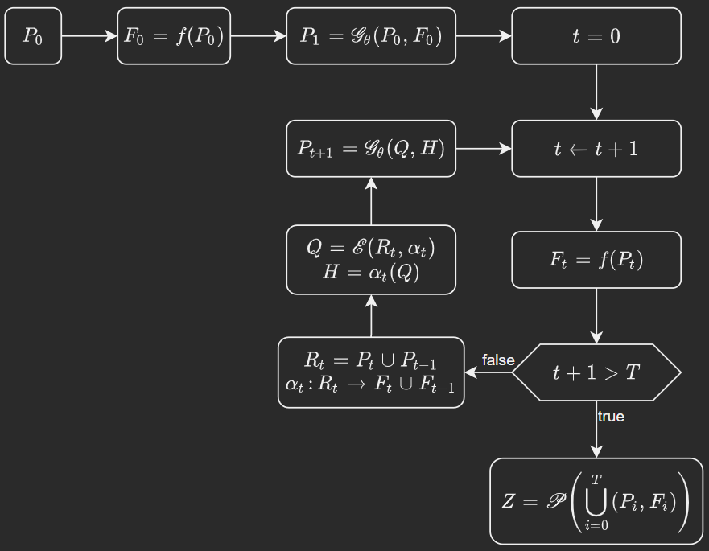

# Strategies

## NSGA-III

The diagram above illustrates the execution flow of the NSGA-III strategy adopted in this work.



Let us define the following elements:

- $N \in \mathbb{Z}_+$ denotes the population size.
- $X$ denotes the configuration (decision) space of the problem.
- $Y$ denotes the objective space.
- $\Theta$ is the parameter space associated with the genetic operators.
- The genetic operator is defined as
  $$
  \mathcal{G} : \Theta \times X^N \times Y^N \rightarrow X^N,
  $$
  and, for a fixed parameter vector $\theta \in \Theta$, we write
  $$
  \mathcal{G}_\theta : X^N \times Y^N \rightarrow X^N.
  $$
- $f : X \rightarrow Y$ is the evaluation (or simulation) function that maps a configuration $x \in X$ to its corresponding objective vector in $Y$.
- $t \in \mathbb{Z}_+$ denotes the generation index, and $T \in \mathbb{Z}_+$ is the maximum number of generations.
- For each generation $t$, $P_t \subset X$ denotes the population at generation $t$, and $F_t = f(P_t) \subset Y$ denotes the corresponding set of objective vectors.
- The intermediate population
  $$
  R_t = P_t \cup P_{t-1}
  $$
  aggregates the current and previous populations. This constitutes a slight abuse of notation. Strictly speaking, $P_t$ and $P_{t-1}$ denote populations, that is, finite collections of chromosomes, each of which corresponds to a point in the configuration space $X$. Therefore, $R_t$ should be understood as the union of the sets of decision vectors in $X$ induced by the individuals of $P_t$ and $P_{t-1}$, rather than a set-theoretic union of abstract population objects.
- $\alpha_t$ is an association map
  $$
  \alpha_t : R_t \rightarrow F_t \cup F_{t-1},
  $$
  which assigns each chromosome in $R_t$ to its corresponding objective vector.
- For a finite set $R \subset X$, we interpret
    $$
    \mathcal{E} : R \times R^Y \rightarrow X^N
    $$
    as a selection (or environmental filtering) operator. This operator selects a reduced subset
    $$
    Q = \mathcal{E}(R_t, \alpha_t),
    $$
    and simultaneously induces auxiliary structural information
    $$
    H = \alpha_t(Q),
    $$
    which is subsequently used by the genetic operator.
- The next population is generated as
  $$
  P_{t+1} = \mathcal{G}_\theta(Q, H).
  $$
- After completing $T$ generations, the final result is obtained by applying the Pareto extraction operator
  $$
  Z = \mathcal{P}\left(\bigcup_{i=0}^{T} (P_i, F_i)\right),
  $$
  where $\mathcal{P}$ computes the final Pareto front.

This formulation explicitly separates evaluation, selection, variation, and Pareto extraction, and matches the iterative flow depicted in the diagram.

## Batch

The `batch` strategy runs a fixed list of pre-defined chromosomes as a single
generation. It performs **no** reproduction, selection or variation: the input
chromosomes are inserted as individuals of `generation_0` and their simulations
are queued immediately. When every simulation reaches a terminal state the
strategy consolidates per-individual objectives, computes the (non-dominated)
Pareto front over the batch and finalises the experiment.

Input shape (subset relevant to this strategy):

```jsonc
{
  "parameters": {
    "strategy": "batch",
    "problem":   { "name": "problem2", ... },
    "simulation":{ "duration": 180, "random_seeds": [336157, 35239] },
    "objectives":[ { "metric_name": "latency", "goal": "min" }, ... ],
    "chromosomes": [
      { "mac_protocol": 0, "mask": [1,0,1,...] },
      { "mac_protocol": 1, "mask": [0,1,1,...] }
    ]
  }
}
```

Use cases: reproducible benchmarks, validating a specific Pareto set found by
another strategy, or executing a user-curated candidate list without any
evolutionary search.

> Note: `batch` is the only strategy **without** the analytical fast-path
> described below — synthetic batch experiments are evaluated by the
> master-node (`master-node/lib/synthetic_data.py`), not in-process.

## Scalability benchmark (`usl_benchmark.py`)

Not an optimisation: it measures the infrastructure. The same simulation — one
chromosome, one seed — runs in **waves** of `N` identical copies, one
generation per wave, for each level in `parameters.benchmark.levels`. The
timings are fitted to the Universal Scalability Law by `pylib/scalability.py`
and served by `GET /scalability/{id}`.

```json
"parameters": {
  "strategy": "usl_benchmark",
  "benchmark": { "levels": [1, 2, 4, 8, 14], "repetitions": 3 },
  "simulation": { "duration": 60, "random_seeds": [123456] }
}
```

Created by `POST /scalability`, not by the experiment wizard, and deliberately
absent from `Step2Experiment.vue`.

| Choice | Why |
|---|---|
| Identical work in every simulation | Different work would show up as different timing and be read as a property of the infrastructure |
| Repetitions alternate ascending/descending | A drift in the machines lands on every level instead of biasing one end |
| Each wave tagged `benchmark: {level, repetition, wave}` | The analysis reads what the engine ran instead of inferring it |
| Workload persisted after its firmware is resolved | Resolving can rewrite the MAC gene; resolving per simulation recorded one network and ran another |
| A wave with no result stops the benchmark | The workload does not run; more waves would only measure failures. A wave with *some* failures is reported invalid and the benchmark continues |

The adapter gets its RNG through `set_ga_operator_configs(rng, {})`:
`build_adapter` hands the RNG over only together with GA settings, and a
benchmark has none.

---

## Analytical fast-path (`analytical.py`)

For analytical problems (P0 synthetic benchmarks — DTLZ2/ZDT1/SCH1) the
objectives are a closed-form function of the decision vector, so the evaluation
map $f : X \rightarrow Y$ is computed **directly in the mo-engine process**
instead of being delegated to simulation:

- During `_generation_enqueue`, when `ProblemAdapter.is_analytical` is `True`,
  the strategy calls `analytical_objectives()` and inserts the `Individual`
  with its objectives already filled — **no `Simulation` document is created**
  and the master-node is never involved.
- The benchmark is evaluated once per simulation seed and each objective's
  per-seed values are collapsed with that objective's seed aggregator
  (`objectives[i].aggregator`, else `simulation.aggregator`, else mean), the
  same ones used for simulation-based problems.
- Observation noise is reproducible: the RNG is seeded per
  `(seed, genome_hash)` pair, so re-evaluations and genome-cache hits are
  always consistent.

Supported by `nsga2`, `nsga3`, `random_search` and, by inheritance, all
DEAP/pymoo variants. See
[docs/markdown/SYNTHETIC_MODE.md](../../../docs/markdown/SYNTHETIC_MODE.md)
for the complete guide to synthetic mode.

---

## Replica completeness (`completeness.py`)

SimLab evaluates an individual with several simulation seeds and aggregates
what comes back. The aggregation reads the simulations that reached `Done`,
which means a lost replica is invisible in the result: an individual evaluated
from one run and one evaluated from two produce the same shape of answer, and
the optimiser cannot tell them apart. It happened in a pilot — one simulation
of a two-seed individual was lost, and the objective published for it was a
single run's.

Three separate things fix that, and keeping them separate is the point.

### The record

`GenerationRepository.replica_completeness` compares what the generation
*planned* against what produced a result. The plan is `expected_seeds`, written
on the generation when it is created; the comparison is **by seed**, not by
document, because a repeated replica has two documents for one seed.

| State | Meaning |
|---|---|
| `complete` | every planned seed produced a result, carrying every metric |
| `partial` | some did not, and nothing is still running |
| `pending` | replicas are still in flight — not a verdict |
| `invalid` | nothing finished; there is no mean to take |
| `unknown` | the generation never recorded its plan (experiments created before this existed) |

`absent` is kept apart from `pending`: a planned seed with no simulation at all
will not arrive and has nothing to repeat, whereas one with an unfinished
simulation is merely slow. Collapsing them made a generation whose second
replica was never created look like one that was waiting.

The record also **names its own hole**, because a state alone cannot be read:

| Field | Meaning |
|---|---|
| `failed_seeds` | ran and ended without a result — there is a document to clone, so a repeat can repair it |
| `absent_seeds` | planned and never created — nothing to clone |
| `thin_metrics` | metrics a *finished* replica came back without |
| `reason` | one phrase for the state, naming which of the above it is |

The distinction is the one the policy acts on. A `partial` evaluation with
`failed_seeds` is waiting for a repeat; one whose holes are only `absent_seeds`
or `thin_metrics` has already been decided, because neither can be repeated and
both reach `on_exhausted` on the first pass without consuming a round. That was
always the behaviour; what was missing is that nothing said so. An evaluation
could read `partial` with `missing_seeds: []`, `failed_seeds: []` and 2 of 2
replicas — every planned seed finished, and one came back without a metric —
and the document gave no clue.

`completeness.unrepairable()` returns exactly those individuals and why, and
the gate logs it once per generation with the destination the policy gives
them. `pending` is deliberately excluded: it is not an outcome yet.

A generation's own **status** uses the same unit. `close_if_finished` counts
seeds, not documents, so a generation whose failed replica was repeated closes
`Done` rather than `Error` — the failed document is still there by design, and
counting documents made a repaired generation indistinguishable from a broken
one. Generations with no recorded plan keep the old document rule.

### The policy

Read from the experiment's `simulation` configuration, because "use a mean over
whichever replicas happened to finish" is a decision about the experiment and
it used to be made in silence.

| Key | Default | Values |
|---|---|---|
| `replica_policy` | `repeat` | `repeat` — run the failed replicas again; `none` — do not |
| `max_replica_retries` | `1` | how many rounds of repetition one generation may take. Enforced by the write that claims a round, not by a number read beforehand |
| `incomplete_objective` | `worst` | on exhaustion: `worst` refuses the individual, `accept` uses the partial mean with the completeness recorded next to it |

```json
"simulation": {
  "random_seeds": [123456, 5343],
  "replica_policy": "repeat",
  "max_replica_retries": 1,
  "incomplete_objective": "worst"
}
```

**The default changes results.** An individual that is still incomplete after
its repeat is given the worst objective in every dimension — the same thing
that already happened to an individual with no metrics at all. The reasoning is
that an under-replicated individual should not compete on equal terms with a
fully evaluated one. `incomplete_objective: accept` restores the previous
numbers, and records the difference rather than hiding it.

An evaluation in `unknown` is **used**: the generation never recorded its plan,
so incompleteness cannot be demonstrated, and refusing individuals on a
suspicion would silently invalidate every experiment created before this
existed.

### The repair

`ReplicaGate` sits between a closed generation and the objectives drawn from
it. In order:

1. Anything still running? Then this is a redelivered event, or one that
   arrived for a generation since reopened — wait.
2. Compute the completeness and log it.
3. Any *failed* seed, with retries left? Clone those simulations (a new
   document, same seed, same individual, so the failure stays on the record)
   and reopen the generation. Evolution waits for it to close again.
4. Otherwise apply the policy, persist the completeness **with** the
   objectives in one write, and evolve.

The order of those four steps is load-bearing in two places:

* **The round is claimed before any clone exists**, with the limit in the
  condition of the write. It used to be counted *after* the clones, and a
  failure of that write left clones that would run and a count that had not
  moved — so the next evaluation created another round. Measured with
  `max_replica_retries: 1`: two effective repetitions. The same atomic write
  now stores `retry_plan`, the source simulations and reasons for the round.
  The gate resumes this plan before checking active clones or budget, including
  after a process dies before the first insert or part-way through the enqueue.
  An empty plan never claims a round; database errors remain retryable instead
  of being interpreted as missing work. Clone creation is an atomic upsert
  protected by a unique index, preserving completed clones on replay.
* **The clones are queued before the generation reopens.** In the other order
  a worker can finish a clone before the reopen lands, closing the generation
  again and leaving the reopen to put a finished generation back into
  `Running` with nothing to close it. Finishing the manifest atomically reopens
  the generation and immediately reconciles its status. The master-node's
  periodic pass also covers a crash between those operations. All strategies
  replay both `Done` and `Error` generations on engine restart, so the normal
  replica policy can finish a retry interrupted by that restart.

### Reuse keeps its evidence

A genome that reappears in a later generation has no simulations *there*, so
nothing computes a completeness for it. The cache therefore stores the record
next to the objectives, and the reused individual carries it marked
`reused: true` with its original decision intact.

Without that, the individual was written with no record at all — which reads
as `unknown` and `objective_used: true`, even when the original evaluation was
a partial mean the policy had **refused**. Measured in a 344-simulation pilot:
38 of 210 individuals reported `unknown` purely through reuse, each having
lost a record that said *complete, 2 of 2*.

Two more states exist so that `unknown` keeps meaning one thing — *the plan
was not recorded*: `analytical` for a problem evaluated in process, and
`infeasible` for an individual rejected by a constraint. Neither had replicas
to count.

Composed rather than inherited: the gate needs the repositories, the metric
names and the policy, and nothing else about the strategy — so NSGA-II,
NSGA-III, batch and random search each pass what it needs instead of sharing a
base class that reaches into their internals.

### What has not been demonstrated

Repeating a replica reopens a terminal generation, which touches the
optimisation loop. The cycle is covered by tests that drive the real
`_handle_generation_done` and the real gate; it has **not** run with Cooja.

---
## NSGA-III with adaptive simulation budget (`nsga3_adaptive_simulation`)

`NSGA3AdaptiveSimulationStrategy` subclasses `NSGA3LoopStrategy` and reuses its
population handling, genetic operators, non-dominated sorting, reference
points, niching, persistence and restart/resume unchanged. It only inserts a
decision layer in front of the simulator, so that the evaluation map
$f : X 
ightarrow Y$ is applied selectively rather than to every offspring.

Per generation, in two phases:

1. **Screening.** Each new offspring is classified — exact genome-cache hit →
   `REUSE`; hard-constraint violation → penalty; otherwise the
   `AdaptiveEvaluationPolicy` decides `SIMULATE` or `ESTIMATE_ONLY` from the
   structural descriptors $\phi(x)$, a k-NN estimate $\hat f(x)$, its
   uncertainty $\hat\sigma(x)$, and a novelty term. An individual is only
   skipped when even its optimistic bound
   $L(x) = \hat f(x) - \kappa\hat\sigma(x)$ is *clearly* dominated by a
   really-evaluated solution.
2. **Promotion.** After the screening simulations close the generation, a
   provisional NSGA-III selection runs over $R_t = P_t \cup P_{t-1}$ using the
   conservative bound $U(x) = \hat f(x) + \kappa\hat\sigma(x)$ for the
   estimated individuals. Any of them landing in the first front or in the
   survivor set is promoted to a real simulation, queued into the *same*
   generation; the definitive selection runs only once those results arrive.

The resulting invariant — on by default via `require_simulated_survivors` — is
that every individual entering $P_{t+1}$ carries simulated or exact-cache
objectives. Estimated objectives are tagged `evaluation_source="estimated"`,
never written to `genome_cache`, never used as estimator training data and
never published in `Experiment.pareto_front`.

Requires a problem adapter exposing `descriptors`, `scenario_fingerprint` and
`observe_simulated` (today: `problem2_topology_aware`); the strategy raises at
construction time otherwise.

Both phases go through the same `ReplicaGate` as the base strategy (see
*Replica completeness* above): a failed replica of a screening or promotion
simulation is repeated before the generation is evaluated, and an individual
the policy refuses is neither scored as a prediction nor used as estimator
training data.

See [docs/markdown/ADAPTIVE_SIMULATION.md](../../../docs/markdown/ADAPTIVE_SIMULATION.md)
for the full design, and
[experiments/adaptive-simulation/](../../../experiments/adaptive-simulation/)
for the cost/quality comparison harness.
