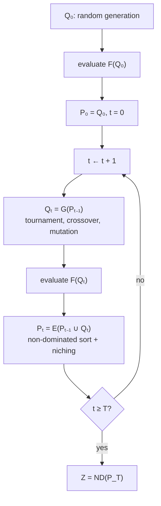

# Strategies

How each strategy works. The service around them (startup, configuration,
extension points) is in [mo-engine/README.md](../../README.md), and the problem
operators in [lib/problem/README.md](../problem/README.md).

## NSGA-III

The notation is the one used by the API's `population` option and by the
[regression baseline](../../tests/regression/README.md): $P_t$ is the surviving
population and $Q_t$ the individuals evaluated in generation $t$.



Let us define the following elements:

- $N \in \mathbb{Z}_+$ denotes the population size.
- $X$ denotes the configuration (decision) space of the problem.
- $Y$ denotes the objective space, in minimization form (maximized objectives are sign-flipped).
- $\Theta$ is the parameter space associated with the genetic operators.
- $f : X \rightarrow Y$ is the evaluation map. For a simulated problem it runs one simulation per seed and collapses each objective with its seed aggregator $\Psi_a$.
- $t \in \mathbb{Z}_+$ denotes the generation index, and $T \in \mathbb{Z}_+$ is `number_of_generations`.
- The genetic operator is defined as

  $$
  \mathcal{G} : \Theta \times X^N \times Y^N \rightarrow X^N,
  $$

  and, for a fixed parameter vector $\theta \in \Theta$, the offspring of generation $t$ are

  $$
  Q_t = \mathcal{G}_\theta\big(P_{t-1}, f(P_{t-1})\big).
  $$

  Parents are drawn by binary tournament on non-domination rank, with random ties. When every parent is infeasible, all get the same rank. Repeated children are discarded, so $Q_t$ can hold fewer than $N$ individuals after $10N$ attempts.
- The intermediate population is the union, with repetitions, of the previous survivors and the new offspring:

  $$
  R_t = P_{t-1} \cup Q_t .
  $$

- The environmental selection $\mathcal{E}$ keeps $N$ individuals of $R_t$:

  $$
  P_t = \mathcal{E}\big(R_t, f(R_t)\big).
  $$

  It takes whole fronts while they fit and completes the last one by niching over reference directions (Das & Dennis, `divisions`), normalized by extreme points and intercepts.
- The final result is the non-dominated set of the **selected final population**, not of every evaluated solution:

  $$
  Z = \mathrm{ND}(P_T).
  $$

Generation 0 is evaluated too, so a run evaluates at most $N(T+1)$ distinct
individuals. Each generation document stores $Q_t$ as its individuals and
$P_t$ as `survivors`.

This formulation explicitly separates evaluation, selection, variation, and
Pareto extraction.

> Mating differs from Deb & Jain (2014), who pick parents at random: SimLab
> uses a tournament on rank. State it when reporting results.

## NSGA-II

The same loop, with two differences: the last front is completed by descending
**crowding distance**, and the mating tournament breaks rank ties by crowding
distance.

## Random search

Each generation is a new draw of `population_size` individuals from the
problem's random generator. There is no selection, crossover or mutation. For
P1–P4 that generator is constructive: P1 and P2 repair what they draw, P3
redraws until feasible and P4 walks the mobility graph. The baseline therefore
samples that space and **not** the decision space uniformly. For P0 the draw is
uniform over $[0,1]^n$.

The genome cache, constraint penalties and replica policy work as in NSGA-III.
Two things differ when reading its results:

- The stored front is the non-dominated set of **everything evaluated**, while
  NSGA stores $\mathrm{ND}(P_T)$. Comparing the two stored fronts favours
  random search.
- No survivors are recorded, so `GET /experiments/{id}/hv-gd` measures its
  offspring and says so in `population_sources`.

**Resume.** After an engine restart the run continues as it would have:

- each generation records `rng_state` (the stream after its draw), and each
  individual its `index` in the population;
- the archive behind the final front is rebuilt from all the generations;
- in the last generation, what was decided at enqueue (reused, analytical,
  infeasible) is read back with its evidence, and what rests on simulations is
  derived from them again;
- a generation cut while being enqueued is finished, as for every strategy
  ([mo-engine](../../README.md#startup));
- a checkpoint without `rng_state` (written before 2026-11-22) has its earlier
  draws repeated to position the stream, with a warning in the log.

## Batch

The `batch` strategy runs a fixed list of pre-defined chromosomes as a single
generation. It performs **no** reproduction, selection or variation: the input
chromosomes are inserted as individuals of generation 0 and their simulations
are queued immediately (constraint violators are penalised instead). When every
simulation reaches a terminal state, and the replica gate lets it proceed, the
strategy consolidates per-individual objectives, computes the (non-dominated)
Pareto front over the batch and finalises the experiment.

Input shape (subset relevant to this strategy):

```jsonc
{
  "parameters": {
    "strategy": "batch",
    "random_seed": 42,          // only draws seeds when random_seeds is absent
    "problem":   { "name": "problem2", ... },
    "simulation":{ "duration": 180, "random_seeds": [336157, 35239] },   // duration in minutes
    "objectives":[ { "metric_name": "latency", "goal": "min" }, ... ],
    "chromosomes": [
      { "mac_protocol": 0, "mask": [1,0,1,...] },
      { "mac_protocol": 1, "mask": [0,1,1,...] }
    ]
  }
}
```

`algorithm` is not needed and not read.

`POST /experiments/` takes this shape and refuses, with a 422 naming the field,
chromosomes that do not fit the problem or its sources (`pylib/batch_input.py`):

| Problem | A chromosome |
|---|---|
| `problem0` | `x`: `n` numbers in [0, 1] |
| `problem1` | `mac_protocol`, `relays`: `number_of_relays` positions `{"x": .., "y": ..}` |
| `problem2`, `problem3` | `mac_protocol`, `mask`: one integer 0 or 1 per candidate |
| `problem4` | `mac_protocol`, `route`: sojourn indices, `sojourn_times`: one non-negative number per stop |

`random_seed`, when sent, is a whole number from 0 to 2³¹−1. These are the forms
stored in `individuals.chromosome` and `pareto_front[].chromosome`, so either
can be sent back as it is. Feasibility is not checked there: the engine
penalises.

With a single source repository, the MAC gene of each input chromosome is
rewritten to the protocol that will run. With several, a non-synthetic batch
needs a source under `csma` for gene 0 and under `tsch` for gene 1. A batch that
is not synthetic needs at least one source.

Use cases: reproducible benchmarks, validating a specific Pareto set found by
another strategy, or executing a user-curated candidate list without any
evolutionary search.

> The GUI does not offer the strategy: create it through the API
> ([example](../../../debug/requests/post-batch-experiment-p2.json)).

> Note: `batch` is the only optimization strategy **without** the analytical
> fast-path described below. Synthetic batch experiments are evaluated by the
> master-node (`master-node/lib/synthetic_data.py`), not in-process.

## Scalability benchmark (`usl_benchmark.py`)

Not an optimisation: it measures the infrastructure. The same simulation — one
chromosome, one seed — runs in **waves** of `N` identical copies, one
generation per wave, for each level in `parameters.benchmark.levels`. The
timings are fitted to the Universal Scalability Law by `pylib/scalability.py`
and served by `GET /scalability/{id}`.

```jsonc
"parameters": {
  "strategy": "usl_benchmark",
  "benchmark": { "levels": [1, 2, 4, 8, 14], "repetitions": 3 },
  "simulation": { "duration": 60, "random_seeds": [123456] }   // duration in minutes
}
```

Created by `POST /scalability/`, not by the experiment wizard, and deliberately
absent from `Step2Experiment.vue`.

| Choice | Why |
|---|---|
| Identical work in every simulation | Different work would show up as different timing and be read as a property of the infrastructure |
| Repetitions alternate ascending/descending | A drift in the machines lands on every level instead of biasing one end |
| Each wave tagged `benchmark: {level, repetition, wave}` | The analysis reads what the engine ran instead of inferring it |
| Workload persisted after its firmware is resolved | Resolving can rewrite the MAC gene; resolving per simulation recorded one network and ran another |
| Each simulation carries `benchmark: true` | The master-node then never holds it for a faster worker |
| A wave counts only if its N ran at the same time | A wave that queued measured a lower concurrency. It is reported invalid, with the concurrency it reached |
| A wave with no result stops the benchmark | The workload does not run; more waves would only measure failures. A wave with *some* failures is reported invalid and the benchmark continues |

A benchmark has no GA settings: `build_adapter` still hands its RNG to the
adapter, which takes the defaults for the rest.

---

## Analytical fast-path (`analytical.py`)

For analytical problems (P0 synthetic benchmarks — DTLZ2/ZDT1/SCH1) the
objectives are a closed-form function of the decision vector, so the evaluation
map $f : X \rightarrow Y$ is computed **directly in the mo-engine process**
instead of being delegated to simulation:

- During `_generation_enqueue`, when `ProblemAdapter.is_analytical` is `True`,
  the strategy calls `analytical_objectives()` and inserts the `Individual`
  with its objectives already filled — **no `Simulation` document is created**
  and the master-node is never involved.
- The benchmark is evaluated once per simulation seed and each objective's
  per-seed values are collapsed with that objective's seed aggregator
  (`objectives[i].aggregator`, else `simulation.aggregator`, else mean), the
  same ones used for simulation-based problems.
- Observation noise is reproducible: the RNG is seeded per
  `(seed, genome_hash)` pair, so re-evaluations and genome-cache hits are
  always consistent.

Supported by `nsga2`, `nsga3`, `random_search` and, by inheritance, all
DEAP/pymoo variants. See
[docs/markdown/SYNTHETIC_MODE.md](../../../docs/markdown/SYNTHETIC_MODE.md)
for the complete guide to synthetic mode.

---

## Replica completeness (`completeness.py`)

SimLab evaluates an individual with several simulation seeds and aggregates
what comes back. The aggregation reads the simulations that reached `Done`,
which means a lost replica is invisible in the result: an individual evaluated
from one run and one evaluated from two produce the same shape of answer, and
the optimiser cannot tell them apart. It happened in a pilot — one simulation
of a two-seed individual was lost, and the objective published for it was a
single run's.

Three separate things fix that, and keeping them separate is the point.

### The record

`GenerationRepository.replica_completeness` compares what the generation
*planned* against what produced a result. The plan is `expected_seeds`, written
on the generation when it is created; the comparison is **by seed**, not by
document, because a repeated replica has two documents for one seed.

| State | Meaning |
|---|---|
| `complete` | every planned seed produced a result, carrying every metric |
| `partial` | some did not, or one came back without a metric, and nothing is still running |
| `pending` | replicas are still in flight — not a verdict |
| `invalid` | nothing finished; there is no mean to take |
| `unknown` | the generation never recorded its plan (experiments created before this existed) |

`absent` is kept apart from `pending`: a planned seed with no simulation at all
will not arrive and has nothing to repeat, whereas one with an unfinished
simulation is merely slow. Collapsing them made a generation whose second
replica was never created look like one that was waiting.

The record also **names its own hole**, because a state alone cannot be read:

| Field | Meaning |
|---|---|
| `failed_seeds` | ran and ended without a result — there is a document to clone, so a repeat can repair it |
| `absent_seeds` | planned and never created — nothing to clone |
| `thin_metrics` | metrics that fewer replicas than planned carry with a finite value. A NaN or infinity counts as absent |
| `reason` | one phrase for the state, naming which of the above it is |

The distinction is the one the policy acts on. A `partial` evaluation with
`failed_seeds` is waiting for a repeat; one whose holes are only `absent_seeds`
or `thin_metrics` has already been decided, because neither can be repeated and
both reach `on_exhausted` on the first pass without consuming a round. That was
always the behaviour; what was missing is that nothing said so. An evaluation
could read `partial` with `missing_seeds: []`, `failed_seeds: []` and 2 of 2
replicas — every planned seed finished, and one came back without a metric —
and the document gave no clue.

`completeness.unrepairable()` returns exactly those individuals and why, and
the gate logs it once per generation with the destination the policy gives
them. `pending` is deliberately excluded: it is not an outcome yet.

A generation's own **status** uses the same unit. `close_if_finished` counts
seeds, not documents, so a generation whose failed replica was repeated closes
`Done` rather than `Error` — the failed document is still there by design, and
counting documents made a repaired generation indistinguishable from a broken
one. Generations with no recorded plan keep the old document rule.

### The policy

Read from the experiment's `simulation` configuration, because "use a mean over
whichever replicas happened to finish" is a decision about the experiment and
it used to be made in silence.

| Key | Default | Values |
|---|---|---|
| `replica_policy` | `repeat` | `repeat` — run the failed replicas again; `none` — do not |
| `max_replica_retries` | `1` | how many rounds of repetition one generation may take. Enforced by the write that claims a round, not by a number read beforehand |
| `incomplete_objective` | `worst` | on exhaustion: `worst` refuses the individual, `accept` uses the partial mean with the completeness recorded next to it |

```json
"simulation": {
  "random_seeds": [123456, 5343],
  "replica_policy": "repeat",
  "max_replica_retries": 1,
  "incomplete_objective": "worst"
}
```

**The default changes results.** An individual that is still incomplete after
its repeat is given the worst objective in every dimension — the same thing
that already happened to an individual with no metrics at all. The reasoning is
that an under-replicated individual should not compete on equal terms with a
fully evaluated one. `incomplete_objective: accept` restores the previous
numbers, and records the difference rather than hiding it.

An evaluation in `unknown` is **used**: the generation never recorded its plan,
so incompleteness cannot be demonstrated, and refusing individuals on a
suspicion would silently invalidate every experiment created before this
existed.

A vector that cannot be built although the replicas are there (a metric
missing from the aggregate, or not finite) is refused too, under either
setting: the record gets `refused` and `objective_used: false`. At the end of
the experiment `pareto_front_validity` counts how many items of the front are
valid, infeasible or refused, and the system message says when none is valid.

### The repair

`ReplicaGate` sits between a closed generation and the objectives drawn from
it. An unfinished `retry_plan` is completed first. Otherwise, in order:

1. Anything still running? Then this is a redelivered event, or one that
   arrived for a generation since reopened — wait.
2. Compute the completeness and log it.
3. Any *failed* seed, with retries left? Clone those simulations (a new
   document, same seed, same individual, so the failure stays on the record)
   and reopen the generation. Evolution waits for it to close again.
4. Otherwise apply the policy, persist the completeness **with** the
   objectives in one write, and evolve.

The order of those four steps is load-bearing in two places:

* **The round is claimed before any clone exists**, with the limit in the
  condition of the write. It used to be counted *after* the clones, and a
  failure of that write left clones that would run and a count that had not
  moved — so the next evaluation created another round. Measured with
  `max_replica_retries: 1`: two effective repetitions. The same atomic write
  now stores `retry_plan`, the source simulations and reasons for the round.
  The gate resumes this plan before checking active clones or budget, including
  after a process dies before the first insert or part-way through the enqueue.
  An empty plan never claims a round; database errors remain retryable instead
  of being interpreted as missing work. Clone creation is an atomic upsert
  protected by a unique index, preserving completed clones on replay.
* **The clones are queued before the generation reopens.** In the other order
  a worker can finish a clone before the reopen lands, closing the generation
  again and leaving the reopen to put a finished generation back into
  `Running` with nothing to close it. Finishing the manifest atomically reopens
  the generation and immediately reconciles its status. The master-node's
  periodic pass also covers a crash between those operations. All strategies
  replay both `Done` and `Error` generations on engine restart, so the normal
  replica policy can finish a retry interrupted by that restart.

### Reuse keeps its evidence

A genome that reappears in a later generation has no simulations *there*, so
nothing computes a completeness for it. The cache therefore stores the record
next to the objectives, and the reused individual carries it marked
`reused: true` with its original decision intact.

Without that, the individual was written with no record at all — which reads
as `unknown` and `objective_used: true`, even when the original evaluation was
a partial mean the policy had **refused**. Measured in a 344-simulation pilot:
38 of 210 individuals reported `unknown` purely through reuse, each having
lost a record that said *complete, 2 of 2*.

Two more states exist so that `unknown` keeps meaning one thing — *the plan
was not recorded*: `analytical` for a problem evaluated in process, and
`infeasible` for an individual rejected by a constraint. Neither had replicas
to count.

A refused evaluation is cached like any other: if its genome reappears in the
same experiment, the refusal is reused and the genome is not simulated again.

Composed rather than inherited: the gate needs the repositories, the metric
names and the policy, and nothing else about the strategy — so NSGA-II,
NSGA-III, batch and random search each pass what it needs instead of sharing a
base class that reaches into their internals.

### What has been demonstrated

Repeating a replica reopens a terminal generation, which touches the
optimisation loop. The cycle is covered by tests that drive the real
`_handle_generation_done` and the real gate, and it has run with Cooja: a JVM
killed mid-run was repeated with the same seed and the generation closed
`Done`. The interruption of the gate itself is exercised against a real MongoDB
by [debug/validation/retry_restart.py](../../../debug/validation/README.md).
